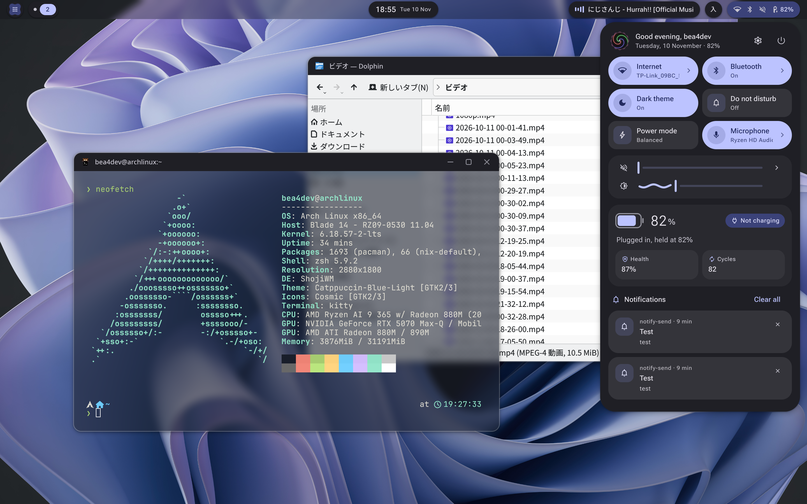
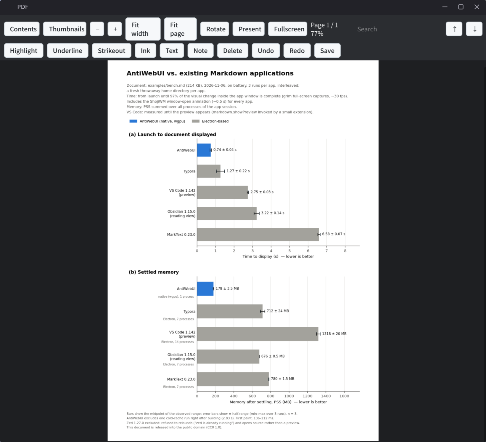
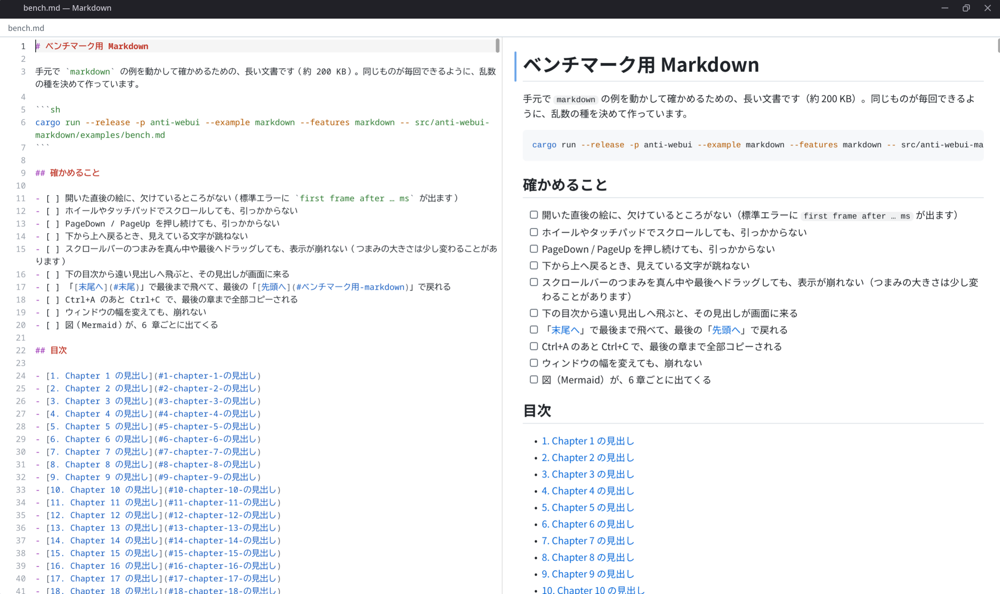
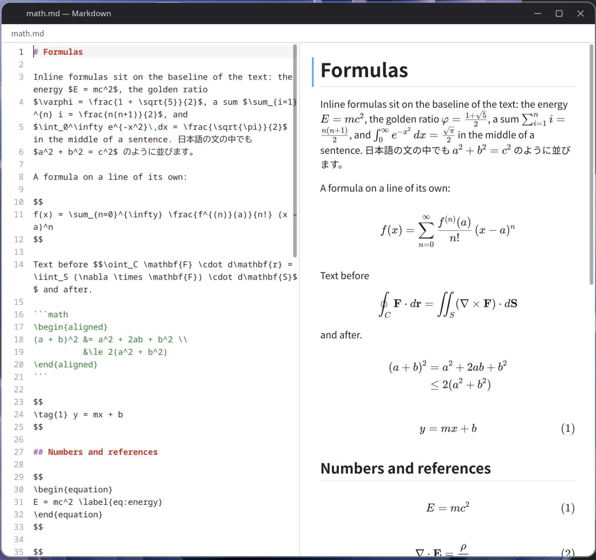

# AntiWebUI

A lightweight framework for building UIs in **Rust with its own wgpu renderer**, no WebView required.

- **Fractional scaling done right from the start**: styles are written in logical pixels and layout happens in integer physical pixels. Borders stay crisp at 125% or 180%, and elements with the same style have the same size wherever they are placed.
- **Browser-grade text selection**: drag selection across multiple elements, double/triple click, copy, and the primary selection.
- **IME support**: Wayland text-input-v3, XIM on X11, `NSTextInputClient` on macOS, and IMM32 on Windows. Preedit text is shown inline.
- **SolidJS-like**: builders such as `div().flex().gap(8.0)` and fine-grained updates driven by `signal()`.

## showcase

 - Wayland shell ([shoji-bar-4](https://github.com/bea4dev/shoji-bar-4))


 - PDF viewer (`cargo run --example pdf --features=pdf -- filepath`)


 - Markdown editor (`cargo run --example markdown_editor --features=markdown -- filepath --split`)


 - Latex support (included in Markdown)


## Example

```rust
use anti_webui::prelude::*;

fn main() {
    App::new().title("Counter").run(|| {
        let count = signal(0);
        div()
            .flex().flex_col().gap(8.0).p(16.0)
            .child(text(move || format!("Count: {}", count.get())))
            .child(button("+1").on_click(move |_| count.update(|c| *c += 1)))
    }).unwrap();
}
```

```sh
cargo run -p anti-webui --example showcase
cargo run -p anti-webui --example widgets
# During development, dynamic linking speeds up builds, just like in Bevy
cargo run -p anti-webui --example showcase --features dynamic_linking
```


## Crates

| Crate | Role |
|---|---|
| `anti-webui` | Facade (`dynamic_linking` feature) |
| `anti-webui-core` | Reactivity, node tree, style resolution, layout, text, selection, editing, input handling |
| `anti-webui-style` | Style types and the `Styled` builder trait |
| `anti-webui-widgets` | Standard widgets such as buttons, inputs, menus, dialogs and tables, plus theming |
| `anti-webui-wgpu` | Renderer |
| `anti-webui-video` | Video decoding and audio. Uses FFmpeg loaded at runtime and contains no FFmpeg code (`video` feature) |
| `anti-webui-wayland` | Wayland backend |
| `anti-webui-x11` | X11 backend |
| `anti-webui-macos` | macOS backend (AppKit) |
| `anti-webui-windows` | Windows backend (Win32) |
| `anti-webui-app` | Wires the above together; offscreen rendering |


## License

Licensed under either the MIT License or the Apache License 2.0, at your option ([LICENSE-MIT](LICENSE-MIT), [LICENSE-APACHE](LICENSE-APACHE)). Authored by bea4dev.

`anti-webui-symbols-outlined` is Apache License 2.0 only, to match the font it bundles. Video only loads FFmpeg at runtime and contains no FFmpeg code ([24-video](docs/design/24-video.md)).
