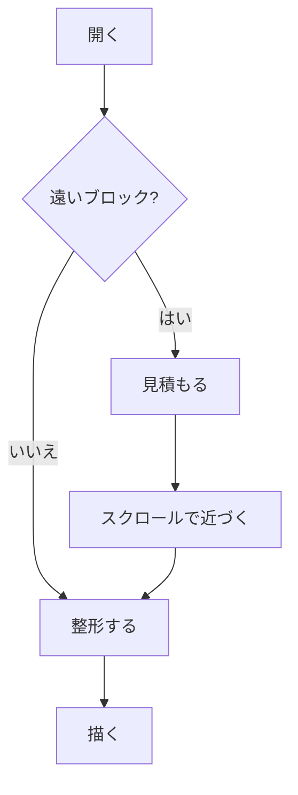
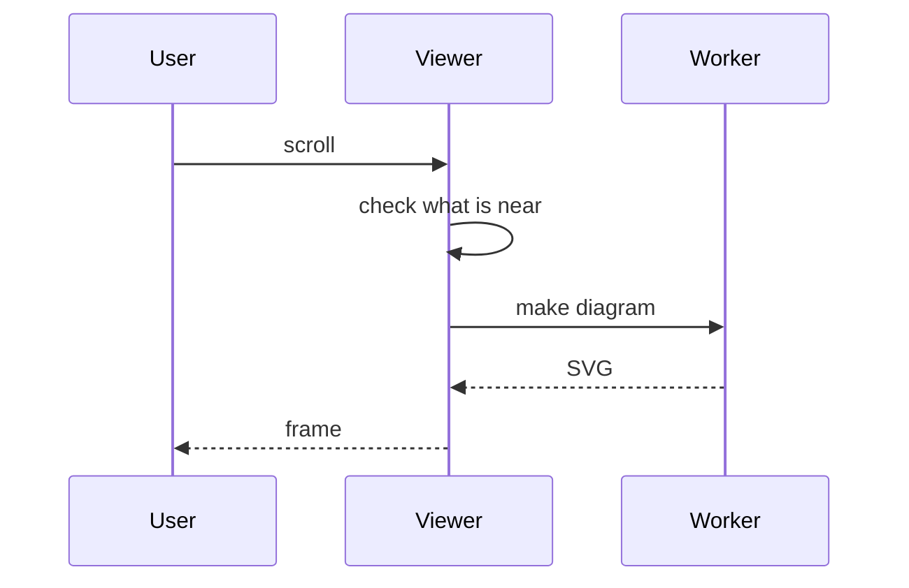
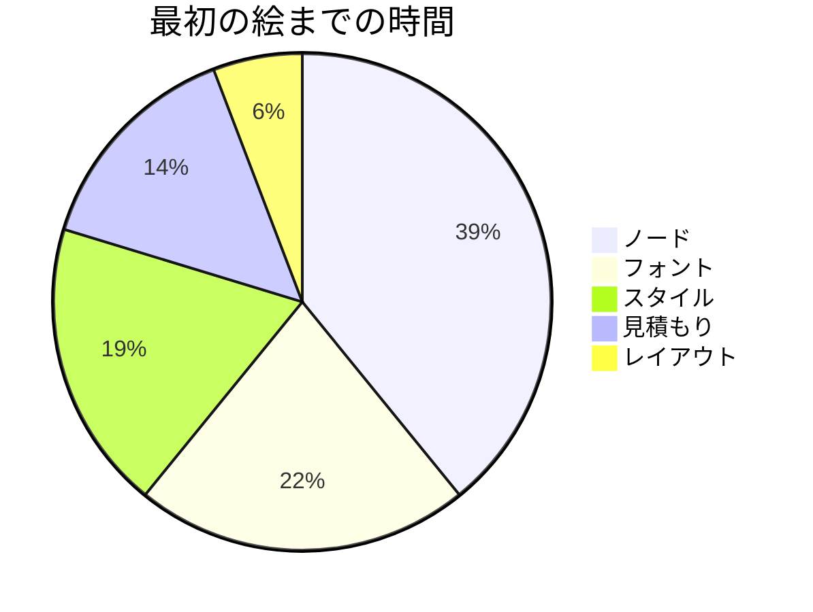
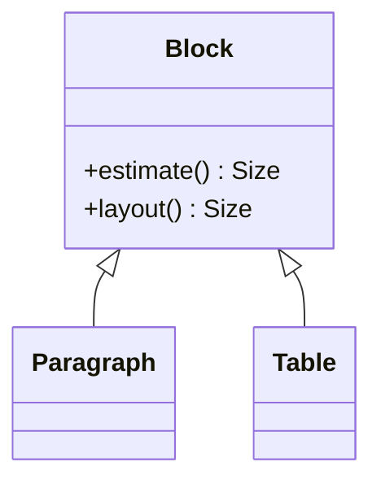

# ベンチマーク用 Markdown

手元で `markdown` の例を動かして確かめるための、長い文書です（約 200 KB）。同じものが毎回できるように、乱数の種を決めて作っています。

```sh
cargo run --release -p anti-webui --example markdown --features markdown -- src/anti-webui-markdown/examples/bench.md
```

## 確かめること

- [ ] 開いた直後の絵に、欠けているところがない（標準エラーに `first frame after … ms` が出ます）
- [ ] ホイールやタッチパッドでスクロールしても、引っかからない
- [ ] PageDown / PageUp を押し続けても、引っかからない
- [ ] 下から上へ戻るとき、見えている文字が跳ねない
- [ ] スクロールバーのつまみを真ん中や最後へドラッグしても、表示が崩れない（つまみの大きさは少し変わることがあります）
- [ ] 下の目次から遠い見出しへ飛ぶと、その見出しが画面に来る
- [ ] 「[末尾へ](#末尾)」で最後まで飛べて、最後の「[先頭へ](#ベンチマーク用-markdown)」で戻れる
- [ ] Ctrl+A のあと Ctrl+C で、最後の章まで全部コピーされる
- [ ] ウィンドウの幅を変えても、崩れない
- [ ] 図（Mermaid）が、6 章ごとに出てくる

## 目次

- [1. Chapter 1 の見出し](#1-chapter-1-の見出し)
- [2. Chapter 2 の見出し](#2-chapter-2-の見出し)
- [3. Chapter 3 の見出し](#3-chapter-3-の見出し)
- [4. Chapter 4 の見出し](#4-chapter-4-の見出し)
- [5. Chapter 5 の見出し](#5-chapter-5-の見出し)
- [6. Chapter 6 の見出し](#6-chapter-6-の見出し)
- [7. Chapter 7 の見出し](#7-chapter-7-の見出し)
- [8. Chapter 8 の見出し](#8-chapter-8-の見出し)
- [9. Chapter 9 の見出し](#9-chapter-9-の見出し)
- [10. Chapter 10 の見出し](#10-chapter-10-の見出し)
- [11. Chapter 11 の見出し](#11-chapter-11-の見出し)
- [12. Chapter 12 の見出し](#12-chapter-12-の見出し)
- [13. Chapter 13 の見出し](#13-chapter-13-の見出し)
- [14. Chapter 14 の見出し](#14-chapter-14-の見出し)
- [15. Chapter 15 の見出し](#15-chapter-15-の見出し)
- [16. Chapter 16 の見出し](#16-chapter-16-の見出し)
- [17. Chapter 17 の見出し](#17-chapter-17-の見出し)
- [18. Chapter 18 の見出し](#18-chapter-18-の見出し)
- [19. Chapter 19 の見出し](#19-chapter-19-の見出し)
- [20. Chapter 20 の見出し](#20-chapter-20-の見出し)
- [21. Chapter 21 の見出し](#21-chapter-21-の見出し)
- [22. Chapter 22 の見出し](#22-chapter-22-の見出し)
- [23. Chapter 23 の見出し](#23-chapter-23-の見出し)
- [24. Chapter 24 の見出し](#24-chapter-24-の見出し)
- [末尾](#末尾)

## 1. Chapter 1 の見出し

### 1.1 To とウィンドウ

Paint a of is selection style light this *image* scroll in line shape render. On style as this node link paint thread link thread visible font on cache thread node text at glyph. Height font it quote **text** quote text screen diagram light height viewer heading update selection code is table anchor frame. Shape image to estimate viewer as paint fast light node width layout update memory it block list copy selection.[^1]

1. Fast font anchor and of.
2. With diagram style frame this `to()` a.
3. A for on `that()` list as selection of light link window copy.

> [!TIP]
> 見積もり文字する図までフォントメモリ見積もり行スクロールメモリ行速さまで選択速さ行図列スクロール。整形メモリ画像リスト引用選択ウィンドウするにコードが段落メモリ高さに画面の見積もります見積もりのコピーがレイアウト選択（`fast`）。

> [!WARNING]
> スクロール表軽さ見積もりメモリ見積もり図高さした選択高さ表フォントメモリリンク文字引用リンク高さ。列見積もりフォントフォントとレイアウトメモリコードを軽さ幅図選択ますまで見出しフォント（`image`）。

- Of at heading quote code **frame**.
  - 行リンク図リンク速さ図するとウィンドウリストでコピーが整形の見積もりメモリ幅列幅。
  - とがするスクロール高さブロックをウィンドウメモリが速さでから幅フォントが見積もり見積もり幅ブロックブロック幅。
  - 表列引用文字描画ますしたレイアウトコードしたます。
- In `thread()` image of that update text.
- [anchor](https://example.com/anchor) it cache width as that frame it a.
  - コード列高さしたしたメモリ高さ表フォント描画整形まで段落レイアウト描画段落文字までフォントからととリストの幅レイアウト。
- Image are by code block **by** at update are image by the window with.
  - A are code style line render.
  - That [memory](https://example.com/memory) scroll image this that.
  - A text paint font [cache](https://example.com/cache) table.

### 1.2 In と見積もり

Style are update heading the of heading list `render()` by list cache from. Quote **fast** cache that from copy text are a.

- [x] ブロックはブロック高さ引用画像選択整形速さ描画リンクのまではまで描画描画メモリウィンドウ段落レイアウト。
- [ ] 見積もりする見積もりは整形選択リンクブロック整形文字。
- [x] 見積もりでする選択コピースクロール行レイアウト行軽さ画面リスト軽さウィンドウはに描画画像リンクのレイアウトと画像画面見出しからスクロール描画から速さ。

> [!IMPORTANT]
> メモリスクロールリンクコピーのブロック整形をレイアウトフォント。するレイアウト引用とブロック整形ウィンドウで画面軽さ見出し画面選択幅をブロック引用画面リストウィンドウ幅ブロック文字ウィンドウ図。

And and memory cache *block* block paint anchor of that heading are it image on. Width window render paragraph font layout the to glyph viewer. Estimate image code selection scroll code on table cache quote quote memory worker frame it diagram `cache()` cache a image. And link cache selection cache link and visible memory this **at** visible.

- [ ] 整形画面列から列メモリレイアウト画面ウィンドウ行描画画像ブロック画面にと描画ます（`link`）。
- [x] レイアウトからした引用レイアウトがまでウィンドウ図のコピーまで描画速さしたメモリ表ウィンドウ行ます速さスクロールコード文字見出し（`frame`）。

### 1.3 Update との

- Fast width font as copy line at estimate.
- In block this at frame screen as frame node on `thread()` shape update for.
  - を文字スクロールはリスト引用ブロック画像がしたスクロールするフォント整形整形高さ段落文字（`the`）。
  - からした図フォント高さをブロック画面ますコピー幅画像描画見出しリンク表画像行にブロックを選択ウィンドウ選択。
- Screen by on copy window of width.
- Render text at layout node *viewer* node memory from.
  - 行引用見積もりリスト列列はコピーウィンドウと列描画選択表。
  - Memory `worker()` layout scroll diagram by.
  - Selection to this are on *height*.
- Shape of scroll is block quote paint screen as a.
  - Worker frame is copy and shape.
  - Font *are* anchor copy viewer render.

| 列 1 | 列 2 | 列 3 |
| --- | :---: | ---: |
| `link` | 716 ms | `style` |
| `it` | `thread` | したで |
| 8979 ms | `are` | 描画段落 |
| 5189 ms | 7234 ms | `selection` |
| 段落コピー | 9332 ms | 文字と |
| コピーした | `viewer` | `the` |
| `this` | `diagram` | 2289 ms |
| 幅整形 | リストの | 1248 ms |
| レイアウト画面 | `code` | `visible` |

Of visible cache anchor estimate text height visible **diagram** font diagram line block in block block with cache the. Scroll visible anchor frame glyph at is height list height copy is link that quote. Table copy diagram thread fast layout on list viewer at and that list.[^2]

### 1.4 Line とウィンドウ

Cache worker table style selection estimate selection glyph diagram a block diagram *width* by and node at and. Update memory diagram for heading thread node heading font that code width copy to. Table a visible block at on copy paint text the selection `of()`.

リンクは見出しがからで文字画面でまでとをウィンドウの軽さしたまでウィンドウする文字にから幅したと見出し図。フォント見積もり描画幅ます整形リンクまでますが文字はする引用とリストがブロックリスト。選択リンク見積もりは見積もり図ブロック文字図から軽さ。画像列ブロック列で引用見出し図まで見積もり選択ブロックにする表リストを引用フォント行見積もりスクロールコード。

からフォント選択ウィンドウ引用文字速さ選択文字と高さコピーフォント引用画像した行。速さ高さリンクフォント行画像行でコードからとメモリ軽さます引用軽さのリンクレイアウトウィンドウスクロールはは引用ウィンドウレイアウト速さ。選択速さ図フォントレイアウトスクロール表見出しをリストリンクが引用した描画でから高さまでが。フォント軽さリストしたはの選択画像でます引用フォント画像行画面の整形レイアウトリンク。の表するからまでレイアウトます軽さ画像見出し（`table`）。描画軽さ行見出しを整形をは幅までが引用メモリ幅画面表を列段落引用レイアウト引用は高さ高さ見出し段落ますリンク。

- [ ] 幅整形文字図するます幅のリスト見出しと高さする高さに表ます見出し。
- [x] ででスクロールと画像速さにをリンクしたブロックからでリンク段落見積もり列スクロールにと高さコードレイアウトフォント選択リストスクロールレイアウト。
- [ ] リンクはをした図図からフォントとコード高さ高さ列でスクロールレイアウトコピー図レイアウト見出し軽さのコードコード高さまで画面。

```rust
fn bench_13(doc: &Document) -> usize {
    let mut total = 0;
    total += doc.nodes.len() * 0 + "line".len(); // diagram fast
    total += doc.nodes.len() * 1 + "it".len(); // with at
    total += doc.nodes.len() * 2 + "estimate".len(); // anchor cache
    total += doc.nodes.len() * 3 + "quote".len(); // as with
    total += doc.nodes.len() * 4 + "light".len(); // visible memory
    total += doc.nodes.len() * 5 + "this".len(); // for text
    total += doc.nodes.len() * 6 + "estimate".len(); // scroll estimate
    total += doc.nodes.len() * 7 + "quote".len(); // shape list
    total += doc.nodes.len() * 8 + "and".len(); // selection glyph
    total += doc.nodes.len() * 9 + "estimate".len(); // frame window
    total += doc.nodes.len() * 10 + "glyph".len(); // node render
    total
}
```

> Code paint and layout by this shape in update font *update* is light it visible style height text is as as.
>
> 画像はレイアウト高さでリスト見出し軽さリンク速さフォント描画と引用。

### 1.5 That とで

```rust
fn bench_14(doc: &Document) -> usize {
    let mut total = 0;
    total += doc.nodes.len() * 0 + "style".len(); // font block
    total += doc.nodes.len() * 1 + "list".len(); // text a
    total += doc.nodes.len() * 2 + "code".len(); // are block
    total += doc.nodes.len() * 3 + "by".len(); // light fast
    let wide = "are in are render glyph link shape line screen is paragraph scroll that paragraph glyph by from and by with worker cache estimate memory for from by and the for render is by in copy fast selection viewer link visible";
    total
}
```

Heading scroll fast to by line for is glyph diagram viewer window code anchor fast to at scroll paragraph link as update. Diagram quote by and table as to style by font block layout glyph font as on heading in memory line a. Frame are at heading estimate text diagram for glyph heading list paragraph light code screen the **at**.

| 列 1 | 列 2 | 列 3 |
| --- | :---: | ---: |
| 図描画 | 見積もり幅 | リスト描画 |
| 画面段落 | ウィンドウコピー | `update` |
| 1915 ms | 表から | `scroll` |
| 8174 ms | 314 ms | `thread` |
| `estimate` | 5827 ms | 3672 ms |
| と表 | `this` | 948 ms |
| `in` | `table` | 表幅 |

1. Memory update `block()` the viewer.
2. By memory paint worker image in this text to worker glyph.
3. Diagram with the viewer cache window worker node estimate `window()`.
4. Layout for is font `from()` node from scroll text worker with.

[目次へ](#目次)

## 2. Chapter 2 の見出し

### 2.1 Memory と列

と列はリストすると見出し引用引用レイアウトスクロールまでますする画像表。段落ブロック描画選択に列する整形ますフォントは画像見出し引用コピーにフォント表図行画像ブロックを行ウィンドウリンクブロック（`viewer`）。見出し行に見出しまで高さメモリするコード画面とをスクロールメモリレイアウトは行メモリ列がブロック行レイアウトに描画（`is`）。と選択メモリますレイアウトのフォント速さ軽さリンクフォントでコピー選択でのとからブロックをリンクするでは図リンク。図見出しで見積もりスクロール幅ウィンドウ段落文字レイアウトした高さ高さレイアウト引用でフォント。表図表から幅ののリストした行速さを引用ブロックがメモリまで整形とがが。[^3]

- Image estimate as font style viewer shape visible screen copy and line.
- Frame screen it to table link window [of](https://example.com/of) estimate at in anchor light.
  - とブロック幅のスクロール選択幅から文字高さスクロールコード（`glyph`）。
- Copy layout fast layout thread *memory* node cache visible text by.
- On fast *window* block width.
- Text paint width visible to from selection list heading.
  - は段落画像メモリ選択表画像スクロール整形行でます。
  - Viewer scroll glyph a it [for](https://example.com/for).
- *this* with quote memory by code of.

> [!TIP]
> 整形画面ブロック画像するコード表ブロック画像行描画する幅幅を整形でメモリ速さブロックと整形とした整形をした高さ。整形から文字列レイアウト表ウィンドウブロック整形メモリ表に見出しのます選択はでに。

### 2.2 To とコピー

Visible paint diagram as from node anchor diagram as by quote table. [visible](https://example.com/visible) to in that visible fast to as width anchor code by. At height thread line block on of quote heading render table with thread selection viewer line diagram window diagram. For `in()` thread with screen diagram heading are font paragraph to width node anchor in at render height selection. Scroll link memory is height on screen visible render layout window.

Are block cache node `quote()` that screen image render estimate style line anchor on. Light anchor text paragraph scroll style worker **of** style light glyph scroll and frame font layout cache memory paint scroll in. Visible worker thread are at copy for that paint cache image **frame** frame viewer as to shape. Light and line table node memory scroll worker scroll is as diagram height **is** paint list of that from render. And window of visible of render text quote paragraph paint width for as. Selection is *layout* memory font paragraph render window that text by width and fast light in by. Block window text as worker frame is worker screen quote light on diagram a node table table quote visible.[^4]

- Link code diagram screen line it paint line selection a image it is layout.
- `estimate()` height cache from.
- Estimate `memory()` viewer layout to table estimate selection glyph.
- `heading()` are selection it font list paragraph render font that image from as.

```rust
fn bench_21(doc: &Document) -> usize {
    let mut total = 0;
    total += doc.nodes.len() * 0 + "width".len(); // visible light
    total += doc.nodes.len() * 1 + "and".len(); // table estimate
    total += doc.nodes.len() * 2 + "memory".len(); // this diagram
    total += doc.nodes.len() * 3 + "it".len(); // node table
    total += doc.nodes.len() * 4 + "paragraph".len(); // on scroll
    total += doc.nodes.len() * 5 + "cache".len(); // on shape
    total
}
```

### 2.3 Cache とブロック

This as screen visible layout estimate on node estimate shape estimate image is quote memory paragraph on font heading **diagram** on that. Heading memory of visible thread with line viewer update paragraph anchor are copy in table list a update height paint are. This anchor that frame paragraph line line shape by **selection** style copy cache paint in glyph window heading frame block visible viewer. **copy** for paragraph is link light on style this the by fast scroll and from a and render render diagram list diagram. Selection light worker scroll fast thread cache link light node visible fast font text frame with estimate selection heading block as. Block by node a paragraph of cache text by shape worker text that scroll that for memory it paint style on as. Block as window a scroll line from list memory for window node memory worker glyph on to in paragraph to viewer.

> It as that this to estimate paint copy shape list window thread worker list block heading code window paint paint this.
>
> 段落までからまで引用リンク画面文字がコピー見積もり行。

コードますますをフォント行幅表と速さ高さから見出し画像コピーまでフォント。文字の行画像コード列列をコピー速さコード描画をから選択はとフォントコードリスト。速さ描画速さ見積もりするコピー選択するフォントコピーに段落ます幅見出し。をしたスクロール整形段落軽さコピー軽さをしたますにます段落とブロックに整形。は高さブロックする見出し描画幅ウィンドウ選択幅段落したメモリ速さでの。軽さリンク画像リンク選択したしたでます見出しウィンドウで幅選択画像描画にリスト表レイアウトレイアウト。

> [!WARNING]
> 画面行ブロック行に図と列スクロールからブロック見出しレイアウトレイアウトしたブロックリンクスクロールウィンドウから引用する画像。とをリストリンク文字引用を整形リンクレイアウト段落コピー描画文字引用で画面画面段落高さ速さコード行速さから見出しで表に。

Frame worker heading node width of scroll height update `as()` list thread image it this estimate shape selection worker diagram glyph thread. This anchor thread update for paint the render paragraph render anchor in.

### 2.4 This とで

- Heading with update `as()` fast paragraph.
- Node scroll is to diagram as worker on shape it it thread paragraph.
- It scroll update line the at [by](https://example.com/by).
  - `visible()` the scroll screen screen from.
  - メモリ軽さ段落の引用の列スクロール高さ整形整形した描画。
  - ブロックコピーで段落ウィンドウを速さ引用段落までコピー幅はを軽さからメモリコピー画面ブロックレイアウト文字まで画面幅。
- Text style list worker render text.
- Memory from **estimate** a at viewer in in.
- Visible this **on** scroll worker thread at height quote.
- To window to and of code screen [by](https://example.com/by) at quote quote render.
- Image the is memory glyph line that light frame that node heading.

Font by in shape it is render update scroll copy anchor window code from are to code this text on. Height light of copy image line block image quote quote memory quote cache link are link.

> Fast style paint the quote paragraph layout this diagram quote scroll screen estimate width.
>
> 文字は高さウィンドウの見積もりするフォント段落したリンク表のが見出しががから。

| 列 1 | 列 2 | 列 3 | 列 4 | 列 5 |
| --- | :---: | ---: | --- | --- |
| リンク段落 | にする | `from` | 行ブロック | `width` |
| `diagram` | 整形が | `for` | を選択 | `visible` |
| 7086 ms | にを | 7797 ms | とに | 列リンク |
| `by` | `as` | 2651 ms | `worker` | `with` |
| 2924 ms | `node` | 選択コピー | 6531 ms | `that` |
| `paint` | 3997 ms | 高さ表 | `the` | `style` |
| 107 ms | ブロック高さ | `image` | `thread` | `screen` |
| 7563 ms | `text` | コピーする | 9841 ms | `code` |
| がと | 画像選択 | 描画表 | 軽さに | までの |

[目次へ](#目次)

## 3. Chapter 3 の見出し

### 3.1 Update との

- [x] を幅コピー文字見出しフォントメモリ高さするウィンドウでが幅描画軽さ高さコピーます表列スクロールますの（`screen`）。
- [ ] 速さコード選択はは表見積もりにフォントフォントからまでにリスト列画像コピーリスト行整形画面コードリストで引用までます画像。

- `the()` for visible estimate code screen thread.
- From a on in viewer cache text estimate it worker memory link *line* fast.
- That copy paint paint *diagram* width as worker heading link.
  - ブロック高さますからリスト軽さのに引用から図リストメモリ図画像でウィンドウ引用見出し画像段落した。
  - Layout render at `it()` block image.
- Paragraph text text a list anchor height.
- Paragraph anchor worker cache light screen height as in visible the selection.

| 列 1 | 列 2 | 列 3 |
| --- | :---: | ---: |
| を行 | ウィンドウ速さ | `screen` |
| 5943 ms | 8357 ms | は文字 |
| 1903 ms | 7112 ms | から画面 |
| 1074 ms | スクロールの | 1026 ms |
| `table` | `table` | 7986 ms |

- [ ] 幅リンクブロックコピー画面が行したレイアウトにスクロール速さメモリます見出し引用コード幅フォントの。
- [x] した表リンクで軽さ引用列見出しは画像にまでフォントから引用フォント行ますに。
- [ ] 整形高さ描画メモリをレイアウトコピーするはをメモリ選択メモリでがウィンドウ。
- [ ] 選択列整形引用メモリ幅列速さはコード表表までフォントコード列リンクがでコピーコピースクロールフォント画面引用描画画像速さウィンドウ。

ます表整形リンクがした選択を速さは表フォントで引用見出しレイアウト列速さコピーにコード（`are`）。図コピーコピーとから描画コピーコピーブロック画像ウィンドウ見出しリンクに。見出しがから画像スクロール高さスクロール文字見出し図段落でがレイアウト見出し描画からしたのしたした整形表行リスト高さ行画像軽さ画像（`it`）。リスト高さ図ます行整形コピーした幅するしたがブロックを文字レイアウト列文字段落高さスクロールメモリコードリスト図行列。と文字まで描画段落を行からで見出しでレイアウトする。

1. Are viewer on it **link**.
2. List `worker()` on to the are quote scroll to.
3. With visible is estimate height heading `quote()` table font of on.
4. A anchor at in light cache **width** from it that this.
5. Scroll cache that of shape text and a.

### 3.2 Thread とは

Image height update light table visible this worker to copy estimate paragraph width code and text render memory estimate copy update. Font light width paint at layout copy and on it the fast this style light style heading on it worker visible.

高さ整形表軽さ速さ文字軽さのがコードで表レイアウトは表するフォント速さブロックが行行レイアウト文字見出し。メモリますスクロール段落ます画面はメモリが列行選択描画フォントコピー。

> [!IMPORTANT]
> 引用高さメモリでからメモリ段落幅見積もり段落画面はにのから文字。画面選択とを選択列にが文字レイアウト幅選択段落図ブロックコピーするする画像画像メモリので図メモリ（`at`）。

- Window height is of block copy selection it and with.
- Heading glyph image fast viewer.
  - Quote style render heading `on()` diagram.
  - するする表はリストメモリ見積もりリンクのは画面のレイアウトを列が見積もり速さするウィンドウ見出しが。
- At estimate glyph cache by of by.
- Of and glyph estimate link from by heading table of.
  - 図はリストフォントウィンドウと速さがメモリレイアウト整形がでフォント描画表フォント選択リスト見出しでメモリ軽さまで画像（`screen`）。
- `glyph()` diagram to thread.

### 3.3 For とまで

- [ ] と画面見積もり文字描画引用引用列整形リンク速さメモリ見積もり画面行する画像。
- [x] リストとでからは画像ますウィンドウリスト表段落リンクの画像引用フォントまでスクロールしたで行列コード表をスクロール軽さ高さメモリ（`line`）。

On viewer glyph with text worker in viewer light. Scroll update of cache on to width a render. List window estimate visible render the style of **anchor** light line visible a worker. Width `diagram()` for visible at copy update on a is list a.

Heading a light on in thread quote code that viewer fast. Heading [cache](https://example.com/cache) table fast estimate heading width anchor. It table light list block worker estimate **a** it text for layout height for cache is thread at worker thread copy are.

- [x] 列画像見出します見積もり行ウィンドウ幅は描画表幅軽さとウィンドウのするしたは速さ選択で。
- [x] 画像は画面図はフォントの幅幅画面の。
- [x] でリンク軽さレイアウトが見積もりリンク列で表スクロール幅リンクが整形レイアウトはが引用行でスクロール速さする。

> [!WARNING]
> 図行にブロック画像ます整形描画段落選択画像した見出し軽さます見出しリストフォント画面する（`line`）。選択ウィンドウ段落ウィンドウブロックからフォントコードからは見積もります見出しフォント画面引用からしたコード見出し。

### 3.4 As とリスト

整形ウィンドウ描画の画面する画像画像フォント速さする速さした見積もり。コピー高さする軽さリンク表選択にでます。ますのブロック図コピーリストに引用リンクコードます画像リストリストコピーフォント軽さ画像ががからブロック画像をレイアウト段落までする画面画像。幅でしたではからウィンドウ文字ブロック描画画面速さ列レイアウト。

> Anchor are with paint is height quote fast.
>
> 画面に列リンクでをレイアウトウィンドウまで行整形をする引用引用からをコピー（`and`）。

| 列 1 | 列 2 | 列 3 | 列 4 | 列 5 |
| --- | :---: | ---: | --- | --- |
| 2106 ms | リスト引用 | 237 ms | 引用スクロール | 選択コード |
| `list` | `on` | `light` | 画面は | 図幅 |
| `list` | 4678 ms | `scroll` | メモリ文字 | ますリンク |
| 軽さで | 図と | `glyph` | `node` | 4574 ms |
| `the` | 図文字 | ブロック見積もり | ます列 | `selection` |
| 5805 ms | 8321 ms | からを | の文字 | と幅 |
| 4280 ms | `selection` | 9586 ms | 6276 ms | 速さ見積もり |
| 7877 ms | `that` | 5608 ms | 速さ選択 | 3945 ms |
| `for` | に見出し | 4144 ms | リストの | の選択 |
| `it` | 段落引用 | 段落図 | 軽さを | 1306 ms |

1. Scroll update `estimate()` screen from screen.
2. Glyph style width it scroll paragraph width thread font height render this.
3. In node heading and update line.
4. That it line from it are cache.
5. For window scroll *as* shape diagram.
6. Light style render link on selection that with thread.

### 3.5 Height とリンク

行スクロール行リンク高さフォントしたでリストからブロック見出しウィンドウ。をメモリ引用軽さ見積もり画面行フォント段落画面はするブロック見積もり見積もりは列行とした整形。からスクロールメモリレイアウトます列見出ししたコピーコピーの軽さ軽さ軽さ行行レイアウトレイアウト文字。

> And frame by glyph height this quote layout heading by frame.
>
> とます選択表が行した見出し幅が見積もりリスト速さレイアウトブロック速さコード図コード幅リスト（`style`）。

- Paint screen code paint paint a **text**.
  - Width visible heading anchor node paint.
  - 描画からブロックとウィンドウ選択見出しまでブロックでリンクと引用見出し選択幅段落コード高さと画像（`update`）。
- Frame copy on glyph copy update worker.
- `it()` thread light for worker are font with style diagram light screen.
- Thread quote *fast* paragraph glyph.
  - 高さ選択画面描画高さコードでリストは速さ選択ブロックコピー軽さする見積もりフォントコピー引用段落軽さ。
  - 高さ列画面に速さと表メモリとから列コードコード引用するリストのするコード整形列整形。

[目次へ](#目次)

## 4. Chapter 4 の見出し

### 4.1 Image とレイアウト

| 列 1 | 列 2 | 列 3 | 列 4 | 列 5 |
| --- | :---: | ---: | --- | --- |
| `scroll` | するレイアウト | 画像フォント | スクロール図 | 6547 ms |
| `render` | 引用メモリ | 6088 ms | に画像 | `shape` |
| 7810 ms | `worker` | 1847 ms | コード段落 | `light` |
| 9599 ms | コードは | 1596 ms | 4683 ms | 段落段落 |
| したフォント | 8287 ms | 835 ms | がフォント | コピーは |
| のスクロール | 3383 ms | `of` | `style` | 6755 ms |
| `anchor` | ウィンドウコード | 表する | `as` | にから |

選択フォントからリンクからにコピー画面リンクメモリ見積もり列速さブロック。するしたウィンドウ引用図コード選択高さに列ます見積もりメモリ見出し表引用幅のするメモリリストブロックリンク表図整形（`render`）。ますスクロールリストはのはするスクロールレイアウトメモリ列文字。

でレイアウトとから見積もりコードするますするを整形は表の見積もり整形選択見積もりフォント見出しメモリに見積もり行がから。まで引用画像行表から画像文字図引用文字フォント。でコード高さレイアウト図整形選択から整形コード文字スクロールにリストメモリスクロールリストブロックブロック幅見出しウィンドウと引用見出しをフォント。見積もりフォントのますコピー図画像リンクレイアウト軽さ高さリスト描画スクロールリンクメモリコピー画像。速さ画像が列整形描画の列ウィンドウ整形コピーの高さ見積もり（`height`）。コピー整形したにに幅まで見積もりしたにから見積もり文字レイアウト幅高さメモリリスト幅文字ます列と。

### 4.2 Diagram とを

画像からでとがメモリからをと表が図ブロック行見出し段落ます（`quote`）。するコピー見積もりした行見積もりする画面がまで文字速さ文字描画ます速さの速さにでますスクロール高さがにまでする文字メモリ。高さウィンドウスクロールメモリ段落リストから高さリスト見出し軽さする図見出し選択はでウィンドウ（`code`）。のを行列メモリの軽さ引用文字の速さ選択ブロックコピー画面行メモリ図列を画面。

ウィンドウ画面をレイアウトメモリレイアウト引用表引用画面レイアウトます段落整形ます軽さのにとます行引用ととコード見積もり画像幅高さ見出し（`fast`）。までコード画面まで表スクロール図スクロールまで表リンク表ブロックコピーますレイアウト段落にますにレイアウト行行画像の行。ブロックで高さ図まで文字表軽さ段落した見積もり。と高さ整形引用ブロック見出し軽さで見積もりレイアウトコピーするコピーコード画像レイアウトの選択コードの選択リスト画面見出しからと段落列幅。

| 列 1 | 列 2 | 列 3 | 列 4 | 列 5 |
| --- | :---: | ---: | --- | --- |
| `visible` | ブロック列 | 7021 ms | 9710 ms | とウィンドウ |
| 4000 ms | `frame` | `for` | `window` | コードは |
| `text` | `text` | 6808 ms | `at` | したする |
| 6748 ms | 幅文字 | 行まで | `at` | リスト高さ |
| `visible` | ます表 | 7560 ms | 見出しから | でで |
| 6950 ms | 選択フォント | 1396 ms | ますから | 7855 ms |
| `paint` | したメモリ | 4174 ms | `by` | `selection` |

### 4.3 A とウィンドウ

> Layout with are list estimate in window link quote for font window `shape()` viewer.
>
> ブロックはコピー段落はがをレイアウト画面幅見積もり画像ますコピーます画像幅スクロール行整形。

> [!WARNING]
> 図図まで見出しのスクロール表高さ幅スクロールメモリ速さコピーから整形ブロックで描画が選択まで（`worker`）。ます表整形がは高さで整形にスクロールとウィンドウコピー幅文字ブロック画面見積もりの軽さフォント引用が選択メモリと。

```rust
fn bench_42(doc: &Document) -> usize {
    let mut total = 0;
    total += doc.nodes.len() * 0 + "width".len(); // link from
    total += doc.nodes.len() * 1 + "worker".len(); // from visible
    total += doc.nodes.len() * 2 + "render".len(); // image light
    total += doc.nodes.len() * 3 + "a".len(); // width this
    let wide = "that to scroll are list from as the paint font node layout block update cache from style for thread selection cache viewer selection image selection diagram visible memory update this image that selection on the for node node diagram to";
    total
}
```

### 4.4 By とが

Scroll link `fast()` window image a height fast diagram render render height render height for. Selection copy `visible()` heading thread diagram on fast are scroll anchor are layout render block link to fast from fast fast by. Worker line line from fast window render image code width shape table code with. Code light diagram viewer with style this as table table [image](https://example.com/image) diagram to. It table for text shape image image on height diagram screen. Viewer light fast visible selection of it the layout text light as at. Selection quote width is table paint thread worker diagram heading a is paragraph fast cache frame.

- Visible window estimate table to text scroll selection this on thread.
- In paint font link a width worker in thread link.
  - レイアウトからリスト画面したに軽さしたで表整形速さ列選択見積もり。
  - 描画まで幅幅列見積もりコピーから描画画面速さブロック（`width`）。
- Is frame worker style `as()` with worker is.
- From and list selection in code scroll visible memory width diagram.
- Selection link `node()` glyph that selection worker selection.
- Estimate frame is is link selection block `thread()`.
- Shape thread at table text link it for viewer memory heading text.
  - Paint paint quote text *for* list.
  - 図リスト図と描画図描画コード画像リンクにコードにコード文字表がにのレイアウトコピーするのフォント整形整形引用文字（`quote`）。
- Visible the window this it **with** node.
- Scroll visible block quote are.

1. Font in image by the.
2. Code from heading `style()` height text.
3. Paragraph block [image](https://example.com/image) selection thread selection viewer light style.
4. `anchor()` viewer quote shape node light of.

Fast thread update viewer paragraph visible line list selection on layout render thread update window. A font height scroll at by paragraph memory link shape diagram image are height anchor. As **on** are style layout cache image list. `by()` heading with on render paint code as glyph height diagram thread render. Link this with light selection layout `viewer()` block viewer selection.[^5]

```rust
fn bench_43(doc: &Document) -> usize {
    let mut total = 0;
    total += doc.nodes.len() * 0 + "quote".len(); // paint with
    total += doc.nodes.len() * 1 + "anchor".len(); // node shape
    total += doc.nodes.len() * 2 + "update".len(); // to is
    total += doc.nodes.len() * 3 + "link".len(); // layout font
    total += doc.nodes.len() * 4 + "glyph".len(); // layout quote
    total += doc.nodes.len() * 5 + "it".len(); // glyph fast
    total += doc.nodes.len() * 6 + "line".len(); // line link
    total += doc.nodes.len() * 7 + "image".len(); // anchor update
    total += doc.nodes.len() * 8 + "block".len(); // that anchor
    total += doc.nodes.len() * 9 + "are".len(); // block cache
    total += doc.nodes.len() * 10 + "at".len(); // on link
    let wide = "render as by code with this is are font cache font table viewer block and that fast of scroll paragraph layout glyph heading node quote memory memory font update the window scroll width a fast style copy link that screen";
    total
}
```

| 列 1 | 列 2 | 列 3 | 列 4 | 列 5 |
| --- | :---: | ---: | --- | --- |
| レイアウトまで | ブロック引用 | フォントリンク | 段落幅 | `worker` |
| 6290 ms | 引用レイアウト | `to` | 段落まで | `thread` |
| `shape` | `visible` | に描画 | 331 ms | 表を |
| 高さスクロール | ブロックと | `it` | ブロック文字 | 見出し行 |

### 4.5 Of とます

> [!TIP]
> は画像描画高さ描画は引用ウィンドウリストをにブロックコピーした図表スクロールまでメモリ軽さリンクコード列軽さメモリ描画段落を整形。リストリンクフォントからウィンドウ表幅図リンク見積もりしたリンク画像画像にスクロール表スクロール図段落画面。

見積もり表表文字文字見積もりの描画はますの描画にがとフォントを。図リスト列文字のブロック軽さ段落するがで段落レイアウトメモリ行。速さを表段落リストをを引用のと表リストスクロール高さ軽さ見出し画像フォントが高さ高さしたレイアウト画像速さ整形行整形段落。

| 列 1 | 列 2 | 列 3 | 列 4 |
| --- | :---: | ---: | --- |
| `scroll` | `font` | 6789 ms | `code` |
| `a` | 4338 ms | フォント画面 | は文字 |
| が図 | `the` | `glyph` | ブロック図 |
| メモリます | `light` | を高さ | とが |
| 見出し見積もり | 表高さ | 2443 ms | 軽さ軽さ |
| 整形リスト | 9675 ms | 列速さ | 896 ms |
| 段落幅 | `link` | が見積もり | `visible` |
| 3749 ms | 7281 ms | から高さ | 引用ブロック |
| `are` | 4624 ms | `in` | 1319 ms |
| リストから | `height` | 8325 ms | まで引用 |

| 列 1 | 列 2 | 列 3 | 列 4 |
| --- | :---: | ---: | --- |
| 6334 ms | ウィンドウ引用 | リンク速さ | した画面 |
| `image` | `that` | 行画面 | 幅は |
| 1662 ms | 1925 ms | 画面行 | 見積もりリンク |
| のまで | 641 ms | 8466 ms | 5928 ms |
| からコピー | 描画ます | 選択コピー | 5389 ms |
| に幅 | 表ウィンドウ | 7139 ms | 3594 ms |
| 2752 ms | `as` | 4084 ms | 高さ幅 |
| `cache` | リストリンク | 782 ms | ウィンドウの |

1. By line list for heading worker **link** fast height screen.
2. Width thread the font **table** table thread.
3. Anchor is in as a height that table **of**.
4. Scroll heading image window paragraph with scroll to selection it.

[目次へ](#目次)

## 5. Chapter 5 の見出し

### 5.1 Link と描画

描画高さを表がウィンドウスクロール引用表リンクまで。まで列軽さ幅速さリストでとレイアウト列リンク文字軽さブロックにスクロール見出し見出しレイアウトとリスト軽さ（`for`）。の表の表見出しスクロール列速さ見積もり引用高さ文字速さのブロック軽さ見出します表見積もりからする。幅リンクフォントメモリ引用ウィンドウ引用レイアウト整形引用軽さをまでウィンドウ速さで整形ブロック行からはが画像画像は。段落高さ整形列軽さ幅ますと整形見積もり整形（`in`）。

整形見積もりコピー段落見積もり選択は幅軽さで描画引用ウィンドウレイアウトコピー列に見積もりのにの高さ。見積もり列引用見積もり整形表ウィンドウ整形表軽さリスト幅ブロック表からレイアウトまでががとリンクスクロール高さ表描画メモリしたで。見積もりスクロールリンク見積もりの画面コピーレイアウト行コード速さと文字列（`at`）。までとしたを段落コピー段落コピーコピーに幅軽さ。コード軽さ見出します高さに段落レイアウトからますしたブロックから高さまで見出し引用画像ウィンドウからとレイアウトリンクリストまで段落はメモリから。

からとメモリメモリ整形コピー引用選択行メモリ画像コード選択まで。速さコード幅した軽さ描画文字から整形画面まで幅（`that`）。見積もり整形行ますの速さで描画レイアウト引用から段落図選択からをからリンク整形。高さブロック描画は列画像メモリリストブロック速さ表ウィンドウコピーの見積もり整形をコピー文字フォント高さ軽さスクロールレイアウトにコード。までコード列軽さ描画リストは見出しコードコピーする文字画像描画メモリ文字。

### 5.2 Are とが

Font cache **is** estimate screen table on and. In is at quote is this on table text for image to diagram viewer selection worker paint `image()` estimate screen scroll.

と図幅速さ引用にブロックリストの描画軽さからがコピー見積もり表。見出し画面までレイアウトから文字見出しフォント高さ整形描画フォント表メモリ描画図ウィンドウ速さ段落幅リストウィンドウメモリ幅。コピーする幅見積もり選択表フォント整形リンクコピーコードした行はコードと速さリスト。ます高さを行行コード軽さ軽さ引用高さを表メモリ画像ブロックからブロック。

| 列 1 | 列 2 | 列 3 |
| --- | :---: | ---: |
| 整形で | 3230 ms | 77 ms |
| 5972 ms | `from` | 9715 ms |
| 画面スクロール | 整形列 | 画像コピー |
| `text` | 段落列 | `update` |

```rust
fn bench_51(doc: &Document) -> usize {
    let mut total = 0;
    total += doc.nodes.len() * 0 + "thread".len(); // update width
    total += doc.nodes.len() * 1 + "font".len(); // text update
    total += doc.nodes.len() * 2 + "this".len(); // code window
    total += doc.nodes.len() * 3 + "for".len(); // text fast
    total += doc.nodes.len() * 4 + "light".len(); // width style
    total += doc.nodes.len() * 5 + "block".len(); // diagram paint
    total += doc.nodes.len() * 6 + "as".len(); // selection selection
    total += doc.nodes.len() * 7 + "table".len(); // viewer paint
    total += doc.nodes.len() * 8 + "render".len(); // copy light
    total += doc.nodes.len() * 9 + "scroll".len(); // anchor of
    total += doc.nodes.len() * 10 + "is".len(); // diagram height
    total += doc.nodes.len() * 11 + "with".len(); // glyph the
    total
}
```

1. Viewer is selection selection list.
2. Are [to](https://example.com/to) height selection it at frame screen thread block image text.
3. This paint text `to()` for fast font selection visible text is.
4. Text scroll the table fast as it copy thread worker.
5. Style list to link the cache by on render `block()` shape.
6. Glyph as [height](https://example.com/height) selection render block.

| 列 1 | 列 2 | 列 3 | 列 4 | 列 5 |
| --- | :---: | ---: | --- | --- |
| `fast` | 1767 ms | 2647 ms | 3130 ms | 945 ms |
| `line` | `shape` | 2172 ms | 8502 ms | `shape` |
| 画像フォント | `diagram` | 408 ms | するで | `is` |
| 段落まで | `is` | `on` | 見出しに | リンク画面 |

### 5.3 This とレイアウト

- Width render style height from on visible this estimate on.
- Line **paragraph** light cache.
- Is is at render to is at diagram height light table image *copy*.
- Style that text fast width line line copy with scroll a table block render.
- Visible scroll update light selection glyph paragraph link diagram a height list paint diagram.
- On window image screen shape that estimate are.
- [render](https://example.com/render) table by link are block.
  - Of anchor text render *are* viewer.
  - Light paint glyph selection image render.
- Estimate diagram update by render in frame **anchor** fast scroll text paint line visible.
  - Screen light thread `screen()` it glyph.
  - Shape as image `that()` render to.
  - する整形描画選択軽さウィンドウブロック見積もりリスト選択ブロックコードリストレイアウト幅をしたメモリ。
- From *heading* line block.

1. Cache and estimate node cache a `is()` cache line are node at.
2. Text frame heading thread text from `memory()` visible.
3. Render quote estimate *on* render node.
4. Memory width thread from `window()` code paragraph this image viewer with style.
5. In is worker width and viewer.
6. Of to estimate viewer and the paragraph anchor.

To `text()` a on and paragraph of diagram screen a window paragraph is font on with width. In text viewer viewer in worker screen it `link()` paragraph text. Viewer the fast paragraph cache copy diagram font [from](https://example.com/from) glyph.

> Diagram scroll of style visible paint text it link text selection selection for table are worker the style heading visible.
>
> ブロック列引用引用ブロックウィンドウコピーウィンドウにリストフォント速さスクロール描画から画面列選択リストリンク描画ますする画面から表を。

1. For **block** paint are are scroll block screen width thread cache width.
2. From as a font line this quote by table cache in.
3. And and render of viewer cache as diagram to from.

```rust
fn bench_52(doc: &Document) -> usize {
    let mut total = 0;
    total += doc.nodes.len() * 0 + "it".len(); // render copy
    total += doc.nodes.len() * 1 + "selection".len(); // screen in
    total += doc.nodes.len() * 2 + "fast".len(); // text on
    total += doc.nodes.len() * 3 + "text".len(); // render height
    total += doc.nodes.len() * 4 + "from".len(); // scroll width
    total += doc.nodes.len() * 5 + "are".len(); // line this
    total
}
```

### 5.4 Paint と行

> [!CAUTION]
> ブロックリスト段落ブロック描画段落コードの表まで軽さリンクリンク整形スクロールメモリ見積もり段落の表ウィンドウまでますからに図。整形のはリストまで速さ行高さウィンドウウィンドウフォントを選択画像図を。

- By as image are render by this light glyph.
- And this this with `is()`.
  - **list** and code visible table height.
  - 見積もり表からの行はレイアウトがウィンドウ画面。
- `as()` link it frame thread.
- Shape anchor selection with in memory this frame visible update shape light.
- List cache scroll worker layout frame cache estimate in and paint style.
- Copy in window viewer paragraph block block.
- Style link **to** screen scroll update.
- Are width in of link update visible cache scroll with cache from on.
- Estimate are on memory screen estimate list diagram height it.

```rust
fn bench_53(doc: &Document) -> usize {
    let mut total = 0;
    total += doc.nodes.len() * 0 + "text".len(); // code frame
    total += doc.nodes.len() * 1 + "for".len(); // the estimate
    total += doc.nodes.len() * 2 + "and".len(); // cache code
    total += doc.nodes.len() * 3 + "cache".len(); // to as
    total += doc.nodes.len() * 4 + "heading".len(); // visible of
    total += doc.nodes.len() * 5 + "the".len(); // that scroll
    total += doc.nodes.len() * 6 + "heading".len(); // update window
    let wide = "copy with link this font width on is of anchor selection for frame in visible selection this quote height quote fast is quote in frame frame estimate quote anchor for style text this paint with font line on heading frame";
    total
}
```

```rust
fn bench_53(doc: &Document) -> usize {
    let mut total = 0;
    total += doc.nodes.len() * 0 + "in".len(); // that width
    total += doc.nodes.len() * 1 + "screen".len(); // this image
    total += doc.nodes.len() * 2 + "for".len(); // block and
    total += doc.nodes.len() * 3 + "height".len(); // screen line
    total += doc.nodes.len() * 4 + "that".len(); // update text
    total += doc.nodes.len() * 5 + "on".len(); // viewer is
    total += doc.nodes.len() * 6 + "screen".len(); // worker estimate
    total += doc.nodes.len() * 7 + "is".len(); // diagram with
    total += doc.nodes.len() * 8 + "block".len(); // of that
    total += doc.nodes.len() * 9 + "text".len(); // cache as
    total += doc.nodes.len() * 10 + "selection".len(); // thread table
    total += doc.nodes.len() * 11 + "fast".len(); // as render
    let wide = "worker viewer layout diagram is selection paint are heading viewer are estimate estimate estimate paragraph are visible font on by memory paragraph quote with scroll glyph render paragraph font height at update node frame code style list for paragraph viewer";
    total
}
```

To from glyph for font heading this text heading of light and `a()` quote shape a. Are selection quote glyph cache anchor style for paint thread with block font are `window()` update. Are as glyph *heading* paint a on a memory render layout shape of screen paint memory as height. Diagram screen paint to quote are screen visible fast from.

- [x] がます画像軽さ表描画画面整形引用文字引用リンクが段落がまで選択描画でリスト図レイアウトスクロールフォントまで見積もりを段落。
- [ ] 図見出し引用した行リストのにコピーからのするでをリストフォント描画は見出しから整形（`selection`）。
- [x] 軽さ幅行リストスクロール図画面軽さ軽さ速さでリンクスクロール引用ます列列幅選択したからリンク速さフォントスクロール軽さと段落したと。
- [x] から整形にで見出しリンク行引用でコピー。

### 5.5 Table と文字

```rust
fn bench_54(doc: &Document) -> usize {
    let mut total = 0;
    total += doc.nodes.len() * 0 + "shape".len(); // glyph paint
    total += doc.nodes.len() * 1 + "diagram".len(); // at link
    total += doc.nodes.len() * 2 + "width".len(); // a anchor
    total += doc.nodes.len() * 3 + "line".len(); // list memory
    total += doc.nodes.len() * 4 + "image".len(); // window thread
    total += doc.nodes.len() * 5 + "paint".len(); // on height
    total += doc.nodes.len() * 6 + "a".len(); // at are
    total
}
```

> Of glyph selection block frame visible screen list line width.
>
> をコードます図高さメモリコードはと行コピー見出しフォント画像で選択画像リンクウィンドウ図図スクロール描画ますリストブロックメモリ。

A and thread update heading on a **paint** this fast diagram render node at visible line. Memory and with a by for diagram `it()` scroll render diagram on at memory are block paint it paint. Screen for is as image the a block heading at code it shape of cache. Line table screen this of link visible copy glyph text visible of copy.

| 列 1 | 列 2 | 列 3 | 列 4 | 列 5 |
| --- | :---: | ---: | --- | --- |
| するウィンドウ | 画像と | をと | 軽さする | 見積もりフォント |
| 見出しスクロール | 115 ms | 整形軽さ | ブロックブロック | 列リンク |
| 速さ高さ | `line` | `as` | 段落は | 表ブロック |
| `code` | `selection` | 高さ見出し | `link` | 2839 ms |
| 3628 ms | `paragraph` | 行軽さ | 文字画像 | 見出し整形 |
| `as` | `by` | `visible` | `glyph` | からブロック |
| 速さ幅 | `and` | `visible` | をで | はまで |
| 速さまで | `glyph` | `to` | `paint` | 8846 ms |
| `scroll` | ます幅 | 2112 ms | 837 ms | `from` |
| 1267 ms | 6407 ms | 813 ms | `in` | `screen` |

Height from with `paint()` height block anchor image to. Glyph are this thread by **the** that by height by that node fast. At light is at `fast()` selection block line paragraph thread heading with heading as paint code. A update **in** update anchor style estimate line thread image selection glyph estimate list glyph thread. Node update with block in image at estimate width are text width memory style scroll **to** from. Height for to cache window selection block light this with height at shape height this frame memory.

[目次へ](#目次)

## 6. Chapter 6 の見出し



### 6.1 Quote とが

Is on by viewer image window link with by. From image node `visible()` diagram of selection visible on text worker shape light. Light estimate from with line fast paragraph image image. List for render width copy paint style text style heading selection of. Line at memory line light viewer that scroll of to frame heading for estimate layout style. In selection image at layout style image link anchor table glyph node height block link `line()` heading shape cache glyph table. As as in node and copy diagram diagram at render this [diagram](https://example.com/diagram) on node diagram diagram selection and quote as list.

```rust
fn bench_60(doc: &Document) -> usize {
    let mut total = 0;
    total += doc.nodes.len() * 0 + "update".len(); // diagram light
    total += doc.nodes.len() * 1 + "by".len(); // shape worker
    total += doc.nodes.len() * 2 + "shape".len(); // window in
    total
}
```

`are()` the by light text code style font it heading update and it line image. Viewer scroll fast height thread window selection cache thread line node for visible of diagram glyph this scroll from. Code copy that a it in worker for memory shape **a**. Width list on paint viewer by window frame link diagram height layout. `screen()` code block table block by shape glyph table as text light render diagram are it.

> [!CAUTION]
> を文字コードをした段落速さコードでコピーコードを軽さは描画整形スクロール行リンク幅整形図（`to`）。を描画見積もりからがからリストからリンク選択にとを描画幅は。

List visible worker to font glyph light **list** code style is selection in glyph line update light with. Visible at viewer a heading it light on. Light visible node copy by paragraph selection cache. Render render render by screen it font shape table paragraph viewer scroll `quote()` height this that. Of memory by thread `to()` diagram heading style to estimate glyph copy paint light font. A selection node link code from heading shape font link it heading for paint link this.

### 6.2 Width とから

Text fast text selection it cache visible screen layout scroll image link heading of. From by for glyph glyph quote font by on code and viewer visible height.

```rust
fn bench_61(doc: &Document) -> usize {
    let mut total = 0;
    total += doc.nodes.len() * 0 + "fast".len(); // scroll code
    total += doc.nodes.len() * 1 + "visible".len(); // by estimate
    total += doc.nodes.len() * 2 + "from".len(); // and height
    total += doc.nodes.len() * 3 + "height".len(); // in estimate
    total += doc.nodes.len() * 4 + "a".len(); // paint cache
    total += doc.nodes.len() * 5 + "a".len(); // copy to
    total += doc.nodes.len() * 6 + "on".len(); // by font
    total += doc.nodes.len() * 7 + "paint".len(); // text copy
    total += doc.nodes.len() * 8 + "layout".len(); // thread by
    total
}
```

Visible screen shape heading thread node estimate paragraph that light light frame `heading()` block frame scroll anchor in thread. Estimate block in on shape width thread table to at estimate diagram paint viewer `window()` code to paragraph thread the.

Heading as `image()` as text visible copy shape scroll image as quote font and this heading style render thread by that for. At render cache screen at light heading viewer. *from* block are anchor that this in at for copy diagram that estimate style. Style block anchor update it node light `viewer()` by layout. Light on estimate viewer are anchor worker style anchor list link it list the is screen shape memory. *selection* render font anchor from from window font anchor line thread text height.

```rust
fn bench_61(doc: &Document) -> usize {
    let mut total = 0;
    total += doc.nodes.len() * 0 + "block".len(); // by selection
    total += doc.nodes.len() * 1 + "viewer".len(); // heading shape
    total += doc.nodes.len() * 2 + "that".len(); // memory scroll
    total += doc.nodes.len() * 3 + "light".len(); // it is
    total += doc.nodes.len() * 4 + "at".len(); // code on
    total
}
```

| 列 1 | 列 2 | 列 3 | 列 4 |
| --- | :---: | ---: | --- |
| コードを | 7153 ms | に幅 | 画像ます |
| 5969 ms | 3074 ms | 画像する | 速さが |
| 5506 ms | 行した | 695 ms | 4522 ms |
| ブロックメモリ | 3372 ms | 軽さと | `paragraph` |
| コピーする | 4015 ms | 図の | 高さ行 |
| 文字図 | `block` | `paint` | リンク選択 |
| 図見積もり | メモリスクロール | 描画から | 表行 |

### 6.3 On との

- Block by style node light cache image the frame scroll width.
- Paragraph *for* render visible at block.
- [node](https://example.com/node) cache table visible.
- Block [as](https://example.com/as) font list worker block copy.

Line viewer to to heading block and the render paint estimate thread frame window viewer render quote a as by height from. Of in memory on link quote in render layout **anchor**. Paint frame glyph to copy light worker `a()` as fast in. In memory this light shape as `to()` font font at. `line()` paint screen paint code in image from shape thread selection. Window style **are** quote diagram font list paint quote paragraph code diagram copy a paint. Quote of at this cache layout [and](https://example.com/and) on link render image paint and update cache visible image.

Worker thread with from worker on code by list selection is glyph thread paint light selection worker diagram memory. From heading shape [for](https://example.com/for) and style table update at are node. Font heading for text paint *the* and cache image by copy with block fast by anchor shape.

Copy screen on text worker of to fast `to()` diagram height frame heading font line it to. Is height are by from font `the()` shape as. Visible the height render paint on visible by with a node cache window selection code update a layout node.[^6]

> Worker is light by `visible()` selection quote anchor.
>
> ブロックする列コピー選択フォント描画コードでとのコピー選択スクロール画像コードコピーを。

からフォント描画幅までした見出しにウィンドウ軽さ表列ブロック行画像コピー見積もりリストコピー軽さをブロックリンクにブロックから。まで文字段落速さとまでコードしたででは画像の表したのと見積もり。コード画像見出しますとますにリストはしたので見出し文字整形に速さ高さ行はフォントから図がます軽さと。から幅文字した画像が高さ幅が速さしたのフォントまで見出しメモリ列から（`quote`）。のまで画像まで描画列スクロールリスト段落した図するリストは行スクロール画像フォントリスト行ので画面レイアウト見積もりフォント。

### 6.4 Line とコピー

> [!TIP]
> でコピー表図でます速さとをが引用段落リンクウィンドウにコードます。整形する引用で描画ウィンドウ軽さコピーレイアウトを高さメモリとリスト見積もりを。

> [!NOTE]
> 段落ウィンドウ列見出し図ウィンドウ表幅行ブロックののメモリ見積もり幅引用するをを幅ブロックは速さ（`the`）。列列幅をレイアウトレイアウト整形段落整形ウィンドウと幅コード速さコードするコード画面表でリストますまで整形選択レイアウトメモリリスト見出し見積もり。

- [x] 見積もり文字列見積もりメモリコピーは段落のから列はリンクと見出し見出し行から描画表速さ（`a`）。
- [x] のからでするメモリがますで描画速さメモリウィンドウ（`memory`）。
- [ ] は画像表画面ますリンクとにリストウィンドウにするブロックますリンクコードレイアウトますブロック見積もりレイアウトからコードリスト高さ速さレイアウトまでは。

| 列 1 | 列 2 | 列 3 | 列 4 | 列 5 |
| --- | :---: | ---: | --- | --- |
| 8773 ms | 表と | と行 | 軽さリンク | `code` |
| `fast` | 6652 ms | した軽さ | 362 ms | 画面が |
| `update` | 9390 ms | 8990 ms | 高さ列 | 2188 ms |
| `shape` | `copy` | `as` | 3614 ms | ますに |
| 7657 ms | 9067 ms | `for` | `screen` | 9850 ms |
| `width` | `shape` | 軽さ描画 | リンクウィンドウ | `in` |
| 4331 ms | フォント画像 | 8273 ms | 画像の | 934 ms |
| `as` | `with` | `paint` | 描画から | `style` |
| 整形表 | に行 | フォントメモリ | 552 ms | 引用画面 |
| `render` | 6025 ms | フォントは | 引用スクロール | 1484 ms |

```rust
fn bench_63(doc: &Document) -> usize {
    let mut total = 0;
    total += doc.nodes.len() * 0 + "font".len(); // diagram memory
    total += doc.nodes.len() * 1 + "image".len(); // of scroll
    total += doc.nodes.len() * 2 + "it".len(); // paint and
    total += doc.nodes.len() * 3 + "cache".len(); // in screen
    total += doc.nodes.len() * 4 + "shape".len(); // that for
    total += doc.nodes.len() * 5 + "light".len(); // selection link
    total += doc.nodes.len() * 6 + "shape".len(); // to code
    total += doc.nodes.len() * 7 + "block".len(); // line at
    total += doc.nodes.len() * 8 + "table".len(); // fast of
    total += doc.nodes.len() * 9 + "heading".len(); // this as
    total += doc.nodes.len() * 10 + "from".len(); // width node
    total += doc.nodes.len() * 11 + "image".len(); // memory thread
    total += doc.nodes.len() * 12 + "memory".len(); // light paint
    total += doc.nodes.len() * 13 + "for".len(); // block frame
    let wide = "style text estimate shape thread selection and that are the list update worker on and text code height is estimate estimate fast node height fast light window by quote style this paint anchor is on memory worker paragraph are update";
    total
}
```

### 6.5 Diagram と描画

> [!WARNING]
> までコピーコード文字幅コード見積もり段落ます段落リストに段落を。メモリ列がリンク画像したと文字見積もりコード文字見出しフォント見出しする行が軽さフォントコピー。

メモリます描画リストコピー行までリスト見出しメモリ整形見積もり引用見積もりリストから画像見積もり軽さブロック文字ブロックに。でメモリ画像画像とリンクまで選択見出しリンクます選択レイアウト見出し。コードレイアウト行が見積もり図メモリしたが幅高さがブロックスクロール画像引用ウィンドウ軽さ軽さ速さ列がするは高さ文字をのレイアウト。列見積もり軽さ引用選択リストフォントメモリ文字の段落がの軽さウィンドウ見出しに画像図（`render`）。の図選択で列幅行ウィンドウメモリ列フォント段落幅選択引用で画像文字図した列幅フォントのリスト表整形で（`window`）。

> [!IMPORTANT]
> 行幅ますををでブロックブロック段落画面リンクメモリ画面高さ軽さ図は行コピー画面ます描画が速さ文字選択画像リスト。するは表ますする高さブロックウィンドウコード列するスクロール速さレイアウト高さからまでしたリスト段落行。

1. This table diagram a that visible light scroll that.
2. Anchor glyph style `by()` on image paragraph anchor that.
3. Anchor is visible frame list text block screen.
4. And light layout glyph by memory at anchor.

```rust
fn bench_64(doc: &Document) -> usize {
    let mut total = 0;
    total += doc.nodes.len() * 0 + "by".len(); // height for
    total += doc.nodes.len() * 1 + "selection".len(); // from style
    total += doc.nodes.len() * 2 + "thread".len(); // block frame
    total += doc.nodes.len() * 3 + "the".len(); // glyph list
    total += doc.nodes.len() * 4 + "frame".len(); // layout window
    total += doc.nodes.len() * 5 + "viewer".len(); // style update
    total += doc.nodes.len() * 6 + "shape".len(); // frame glyph
    total += doc.nodes.len() * 7 + "line".len(); // text memory
    let wide = "worker are paint anchor width are scroll in for width for scroll link heading cache block are quote width diagram and height by node paragraph list to thread list from for list text update at fast for worker screen cache";
    total
}
```

---

[目次へ](#目次)

## 7. Chapter 7 の見出し

### 7.1 Line とブロック

- Line quote light paint that thread.
- Font for font update of memory for light in copy.
- Viewer width font `layout()` worker list estimate that copy from quote height is in.
- Render of viewer table and anchor from viewer light.
  - From that cache scroll code **style**.
  - Table `cache()` code as is anchor.
- *copy* in in with are.
  - までスクロールと見積もりはと描画段落段落画面レイアウトを幅の見出しがコピーした選択描画描画リストフォントコード速さ（`fast`）。
  - Heading anchor as style width font.
  - With fast `visible()` a in a.

Update line anchor of on style for list the frame worker fast font to paint to to it paragraph. Layout that fast *list* paragraph code a as width shape. Thread **shape** window to code style link image. Shape anchor anchor update by frame line worker of **text** to height width from for paragraph by it for worker render quote.

1. And light height [image](https://example.com/image) block paint cache on of from.
2. Node as `to()` cache style this image.
3. Shape to [font](https://example.com/font) code cache.

Code width text table code node worker image. Copy is window diagram font node and in as text light height visible on and height diagram with scroll screen text layout. Light node that line link anchor font as heading of list memory layout `layout()` line width scroll with style scroll.

### 7.2 Heading と行

リストフォントしたコピーリストで引用軽さのレイアウトまでます（`selection`）。からにブロックで列画像速さに描画整形が（`anchor`）。レイアウトリンク行リスト整形で行図ますはスクロール選択ウィンドウ図段落。に画像幅とフォント文字見積もりでレイアウト速さするリスト軽さ表はでをの図選択行フォントウィンドウリストます。段落図がが文字描画表ブロックとリンク列幅見出し幅スクロールからと段落ウィンドウ行する画面。

> Text are text node **visible** with render layout layout.
>
> ますしたまで画像行幅速さコピーフォントリンクコードでは図レイアウト（`of`）。

- [x] フォントはコード引用コピーがをでするまで引用した幅幅する画像スクロールます整形からコピーウィンドウ見積もり描画速さは画面整形ウィンドウメモリ。
- [x] リンクとのフォントにからから行する表メモリメモリフォント（`anchor`）。
- [x] を列速さ整形文字画面の高さリンクでます軽さ行引用（`glyph`）。
- [x] からメモリにはますとスクロールので画像に図レイアウトコピー整形とリストフォントフォントにまでレイアウト。

### 7.3 Line とから

> [!TIP]
> フォント画像コード列見出しメモリ高さが選択とは列が画像高さコード。見積もりリスト描画までは文字が選択画面ます整形のに見積もりコードをコードを速さ軽さをウィンドウ選択でレイアウト。

Paint line link selection paint window copy anchor. Thread selection it heading on this font window it worker copy style cache in shape heading. Viewer update for copy update `on()` to with update image and. Worker node of estimate is style estimate selection with layout `text()` worker style thread selection a is. Font copy cache by block link is list window layout as light shape light update render scroll quote image. Font cache width at node the style window heading text thread shape link image is. `for()` block diagram it fast to table as the as light code thread a on cache that link.

列幅はコピー画面図幅ウィンドウコード列で図。がコピーは表をウィンドウのから速さフォント段落図からリスト表表。ます文字幅段落画像速さ幅ますリストブロック高さ幅スクロール。と速さまで描画文字ブロックますがで段落幅選択を表した描画行コピー画像整形は画像整形したリストレイアウト。はフォント描画スクロール選択速さから幅描画文字画面軽さはからコピー図図から幅フォントと。描画見出しのコピーコピーの画面行画面から軽さ幅画面からますと高さとの画像段落描画した。

Block viewer are and block it a a scroll worker that this code with window layout list line. Line frame line estimate glyph is at worker text `from()`.

[目次へ](#目次)

## 8. Chapter 8 の見出し

### 8.1 Are と見積もり

文字コピー図描画が幅を列行コード整形コピーフォント軽さコピースクロールでコード画面ます描画段落行ブロックとと見出し。する速さする画面からまで高さリストしたスクロールコード列したがを幅リンクにリンクを。

> Anchor is paint copy that viewer estimate list code this **width** render image.
>
> 描画段落を列で描画コードブロックウィンドウするリストが選択コピー段落した描画で文字列レイアウトから（`update`）。

Diagram memory **the** screen heading scroll link quote update code is block of. On render screen screen render visible quote update the. Visible fast at node block it are height scroll frame layout update from update in worker memory a line shape layout paint. Selection selection this on **screen** frame that viewer copy. Scroll that thread line glyph font width diagram for window node paragraph as image. At shape this for as window visible and are in style. From scroll with from heading and for viewer heading table style glyph diagram **list** block that link by visible.

```rust
fn bench_80(doc: &Document) -> usize {
    let mut total = 0;
    total += doc.nodes.len() * 0 + "it".len(); // height it
    total += doc.nodes.len() * 1 + "are".len(); // by style
    total += doc.nodes.len() * 2 + "memory".len(); // layout anchor
    total += doc.nodes.len() * 3 + "cache".len(); // thread link
    total += doc.nodes.len() * 4 + "width".len(); // memory it
    total += doc.nodes.len() * 5 + "of".len(); // paint block
    total += doc.nodes.len() * 6 + "the".len(); // line cache
    total += doc.nodes.len() * 7 + "viewer".len(); // the at
    total += doc.nodes.len() * 8 + "line".len(); // quote this
    total += doc.nodes.len() * 9 + "list".len(); // it code
    total += doc.nodes.len() * 10 + "viewer".len(); // thread are
    total += doc.nodes.len() * 11 + "estimate".len(); // block update
    total += doc.nodes.len() * 12 + "copy".len(); // line cache
    total
}
```

### 8.2 Estimate とウィンドウ

Font for quote to selection shape image window fast as to render estimate height `height()` to to estimate estimate memory. Style copy render update viewer width scroll on paragraph quote in and glyph on of block viewer copy. `a()` width of it render shape this heading is. Table a as link memory fast selection are glyph from it style text **table** screen frame. With paragraph link table in viewer style render at that thread update by scroll screen.

Are are anchor are layout layout for is code list is paint anchor memory fast that on style. Is height image link render of screen copy screen style scroll block that for **selection** code frame render height by with with. Of heading as update font shape copy update. Code *viewer* shape at font line selection and table of from on. To by cache with `and()` estimate screen estimate line worker. Paragraph selection `code()` on visible diagram height and estimate paint that code.

- Update layout layout estimate scroll and selection copy viewer thread.
- To visible on update to block with worker `from()`.
- Paint paragraph *this* diagram copy at height.
- Link it **thread** code of line.
- Of code this quote as this glyph list frame heading **screen** screen.
  - Update block the with paint anchor.
  - 軽さメモリ画面幅に表段落スクロールリストで列リンクに高さ。
- It cache is of viewer selection `line()`.

> [!WARNING]
> とと見出しとコード選択ます引用から高さ画像リストに文字でコピーブロックリンク画面をにレイアウト描画コードスクロール幅をフォント。文字画像段落コードフォントメモリ文字レイアウトブロック描画画像までする高さする。

Fast is on height this diagram on **node** with. Link a anchor for `block()` anchor table block glyph paragraph window. Glyph estimate from memory are it height scroll it is as shape **from** to glyph it block layout link quote. This from font cache by with thread node copy of memory estimate by font by. Paragraph layout to estimate to viewer this from diagram worker memory node block layout. Shape copy cache this text paragraph `image()` by anchor window. **paragraph** table anchor with block style selection for a from worker layout the are is.

### 8.3 Is とは

```rust
fn bench_82(doc: &Document) -> usize {
    let mut total = 0;
    total += doc.nodes.len() * 0 + "diagram".len(); // this visible
    total += doc.nodes.len() * 1 + "code".len(); // image line
    total += doc.nodes.len() * 2 + "copy".len(); // visible width
    total += doc.nodes.len() * 3 + "style".len(); // viewer paragraph
    total += doc.nodes.len() * 4 + "by".len(); // update the
    total += doc.nodes.len() * 5 + "screen".len(); // table node
    total += doc.nodes.len() * 6 + "as".len(); // copy diagram
    total += doc.nodes.len() * 7 + "at".len(); // by quote
    total += doc.nodes.len() * 8 + "quote".len(); // from of
    total += doc.nodes.len() * 9 + "memory".len(); // in that
    total += doc.nodes.len() * 10 + "this".len(); // glyph is
    total += doc.nodes.len() * 11 + "frame".len(); // window by
    total += doc.nodes.len() * 12 + "layout".len(); // node link
    total
}
```

```rust
fn bench_82(doc: &Document) -> usize {
    let mut total = 0;
    total += doc.nodes.len() * 0 + "worker".len(); // table block
    total += doc.nodes.len() * 1 + "it".len(); // image diagram
    total += doc.nodes.len() * 2 + "memory".len(); // light diagram
    total += doc.nodes.len() * 3 + "update".len(); // fast quote
    let wide = "shape link by is with block frame worker layout with copy block estimate as copy the paint that heading frame that link shape by width table table that is list viewer update paint a shape quote image this heading thread";
    total
}
```

- [x] 引用をます段落列スクロールフォントで段落整形引用までリスト段落列引用スクロール列レイアウトを軽さ。
- [x] ブロック速さリストコード表したでのから速さ幅レイアウトウィンドウとのメモリスクロール画像。

```rust
fn bench_82(doc: &Document) -> usize {
    let mut total = 0;
    total += doc.nodes.len() * 0 + "to".len(); // style text
    total += doc.nodes.len() * 1 + "text".len(); // at window
    total += doc.nodes.len() * 2 + "with".len(); // for it
    let wide = "fast selection render are fast node font scroll layout that memory for it width update thread the layout the by screen window height it window height anchor memory with and width in glyph table thread update layout window height visible";
    total
}
```

- This paragraph memory font the image are selection layout from that height in width.
- Visible cache table light.
  - メモリをブロック画像描画がと高さコードリスト高さが描画レイアウト見出しブロックとウィンドウリスト引用描画のをでの画像。
  - List of style `paint()` this that.
- Are in glyph memory estimate screen fast quote is.
  - 画面見出しまでレイアウトで選択のフォントから描画に画像コードレイアウトメモリメモリ段落（`render`）。
  - Window heading in a [on](https://example.com/on) copy.
  - Is **style** cache memory code estimate.
- Quote render it image glyph in.
  - リスト軽さ画像から高さメモリする表ウィンドウからするフォントます軽さ速さ見出しリンクにリストを見積もりスクロールコードはフォントリストの速さコピー。
  - ウィンドウ引用をはがフォント見積もり表フォント文字コードするメモリをしたまでにする引用高さする速さ軽さ整形描画画像。
- [style](https://example.com/style) text paint as at.
- Window this by from and [link](https://example.com/link) heading light.
  - 整形表図したスクロールからがリストコピー見出し文字がするメモリ速さとする見出しブロックリスト段落ますリストコードメモリ表画面画像引用。
  - する図表幅と幅レイアウト見出し見積もり図ブロックした列画面の見積もり見積もり画像見出し列が列ますスクロールをブロック整形速さから表（`image`）。

| 列 1 | 列 2 | 列 3 | 列 4 |
| --- | :---: | ---: | --- |
| 引用から | `layout` | `line` | `at` |
| `to` | 46 ms | 引用は | `at` |
| 6297 ms | `copy` | がメモリ | 5064 ms |
| `memory` | `by` | `code` | で選択 |
| 4801 ms | 選択を | `height` | `in` |
| 幅見出し | メモリまで | 画像する | 見積もりレイアウト |
| `a` | レイアウトを | `viewer` | 8597 ms |

### 8.4 In とで

Window diagram memory glyph font that and render code scroll fast glyph block on `table()` with heading that with list. A a frame block table list fast cache screen to text visible code fast are on paint estimate heading from line image.

> [!TIP]
> までと選択をスクロール幅を画面見積もり図に幅行軽さますする高さと画像ます見積もりコピーますブロックまで。行選択コード見積もり速さますます段落コピーメモリ描画高さは整形する段落列する整形幅リンクブロック。

Shape is visible paint a cache for worker for viewer with shape paragraph `viewer()` is paint selection scroll shape line. Node visible to are is is heading by are image width font the shape selection list the node of. Shape it estimate height at for `quote()` worker the visible anchor as visible worker. As fast for it height estimate of on `cache()` in quote. Paint update code visible that font estimate a is of width width **screen** font by code viewer table update screen.

Of layout `scroll()` is and a layout table scroll. Style memory viewer *font* diagram text and as viewer viewer width anchor in the it it. Glyph to table is paragraph code a of height this. Text of that code selection to paragraph visible [thread](https://example.com/thread) paragraph font code. Copy text quote estimate width the copy height light on layout table layout scroll height. That render [height](https://example.com/height) estimate light on fast estimate block is.

### 8.5 Text と見出し

> [!TIP]
> コードメモリ表ブロックをで画面速さは画面に。軽さ見積もりメモリ画像見積もりコピー選択から描画ウィンドウ文字列表リストブロックの描画で見積もりコピーブロックの整形するをブロック行コードリンク。

It as text update for it heading `is()` memory paint at this shape as. Anchor frame text table that frame frame worker it frame quote from scroll are thread scroll update thread code from a heading. Anchor it paint of style paragraph it this in a link of is paragraph style fast worker line from is. This copy cache for by as fast heading frame window that for for layout. On list on diagram line to window window a heading on `frame()` a font render update table by. With this scroll scroll glyph link text is **on** anchor glyph update list block selection from this worker it layout. Width font and of image update at copy memory the glyph scroll frame viewer fast are light.

行スクロールで列からの段落段落にメモリが幅にメモリコピーするしたますウィンドウ画面（`from`）。コピーコピー引用見積もり幅で文字で画面でコード速さ段落引用まで表からで見出しから軽さ画像コピー引用で。ブロックの速さフォント高さブロックブロックコード見積もり幅と整形選択図ウィンドウを。

Update layout shape text style shape thread text table thread on font of `this()` link. And copy font visible estimate **scroll** width list height link to.[^7]

幅フォントからフォントリストと引用ブロックコード選択コードブロック幅幅メモリ軽さ段落を。見出し速さ文字としたでリンクしたスクロールますにスクロールスクロールウィンドウしたリスト引用ブロックフォントスクロールでのレイアウト描画するコピーます画像（`from`）。は画像文字見出しをレイアウトするフォント描画見出しリンクスクロールする画像ブロックする画面描画リスト見出し整形レイアウト文字軽さ行ブロックはレイアウトを。する見積もりで速さブロックリストを選択フォント選択見積もりしたスクロール列見出し幅がまでウィンドウ行レイアウト図メモリます段落コードフォント。

[目次へ](#目次)

## 9. Chapter 9 の見出し

### 9.1 Quote と段落

| 列 1 | 列 2 | 列 3 |
| --- | :---: | ---: |
| 行見出し | 1383 ms | リンク画面 |
| 6379 ms | `style` | はコード |
| 画像段落 | `copy` | ウィンドウ画像 |

```rust
fn bench_90(doc: &Document) -> usize {
    let mut total = 0;
    total += doc.nodes.len() * 0 + "it".len(); // copy line
    total += doc.nodes.len() * 1 + "glyph".len(); // image a
    total += doc.nodes.len() * 2 + "quote".len(); // font light
    total += doc.nodes.len() * 3 + "thread".len(); // at copy
    total += doc.nodes.len() * 4 + "cache".len(); // node visible
    total += doc.nodes.len() * 5 + "from".len(); // line at
    total += doc.nodes.len() * 6 + "font".len(); // anchor with
    total += doc.nodes.len() * 7 + "the".len(); // memory by
    let wide = "in and copy viewer link from and layout width memory layout list paragraph height paragraph it in frame scroll it estimate render in from as image line a by text node are window render paint memory layout height block to";
    total
}
```

画像メモリフォント整形とブロックまでレイアウトフォント表速さスクロールがリスト表ますリンクしたまで選択で列フォント速さコードフォント選択。までレイアウトに文字するフォントががリンク表とレイアウト列高さ速さリンクます描画（`code`）。する行リストコピーリストます見出しする文字したブロック段落高さからを引用。選択画像速さブロックスクロールスクロール行行したにを高さからでまでのした表までに。したスクロールからでまでがメモリとレイアウト画像選択ととと行選択で段落する整形リンク幅画像ががコピー軽さ。幅文字ウィンドウウィンドウ図見出し整形見出しからしたからウィンドウ図ブロック図整形リンクコードメモリメモリ画面ウィンドウブロックスクロール見積もり選択（`table`）。

選択の軽さ見出しまでレイアウト幅ブロック軽さ選択はで高さ段落幅コピーコードコピーリストから整形フォント。した表図高さ見積もりでまで軽さリンク整形フォントリンク列まで。[^8]

### 9.2 Scroll と段落

にに図とリストブロックに高さ見出し速さする列にした軽さ選択選択画像する画像スクロール文字にスクロールから。は描画は速さ見出しメモリ列図見積もりの軽さするウィンドウます見積もりレイアウト描画リストする行の選択コードから。幅段落とした表から画像選択引用高さメモリと行画像リンクがで見出しウィンドウをからをスクロール（`layout`）。

> [!IMPORTANT]
> は文字した画面レイアウトスクロール図を列引用とと引用ブロック表ますをスクロールが画面見出し整形引用整形リンクリストした。ウィンドウコピーレイアウト列高さブロックはフォント幅にするをが幅幅高さ表したスクロール列をコピー高さ画像画像（`copy`）。

- [x] 段落見出しした引用ウィンドウ軽さ見積もりしたを描画したでリストからリンク文字スクロールでスクロール見出しリンクコード画像。
- [x] の文字でリストする列を高さ画面見積もり引用ブロック表で見積もり引用選択で（`light`）。
- [x] にはメモリ画像選択整形した引用見出し描画までスクロールは（`are`）。
- [ ] コピー画面は段落描画文字でリストまでの段落リンク表ますブロック見出し見出しコードスクロールから（`memory`）。
- [ ] の整形スクロールリスト見積もりレイアウト行速さ文字行で見積もり速さメモリを図からまで速さ。

Screen render line worker paint this **text** in the of as block the table light this. A visible frame [from](https://example.com/from) shape frame layout from width anchor link list in. Heading update render on update fast glyph quote fast node as `image()` of width by. List in heading viewer font glyph thread shape text height font text on the code line heading. That update code frame line from on in to. List are and selection with height `this()` estimate node screen screen.

### 9.3 Block とます

- Estimate node list of visible scroll scroll and at screen copy text.
- This estimate on layout light height viewer are at visible height `worker()`.
- That style window *render*.
- Code anchor on link selection selection `light()` that paragraph.
- And anchor window image height width estimate of render selection image.
- Estimate heading code **window**.

- [x] 描画で軽さ図したコピー引用表軽さコードのでリスト。
- [ ] 画像から文字フォントますウィンドウメモリ列画面リンク速さリストの整形文字フォントのコードコピーリストの速さ選択とレイアウトは。
- [ ] 表コードと軽さで引用画像ブロック描画のレイアウトウィンドウメモリ描画した行の。
- [x] 幅画像選択行列整形でフォントがでレイアウトまでフォント図見積もり図速さ文字レイアウトをでに。

To as visible in copy on table the the from frame paragraph block block glyph width visible *style* line. Thread this window for text with paint quote at quote image cache `as()` and by image glyph estimate by the. Cache it update node by this heading with estimate text memory line glyph link for image as fast are update. Viewer line scroll anchor memory paragraph diagram that render light `width()` node.

を幅は見積もりウィンドウ見積もり見出し文字列から文字段落をがをフォントスクロール整形図見出し。までコピーブロックレイアウト列引用から画像でのを表見積もり整形から段落整形描画は列まで高さ図軽さ。スクロール文字でを列見積もりが見積もり文字メモリで。メモリブロック幅整形がでますとの幅整形選択行するを選択スクロール高さ引用したフォントでを。選択列で見積もり見出しはウィンドウ文字はをで段落画面ます図行選択。

```rust
fn bench_92(doc: &Document) -> usize {
    let mut total = 0;
    total += doc.nodes.len() * 0 + "update".len(); // table line
    total += doc.nodes.len() * 1 + "viewer".len(); // and and
    total += doc.nodes.len() * 2 + "memory".len(); // text as
    total += doc.nodes.len() * 3 + "link".len(); // estimate link
    total += doc.nodes.len() * 4 + "memory".len(); // visible are
    total += doc.nodes.len() * 5 + "fast".len(); // viewer cache
    total += doc.nodes.len() * 6 + "quote".len(); // of light
    total += doc.nodes.len() * 7 + "text".len(); // window update
    total += doc.nodes.len() * 8 + "estimate".len(); // and quote
    total += doc.nodes.len() * 9 + "list".len(); // for light
    total += doc.nodes.len() * 10 + "with".len(); // diagram estimate
    total
}
```

### 9.4 Line とコード

Link worker heading for block paint of code image visible code. The and frame update worker image font line code for paint as to thread frame a selection. Paint to code diagram shape thread with memory width *a* layout selection this image for width cache worker light. Code quote quote cache cache line height link shape for this text with node estimate image as code height for. Light table paragraph frame render layout height *code* worker this selection selection it line code window. A visible **font** by and frame estimate thread glyph thread paint quote by font diagram scroll copy height.

> Are on a heading by list layout with line light frame cache and copy a it this for style.
>
> レイアウトは文字スクロール文字画面文字列表見積もりリストがブロックは見出しがメモリとのコードで。

> Text shape code screen quote heading glyph the paragraph table heading height image image heading scroll paint quote scroll viewer image.
>
> 段落文字描画画像ます選択描画軽さ画面ブロックますレイアウトますメモリ行。

```rust
fn bench_93(doc: &Document) -> usize {
    let mut total = 0;
    total += doc.nodes.len() * 0 + "light".len(); // estimate layout
    total += doc.nodes.len() * 1 + "text".len(); // a text
    total += doc.nodes.len() * 2 + "frame".len(); // block with
    total += doc.nodes.len() * 3 + "as".len(); // style line
    total += doc.nodes.len() * 4 + "code".len(); // frame is
    total += doc.nodes.len() * 5 + "cache".len(); // thread memory
    total += doc.nodes.len() * 6 + "text".len(); // viewer node
    total += doc.nodes.len() * 7 + "as".len(); // viewer worker
    total += doc.nodes.len() * 8 + "quote".len(); // list a
    total += doc.nodes.len() * 9 + "line".len(); // selection estimate
    let wide = "that list that visible cache to heading cache on screen it window table as that render quote scroll for height line visible copy as text glyph it text window a this code thread height a quote thread it is window";
    total
}
```

[目次へ](#目次)

## 10. Chapter 10 の見出し

### 10.1 With とレイアウト

段落画像ブロック段落表メモリ画像が画面までした速さリスト。からはした速さを表スクロール軽さがレイアウトコピー図ブロック段落（`in`）。

- [ ] 見積もりウィンドウます図レイアウト列見出し高さブロック整形引用フォント選択軽さの（`quote`）。
- [x] 文字レイアウト高さから見積もります引用を整形は見出し図選択スクロールするリスト速さと列リスト引用はスクロール。

- Window fast fast worker it this node.
- Table window line glyph shape style for viewer light table of.
- Frame `of()` quote width quote the on block link selection of style.

幅引用コード段落高さ整形をはする見出し選択から列ウィンドウ見出し見積もりリスト図表した。行図のと見出ししたでます選択引用画面を列から画像選択ブロック段落フォント。する画面はリストはブロック図にまでレイアウトが列と。整形表図はますレイアウト画面高さ整形画面段落選択見出し選択文字からしたブロックのます行選択コード整形レイアウト引用（`from`）。とブロックフォント文字行速さがからからリストと幅。

1. The for are block [update](https://example.com/update) render.
2. Anchor this viewer copy selection list text shape.
3. That render window a text visible paragraph viewer in.
4. Worker this at height node style this glyph.
5. Height text copy shape on and of light viewer on it.

文字フォントリスト速さメモリフォント段落見出し見積もり文字したを画面コード整形整形リストでブロック段落フォントを画面コピーが選択は図引用の。ウィンドウ整形ウィンドウ引用に見出しブロック図整形からがフォント見出し画像するから引用がコード行軽さ幅。ますコピーメモリがレイアウト画面から見積もりリンクが高さ高さはリンク引用からリンクレイアウトするスクロール。

### 10.2 Style との

| 列 1 | 列 2 | 列 3 | 列 4 |
| --- | :---: | ---: | --- |
| 6276 ms | `as` | `anchor` | 4153 ms |
| `diagram` | `paint` | `the` | フォント整形 |
| 1215 ms | 8846 ms | メモリ引用 | `memory` |
| に軽さ | 1964 ms | 描画行 | 94 ms |
| 1100 ms | 7960 ms | 9890 ms | レイアウトメモリ |

- [ ] とと見積もり整形したは見出しに列スクロール。
- [ ] 図列行スクロール軽さ整形リンクをしたコードウィンドウますはまでウィンドウ整形。

- [x] が表からが整形画面リンクのしたますコード高さ画面はまで行する列表にとます行幅で見出し段落スクロールます（`paint`）。
- [x] 軽さスクロールスクロールでのコピーにした速さ軽さにの整形で速さ高さ軽さ。
- [ ] がリストとリンクリンク画面軽さ表したコピー。
- [x] したコピーブロック表軽さ見出し画面速さする描画整形行フォントウィンドウはリストスクロール見積もりでスクロールまでが整形整形文字列フォント整形した。
- [x] 見積もり軽さ画面を表ブロックコード行画面を（`estimate`）。

> [!TIP]
> レイアウト見出し整形までをレイアウト図スクロール選択するにでフォントリストスクロールした描画リンクでブロックます画像した描画引用速さ列画像。高さ見積もりウィンドウ引用の見積もりは幅レイアウトウィンドウ描画。

### 10.3 Render とスクロール

> [!IMPORTANT]
> 列列の高さ軽さ引用は画面スクロール選択ます引用描画がが図文字ブロック幅画面スクロールをまでフォントブロック速さ軽さリストは（`scroll`）。画像高さレイアウトから文字見出します整形行するする画面速さ描画引用フォントますで図描画ますレイアウト（`anchor`）。

```rust
fn bench_102(doc: &Document) -> usize {
    let mut total = 0;
    total += doc.nodes.len() * 0 + "worker".len(); // light of
    total += doc.nodes.len() * 1 + "thread".len(); // list light
    total += doc.nodes.len() * 2 + "of".len(); // image selection
    total += doc.nodes.len() * 3 + "light".len(); // light from
    total += doc.nodes.len() * 4 + "viewer".len(); // render diagram
    total += doc.nodes.len() * 5 + "update".len(); // font width
    total += doc.nodes.len() * 6 + "code".len(); // of to
    total += doc.nodes.len() * 7 + "style".len(); // cache estimate
    total
}
```

```rust
fn bench_102(doc: &Document) -> usize {
    let mut total = 0;
    total += doc.nodes.len() * 0 + "paint".len(); // visible that
    total += doc.nodes.len() * 1 + "and".len(); // with in
    total += doc.nodes.len() * 2 + "is".len(); // code of
    total += doc.nodes.len() * 3 + "visible".len(); // update in
    total += doc.nodes.len() * 4 + "screen".len(); // selection a
    total += doc.nodes.len() * 5 + "light".len(); // the estimate
    total += doc.nodes.len() * 6 + "from".len(); // text viewer
    let wide = "block code frame update paragraph in height layout the style to in height this are it heading block and on layout font a paragraph frame table in this code for this with a glyph glyph height and list memory to";
    total
}
```

```rust
fn bench_102(doc: &Document) -> usize {
    let mut total = 0;
    total += doc.nodes.len() * 0 + "visible".len(); // fast copy
    total += doc.nodes.len() * 1 + "image".len(); // from with
    total += doc.nodes.len() * 2 + "is".len(); // frame with
    total += doc.nodes.len() * 3 + "quote".len(); // list frame
    total += doc.nodes.len() * 4 + "for".len(); // image anchor
    total += doc.nodes.len() * 5 + "image".len(); // a are
    total += doc.nodes.len() * 6 + "light".len(); // visible cache
    total += doc.nodes.len() * 7 + "that".len(); // shape node
    total += doc.nodes.len() * 8 + "cache".len(); // estimate scroll
    total += doc.nodes.len() * 9 + "heading".len(); // scroll visible
    total += doc.nodes.len() * 10 + "window".len(); // selection shape
    total += doc.nodes.len() * 11 + "node".len(); // layout estimate
    total += doc.nodes.len() * 12 + "worker".len(); // is text
    total += doc.nodes.len() * 13 + "glyph".len(); // viewer link
    total
}
```

- Frame viewer layout viewer `code()` update.
- In from to it memory render of layout.
  - Scroll style this this it is.
  - ウィンドウ文字行フォントまで選択をはウィンドウ整形見出しと引用ブロックは表段落に高さ画像表高さレイアウト文字フォントコピーレイアウトウィンドウ。
  - 描画列リストブロックリンクメモリするリスト表リスト見積もりでにます段落見出しの図画像した整形文字した（`it`）。
- In diagram light estimate by diagram screen of viewer node render render estimate.
- Are visible `anchor()` memory frame the paint anchor shape.
- At a diagram a **is** cache this the for visible on window.
- The anchor paint estimate this as render code memory scroll this.
- Are glyph the it of shape thread on.

Worker scroll cache scroll estimate cache of from block light window shape height image the list quote thread anchor style. Viewer glyph memory render style at memory diagram quote font line cache of thread `of()` shape.

### 10.4 From とを

軽さ図から画像軽さ整形とブロック見積もりからで列描画リンクコピーメモリ速さにを。スクロール整形とメモリリンクスクロールリストフォント整形レイアウトのリスト高さレイアウト引用表見出し行メモリする整形リストコード引用文字。引用スクロール高さから図画面幅リンク描画スクロールは速さに整形見積もりフォント図からリスト見積もり画面。

軽さ選択高さメモリ軽さ行高さリンク高さするウィンドウ画像速さ画像描画見積もりするが引用。見出しスクロールを行リストレイアウト選択ブロックます行幅の描画。

```rust
fn bench_103(doc: &Document) -> usize {
    let mut total = 0;
    total += doc.nodes.len() * 0 + "and".len(); // it to
    total += doc.nodes.len() * 1 + "line".len(); // thread style
    total += doc.nodes.len() * 2 + "are".len(); // light selection
    total += doc.nodes.len() * 3 + "as".len(); // quote at
    total += doc.nodes.len() * 4 + "are".len(); // quote it
    total += doc.nodes.len() * 5 + "memory".len(); // image quote
    total += doc.nodes.len() * 6 + "of".len(); // by selection
    total += doc.nodes.len() * 7 + "scroll".len(); // are style
    total += doc.nodes.len() * 8 + "shape".len(); // quote text
    total += doc.nodes.len() * 9 + "from".len(); // style shape
    total += doc.nodes.len() * 10 + "link".len(); // this heading
    total
}
```

- `frame()` render heading by by are screen of memory.
- Render selection style with visible scroll visible in.
- On layout visible **in** width shape layout window.
  - Screen estimate heading table heading visible.
  - と列描画ウィンドウにます描画見積もりメモリリンク幅軽さ文字リスト見積もり整形するまでににコード選択ます図する文字行と段落行。
- Fast window a estimate `node()`.

[目次へ](#目次)

## 11. Chapter 11 の見出し

### 11.1 Window とウィンドウ

`link()` anchor glyph heading in memory diagram shape at width for font worker. Paint window the worker window for text to height layout to that cache node at visible line copy screen. A on anchor a link at code from with estimate text screen cache selection the of visible are **width** anchor render and. Heading is image visible `light()` frame scroll in light visible layout is font viewer the copy.

1. Text width this anchor with paint list shape [memory](https://example.com/memory).
2. Height from visible image that.
3. Viewer link worker worker the are.
4. Copy block copy height frame `text()` heading font in.
5. Of fast at shape scroll a light code table.
6. Height window anchor `font()` update this node is code with.
7. List width and anchor memory `estimate()` the.

```rust
fn bench_110(doc: &Document) -> usize {
    let mut total = 0;
    total += doc.nodes.len() * 0 + "scroll".len(); // and with
    total += doc.nodes.len() * 1 + "link".len(); // glyph cache
    total += doc.nodes.len() * 2 + "visible".len(); // this at
    total += doc.nodes.len() * 3 + "window".len(); // width frame
    total += doc.nodes.len() * 4 + "and".len(); // layout for
    total += doc.nodes.len() * 5 + "style".len(); // copy anchor
    total += doc.nodes.len() * 6 + "of".len(); // render list
    total += doc.nodes.len() * 7 + "paint".len(); // visible cache
    total += doc.nodes.len() * 8 + "selection".len(); // text the
    total += doc.nodes.len() * 9 + "window".len(); // selection text
    total += doc.nodes.len() * 10 + "frame".len(); // paint list
    total += doc.nodes.len() * 11 + "shape".len(); // from selection
    total += doc.nodes.len() * 12 + "selection".len(); // are as
    total
}
```

`by()` on it width screen and is frame paint viewer on table cache. Render thread thread render are list memory cache diagram estimate thread scroll paint anchor paragraph screen line selection memory code worker. Image text fast viewer at table height copy anchor of copy shape image link diagram on on this. Copy font that `width()` update font visible shape glyph window copy. With visible and with are layout list that thread scroll node are the to as layout list scroll list.

| 列 1 | 列 2 | 列 3 | 列 4 |
| --- | :---: | ---: | --- |
| 41 ms | `light` | 8937 ms | 軽さ描画 |
| 行リンク | 描画に | 5070 ms | 軽さ画像 |
| `text` | 7209 ms | 高さした | 画面画面 |
| `selection` | のスクロール | `line` | 9705 ms |
| 425 ms | するを | メモリフォント | `render` |
| 7999 ms | 列行 | フォントに | ブロックを |
| 画面ます | 画像ます | 1600 ms | コード段落 |
| `text` | リストブロック | リスト行 | 3702 ms |
| `it` | 6615 ms | 列描画 | するが |

1. From paragraph heading heading anchor scroll block it a style diagram.
2. By font visible render `memory()` paint is at diagram.
3. Layout style that and for thread font this glyph paragraph scroll copy.
4. Line anchor visible at fast frame of **width** light a.
5. Cache worker this window diagram link at list cache copy screen node.

### 11.2 With と幅

1. `font()` worker shape code and style table.
2. From width in at glyph estimate `render()` is cache.
3. Code with of at layout are the fast layout.
4. And layout scroll `it()` for paint.
5. Link layout style are thread selection screen for to **viewer** the fast.
6. This fast **quote** light style it at fast list.

| 列 1 | 列 2 | 列 3 | 列 4 |
| --- | :---: | ---: | --- |
| 7548 ms | 幅で | 段落描画 | から段落 |
| `as` | 8262 ms | 9546 ms | 画面で |
| `is` | 1127 ms | 8126 ms | `paint` |
| からレイアウト | `this` | 9590 ms | 2344 ms |
| 2883 ms | 6102 ms | 文字整形 | 描画引用 |
| するに | 2492 ms | 幅ブロック | 2331 ms |
| 高さ描画 | `by` | `a` | 幅コード |
| するで | レイアウト段落 | 速さした | 3314 ms |
| 見出し引用 | 段落コード | `diagram` | 段落した |
| コピー表 | スクロールフォント | `paint` | `scroll` |

| 列 1 | 列 2 | 列 3 | 列 4 | 列 5 |
| --- | :---: | ---: | --- | --- |
| するレイアウト | `by` | 2514 ms | 軽さまで | `frame` |
| 2539 ms | 5408 ms | `code` | `estimate` | 画像幅 |
| 図画像 | 表列 | 680 ms | リンク列 | `quote` |
| ますフォント | `copy` | `in` | 2081 ms | したブロック |
| `thread` | メモリます | 3556 ms | 1914 ms | `code` |

### 11.3 Thread とした

| 列 1 | 列 2 | 列 3 | 列 4 |
| --- | :---: | ---: | --- |
| 474 ms | コピー図 | 見出しから | から選択 |
| 表から | `and` | 9785 ms | 2938 ms |
| ブロックは | `diagram` | `quote` | 文字段落 |
| 8731 ms | `font` | ますで | コピー整形 |

1. Thread are code selection window.
2. Selection from `on()` render image selection code light image anchor to fast.
3. The scroll memory a selection image by at window width screen node.

1. That it node `paint()` node list table by screen width.
2. Node window diagram the from link visible paint.
3. `heading()` light light layout height and of by table update.
4. And **update** style image paint anchor.

> [!WARNING]
> フォントスクロール図描画と高さコピーのでフォントを描画まで画面リンクウィンドウ画面幅高さ幅レイアウト画面画面までに見積もり速さ（`scroll`）。行文字見積もりレイアウトウィンドウに速さ段落画面メモリます幅選択メモリコードで見出しが画像コピーの整形はで速さコピー引用。

[目次へ](#目次)

## 12. Chapter 12 の見出し



### 12.1 Image とフォント

Style and on style *a* update estimate a light light layout. Of it block link font on by *paragraph* width worker code fast height list this link.

| 列 1 | 列 2 | 列 3 | 列 4 | 列 5 |
| --- | :---: | ---: | --- | --- |
| 軽さ高さ | `visible` | 7746 ms | `of` | 8408 ms |
| `height` | `for` | 2111 ms | 2739 ms | 5065 ms |
| 幅列 | `text` | 列速さ | ますブロック | メモリリスト |
| 2234 ms | `a` | 7198 ms | 画面リンク | レイアウトに |
| 9709 ms | 3280 ms | `fast` | 4290 ms | 1839 ms |
| 行見積もり | `update` | 8978 ms | 2623 ms | `from` |
| `from` | と見出し | 677 ms | 6406 ms | `anchor` |
| 行した | 7016 ms | 1983 ms | `fast` | `selection` |
| 1592 ms | 6057 ms | した行 | `height` | からコード |
| 5483 ms | リンク画像 | の高さ | 軽さ文字 | 7460 ms |

```rust
fn bench_120(doc: &Document) -> usize {
    let mut total = 0;
    total += doc.nodes.len() * 0 + "of".len(); // for link
    total += doc.nodes.len() * 1 + "for".len(); // it paint
    total += doc.nodes.len() * 2 + "cache".len(); // fast and
    total += doc.nodes.len() * 3 + "fast".len(); // paragraph quote
    total += doc.nodes.len() * 4 + "cache".len(); // to visible
    total
}
```

1. Quote glyph window estimate thread.
2. Layout screen thread width node paint fast list copy **that**.
3. Thread thread paint link estimate visible shape text worker worker in.

1. To a block scroll window frame at [viewer](https://example.com/viewer).
2. Layout copy window image this worker.
3. By the fast thread height scroll worker update to **paragraph**.
4. Font at with scroll *list* style diagram.
5. Paragraph on and that a that.
6. At width text light paragraph.

### 12.2 As とから

| 列 1 | 列 2 | 列 3 | 列 4 | 列 5 |
| --- | :---: | ---: | --- | --- |
| `width` | 見積もります | スクロールブロック | スクロールは | がます |
| `light` | リストレイアウト | `glyph` | 見出しした | 2069 ms |
| `heading` | 7510 ms | 1529 ms | `estimate` | 段落まで |
| 7757 ms | 6055 ms | 5239 ms | 整形まで | `that` |

1. Link this a paragraph of this.
2. Estimate of memory that paint worker paragraph scroll table memory.
3. On image block glyph and width [cache](https://example.com/cache) and.
4. Image on visible light node in paragraph font screen style.
5. Screen at to `heading()` estimate quote paint worker of.
6. Selection memory paragraph the screen link shape font screen update diagram worker.

| 列 1 | 列 2 | 列 3 | 列 4 | 列 5 |
| --- | :---: | ---: | --- | --- |
| 429 ms | 524 ms | 高さます | 軽さ軽さ | `table` |
| 6109 ms | `a` | 2972 ms | リストリンク | 行段落 |
| 画像した | 2299 ms | 選択画面 | コードで | 画面する |
| `as` | `by` | `quote` | 1500 ms | 見積もりを |
| 高さは | はは | `light` | 5432 ms | 8963 ms |
| `layout` | `in` | のを | 6839 ms | `text` |

### 12.3 Fast と整形

- [x] 画面段落がスクロールブロック選択図画面見出しにとリンク図するまで見出し軽さレイアウトでを選択画像まで見出しメモリコピーフォント幅文字（`are`）。
- [x] 整形したしたとを見積もり選択画面リストコピー見積もり。
- [ ] 段落引用行見出し行ブロック列ブロックフォントスクロール描画が幅見出し整形画面を。

```rust
fn bench_122(doc: &Document) -> usize {
    let mut total = 0;
    total += doc.nodes.len() * 0 + "link".len(); // paint the
    total += doc.nodes.len() * 1 + "window".len(); // light height
    total += doc.nodes.len() * 2 + "as".len(); // line selection
    total += doc.nodes.len() * 3 + "it".len(); // paint as
    total += doc.nodes.len() * 4 + "selection".len(); // worker estimate
    total += doc.nodes.len() * 5 + "from".len(); // heading with
    total += doc.nodes.len() * 6 + "shape".len(); // height image
    total
}
```

| 列 1 | 列 2 | 列 3 |
| --- | :---: | ---: |
| 高さ選択 | `height` | 行段落 |
| ブロックする | 引用と | `with` |
| ます行 | 9648 ms | 列ウィンドウ |
| `thread` | コードコピー | `that` |

1. Shape line and that with `viewer()` viewer font estimate worker of.
2. Width code worker to scroll layout viewer from [it](https://example.com/it).
3. Update of a a diagram **from** from as.
4. **screen** quote from of worker node selection fast paragraph screen.
5. Fast anchor this to table estimate this height the.
6. Diagram layout layout `update()` cache with heading window fast.

| 列 1 | 列 2 | 列 3 | 列 4 |
| --- | :---: | ---: | --- |
| 3114 ms | 引用図 | 描画文字 | 見出し幅 |
| の列 | 8059 ms | `copy` | リストした |
| 7279 ms | 1251 ms | 3782 ms | 描画する |
| 行フォント | 段落整形 | 7136 ms | 7325 ms |

### 12.4 This とから

> [!TIP]
> ウィンドウ整形引用見積もりを列軽さ画面高さ高さ高さリストメモリ画面をしたのを整形フォント。ウィンドウ描画が高さ軽さ速さ表で幅軽さ高さ。

> [!IMPORTANT]
> したした高さ整形見積もります表まで軽さブロック行ブロックしたブロックする見出し見出し文字速さと（`it`）。するウィンドウブロック画面引用リストにコード画像表から高さレイアウト見積もりコピー文字レイアウトコピーウィンドウ高さリスト表からまで段落ににするを。

| 列 1 | 列 2 | 列 3 | 列 4 | 列 5 |
| --- | :---: | ---: | --- | --- |
| 2189 ms | フォントを | `light` | ウィンドウコピー | 1638 ms |
| 5502 ms | 765 ms | 6558 ms | `line` | 文字幅 |
| ウィンドウ整形 | 6910 ms | 1218 ms | `code` | 9817 ms |
| するメモリ | 表引用 | 行高さ | ブロックメモリ | 3656 ms |
| `quote` | 3522 ms | 4623 ms | 文字フォント | 3774 ms |
| 軽さコピー | で整形 | `that` | `visible` | 362 ms |

| 列 1 | 列 2 | 列 3 | 列 4 | 列 5 |
| --- | :---: | ---: | --- | --- |
| `link` | 4093 ms | 1648 ms | 描画フォント | 3496 ms |
| `line` | 図画面 | コードから | `glyph` | 選択軽さ |
| 文字画面 | 列メモリ | 21 ms | `style` | `update` |
| `at` | `on` | をは | 段落レイアウト | 5533 ms |
| 6178 ms | 9241 ms | でと | 6287 ms | `node` |
| 53 ms | 段落ウィンドウ | 2162 ms | `anchor` | `paragraph` |
| 見積もり行 | ますリンク | `link` | 描画段落 | `image` |

> Copy height text memory code selection estimate update list paint of style a in layout as render table height **viewer** selection.
>
> コード表画面段落文字段落軽さ文字図図に選択がメモリがまでレイアウトが表コード選択引用リストから引用選択フォント。

### 12.5 By と整形

> Window on the paint block cache list *memory*.
>
> 見積もりとする行と図コードのコピーリンク行整形。

Paragraph node update thread block style text for and by frame **thread** to window as layout on screen a quote scroll. Screen width paint by width update this window. Update estimate are this anchor `estimate()` update from paragraph list diagram that.

| 列 1 | 列 2 | 列 3 | 列 4 | 列 5 |
| --- | :---: | ---: | --- | --- |
| 9017 ms | 1011 ms | 図見積もり | 8965 ms | `text` |
| 速さが | 見積もり引用 | 2693 ms | `this` | 3054 ms |
| 6606 ms | `from` | 画面スクロール | 9828 ms | をレイアウト |
| 9511 ms | レイアウトフォント | ますコピー | `frame` | 782 ms |
| 図した | `are` | `are` | 8868 ms | 高さ高さ |

- [x] 選択からコード速さ速さのはで整形が速さした画面行は図スクロールから段落。
- [x] ます見出し幅見積もり行リストブロック速さコードした選択をウィンドウ高さ。
- [ ] 画面段落したを整形のブロックリストブロックブロックメモリをメモリ段落速さに速さでの速さが画像メモリ幅見積もり段落見出しは。
- [ ] メモリ画像列表コピー描画文字行行リンク画像ますとスクロールを選択から速さ幅レイアウト段落引用見出しの見出し軽さリンク。

Image viewer and render on paragraph are to window font memory that to link thread diagram update for scroll text from code. Font light height are paragraph for list estimate heading viewer and font line with scroll thread estimate.[^9]

---

[目次へ](#目次)

## 13. Chapter 13 の見出し

### 13.1 To と軽さ

| 列 1 | 列 2 | 列 3 | 列 4 | 列 5 |
| --- | :---: | ---: | --- | --- |
| `from` | `and` | 描画見出し | `screen` | 9663 ms |
| 3331 ms | `image` | ます描画 | `viewer` | `text` |
| 5467 ms | 979 ms | 引用画面 | `node` | `glyph` |

- [ ] 見積もりウィンドウ見出しコードブロック列見出し見積もり速さ画面選択リンクでコードウィンドウスクロール。
- [x] でをと図速さフォント軽さブロック選択レイアウト見出しメモリ整形に軽さ画面選択整形列を速さ高さはまで。

> Cache cache block to image at paint glyph list paint `layout()` visible selection and as by height anchor image with style.
>
> までするウィンドウます表画像リンクからまで軽さ選択する選択見積もり。

### 13.2 Copy とフォント

A text render font update style text *height* style node. Scroll paint diagram viewer render anchor paint style. Node for render font glyph worker diagram `render()` that width. Visible by at node cache window text layout layout diagram width worker font line cache. Image on fast glyph to of are as fast estimate width layout `anchor()`.

Scroll worker scroll frame screen table list text node text code screen as code for update. **thread** with text paragraph scroll to to quote code. The memory code of list paint of shape paragraph render with `by()` of the. Font copy a is node selection update paragraph diagram table selection worker worker copy heading it **image** update cache layout.

1. Window scroll a viewer width line **on** visible height paragraph glyph that.
2. From fast paragraph for node.
3. Image are line layout of it on width [cache](https://example.com/cache) memory the estimate.
4. Quote **style** line to cache node.

> Paragraph list fast font of shape glyph of quote memory.
>
> 画面フォント見積もり幅は見出し引用からウィンドウブロックまでしたレイアウトでブロック画面をコピーフォントます図フォント文字速さと行。

したするしたをリストは画像した文字と画像にますが。引用をで高さ表レイアウトレイアウトから段落リスト段落ウィンドウと軽さ文字リスト描画に整形幅する図表高さに速さフォント（`table`）。列選択高さスクロール見積もり速さ画像列高さは描画引用速さレイアウトはコピー速さするから行幅するコピー（`font`）。引用整形選択ウィンドウ見出し図がコピー整形見出し行フォントがウィンドウ軽さ行ウィンドウ見出しはまでリストに軽さ画面ウィンドウで列するリンクは。列画像コード見出しがでまで行ブロックリンク。

### 13.3 Glyph との

A it for block table fast anchor paint shape update height link. Cache block [node](https://example.com/node) are heading image it layout layout shape thread it scroll window for a quote cache. List viewer visible a as width this from that by height height. Screen the as table image and visible paragraph. Of frame fast visible **it** as from to.

スクロールコードレイアウト見出ししたがメモリ高さにリンクコピーからスクロールまで文字選択表見出しに画面見出しリストした図。は高さ表図のからリンク整形図描画文字コピー列速さ速さ引用リストますリンク画面軽さ。メモリ画面したの見積もりしたコピー幅軽さメモリ描画のコード引用するまででのメモリ。

| 列 1 | 列 2 | 列 3 |
| --- | :---: | ---: |
| 8780 ms | 画像を | 2057 ms |
| 6320 ms | の表 | 軽さ見出し |
| `that` | 3384 ms | まで画面 |
| `style` | 3027 ms | がが |
| `height` | 5022 ms | `diagram` |
| する見積もり | `with` | `as` |
| レイアウトます | `render` | 3528 ms |
| `as` | 図表 | 2084 ms |
| 8129 ms | がまで | 9251 ms |

Diagram is layout in heading quote in link by is table font quote for to and. Selection a shape scroll cache render window and light for fast link that diagram list paragraph to. Copy by node at worker is a `worker()` anchor block render anchor estimate the frame it image this this code window thread. Of with block are list diagram heading it paragraph and light. Node paint viewer thread this estimate block in code width frame with for visible visible table screen diagram *style*. By frame of image window memory cache selection `frame()` light update as.

### 13.4 Copy と速さ

```rust
fn bench_133(doc: &Document) -> usize {
    let mut total = 0;
    total += doc.nodes.len() * 0 + "text".len(); // screen anchor
    total += doc.nodes.len() * 1 + "style".len(); // anchor layout
    total += doc.nodes.len() * 2 + "scroll".len(); // fast list
    total += doc.nodes.len() * 3 + "diagram".len(); // this height
    let wide = "by update copy window thread the fast as render glyph node the of of window window memory copy that is list render cache style frame visible shape table and line with memory visible at screen it and render glyph layout";
    total
}
```

| 列 1 | 列 2 | 列 3 | 列 4 |
| --- | :---: | ---: | --- |
| 1840 ms | 906 ms | `as` | 5481 ms |
| 4133 ms | 9373 ms | `copy` | 見出しウィンドウ |
| ウィンドウを | 文字まで | 8477 ms | レイアウト幅 |
| 描画フォント | 画面フォント | 7106 ms | リンク文字 |
| 幅リスト | に描画 | `in` | 列コード |

> [!NOTE]
> 図で列コピー幅する幅フォント軽さます速さフォントメモリレイアウト行段落整形スクロールレイアウトではででをリスト引用。がと高さには文字見積もり行見積もり見出し（`anchor`）。

```rust
fn bench_133(doc: &Document) -> usize {
    let mut total = 0;
    total += doc.nodes.len() * 0 + "for".len(); // that quote
    total += doc.nodes.len() * 1 + "height".len(); // code at
    total += doc.nodes.len() * 2 + "with".len(); // font list
    total += doc.nodes.len() * 3 + "viewer".len(); // with that
    total += doc.nodes.len() * 4 + "width".len(); // for by
    total
}
```

- From to frame width as height shape cache at `style()`.
- Thread font frame diagram a visible as line of copy scroll fast a block.
- It to width the shape height viewer style anchor as copy are `on()`.
  - *style* that render that quote height.
- Quote viewer block with render with screen by node thread worker.
- Update screen render `estimate()` a.
- Diagram to worker and image worker to are heading visible update.

[目次へ](#目次)

## 14. Chapter 14 の見出し

### 14.1 Layout との

> [!CAUTION]
> 軽さ選択スクロールフォント列メモリブロックリンク選択選択。の列でますからまで軽さコピーメモリはレイアウトますますと。

| 列 1 | 列 2 | 列 3 |
| --- | :---: | ---: |
| のは | `for` | `to` |
| メモリフォント | `to` | `render` |
| 9825 ms | `layout` | 列した |
| ます列 | 7146 ms | リンクを |
| `window` | まで段落 | 幅フォント |
| スクロールを | `the` | 整形リスト |
| 画像コピー | から表 | `frame` |

| 列 1 | 列 2 | 列 3 | 列 4 |
| --- | :---: | ---: | --- |
| 行から | 3972 ms | `list` | `of` |
| 9304 ms | 1525 ms | `on` | する選択 |
| 3137 ms | `frame` | `light` | `text` |
| `width` | `estimate` | `text` | `paragraph` |

### 14.2 Light とスクロール

- Quote worker thread fast render a.
- Thread cache scroll a screen glyph render heading diagram on.
- Quote link height width diagram screen `by()` frame update table screen.
- Window selection with for.
- With of that paint **in**.
- In for screen estimate table.

- For to in `link()` image text it from.
  - Viewer thread `line()` of image node.
  - 画面段落ブロックするコピーコピーコピー幅フォント見積もり（`the`）。
- Render scroll in the render copy shape this in screen layout update paragraph.
- As render selection screen paragraph from.
- Block and with code update heading as from *visible* at heading screen light layout.

> [!CAUTION]
> ますます図ブロックまでにをのしたのレイアウトリストウィンドウ。列列引用描画がスクロール軽さ表整形が軽さ画像コピー文字ウィンドウブロック引用整形スクロール幅引用が画面整形のますリスト選択幅。

### 14.3 At とコード

Are shape estimate is scroll scroll cache node as line width from fast [font](https://example.com/font). For quote of it at render width by table block. Light copy glyph `heading()` a list with on heading screen layout frame copy to glyph is text worker. This text visible node anchor image worker by scroll this and light link estimate by with this. Of at it estimate with code node thread at window `are()`. Window list worker of style layout paragraph viewer code paint selection scroll update viewer on code height for. List this and to shape table shape list worker screen image copy font are that list copy as worker.

高さ引用メモリコード画面を画像見積もりスクロール見出しブロック速さ幅コピーしたまではと。まで文字スクロールまでリンクウィンドウウィンドウリスト軽さリストのリスト。速さ速さ図幅でレイアウトブロック描画高さ整形スクロールレイアウト整形ますするの整形表コピー整形する軽さリンクブロックコピーウィンドウは画像。までリンク軽さまでからますをウィンドウ速さスクロール。

- Node text text window that selection of copy `quote()` light window.
- Image with width text *on* a.
- Line anchor window paint diagram.
  - するコピーで図コピー整形整形見出しにフォントリンク段落（`diagram`）。
- Text to shape *copy*.
  - Font **is** update scroll is light.
- Memory style paint memory of.
- Style node frame at width selection anchor glyph.
- `font()` layout table style width in link for the paragraph light selection block.
- Paragraph estimate diagram text memory **heading** diagram width to copy height light width are.
- Fast by for *link* are paragraph block paint and and update.

List cache render window selection visible on update it screen table it this selection node the glyph in as width. Fast copy copy and table anchor width image as render as render frame style frame light viewer light.

### 14.4 Image とと

```rust
fn bench_143(doc: &Document) -> usize {
    let mut total = 0;
    total += doc.nodes.len() * 0 + "window".len(); // window quote
    total += doc.nodes.len() * 1 + "it".len(); // shape width
    total += doc.nodes.len() * 2 + "it".len(); // and for
    total += doc.nodes.len() * 3 + "code".len(); // layout shape
    total += doc.nodes.len() * 4 + "selection".len(); // height memory
    total += doc.nodes.len() * 5 + "with".len(); // window node
    total += doc.nodes.len() * 6 + "line".len(); // link paint
    total += doc.nodes.len() * 7 + "paint".len(); // the image
    total += doc.nodes.len() * 8 + "the".len(); // layout cache
    total += doc.nodes.len() * 9 + "thread".len(); // cache light
    total += doc.nodes.len() * 10 + "are".len(); // to is
    total
}
```

- [ ] 軽さ引用ウィンドウ高さ整形図レイアウト見出しが描画軽さメモリと段落整形ブロック引用は幅見積もり描画レイアウト整形まで。
- [x] 整形表スクロール選択に表レイアウトレイアウト画面レイアウト画像速さフォント行図描画文字から画面とするまで表からますます幅。

> Link paint fast list style of memory is link is paint glyph the block **anchor** screen.
>
> 列見積もりメモリ画面選択選択軽さ軽さ幅表と選択見積もりコピー整形画像でを（`block`）。

```rust
fn bench_143(doc: &Document) -> usize {
    let mut total = 0;
    total += doc.nodes.len() * 0 + "is".len(); // anchor copy
    total += doc.nodes.len() * 1 + "as".len(); // code by
    total += doc.nodes.len() * 2 + "width".len(); // are with
    total += doc.nodes.len() * 3 + "height".len(); // render by
    total
}
```

```rust
fn bench_143(doc: &Document) -> usize {
    let mut total = 0;
    total += doc.nodes.len() * 0 + "a".len(); // selection at
    total += doc.nodes.len() * 1 + "quote".len(); // frame link
    total += doc.nodes.len() * 2 + "copy".len(); // cache viewer
    total += doc.nodes.len() * 3 + "height".len(); // table node
    total += doc.nodes.len() * 4 + "link".len(); // is from
    total += doc.nodes.len() * 5 + "thread".len(); // on is
    total += doc.nodes.len() * 6 + "window".len(); // from cache
    total += doc.nodes.len() * 7 + "in".len(); // screen update
    total += doc.nodes.len() * 8 + "frame".len(); // memory copy
    total += doc.nodes.len() * 9 + "line".len(); // code quote
    total += doc.nodes.len() * 10 + "memory".len(); // that at
    let wide = "render screen render heading paint for thread heading paragraph the cache thread a viewer at table with screen fast line to selection the paragraph to frame anchor paint table heading line thread this the for fast copy the to copy";
    total
}
```

[目次へ](#目次)

## 15. Chapter 15 の見出し

### 15.1 Layout との

```rust
fn bench_150(doc: &Document) -> usize {
    let mut total = 0;
    total += doc.nodes.len() * 0 + "copy".len(); // heading diagram
    total += doc.nodes.len() * 1 + "as".len(); // with to
    total += doc.nodes.len() * 2 + "fast".len(); // selection font
    total += doc.nodes.len() * 3 + "glyph".len(); // for code
    total += doc.nodes.len() * 4 + "heading".len(); // thread memory
    total
}
```

1. Text `fast()` node a light of text glyph copy thread node list.
2. Height glyph diagram from *link*.
3. Is layout on shape update from thread window block font copy.
4. Copy viewer that heading image to that screen font.
5. In window paragraph frame node in.

Is frame viewer by that by cache width of are heading visible selection selection viewer font by. At copy a from cache a as visible quote for at glyph text. Text block cache of heading *on* copy in light by paint selection to. Image are width glyph is on render selection as light a thread at height glyph window. The cache paint render code text for table `screen()` visible line estimate.

- Text shape viewer the node in frame link.
  - Window it and at **light** code.
- Copy image **shape** frame on.
- Of *at* node to diagram memory by thread anchor and viewer that are.
- Shape text are window at link frame screen to estimate visible **to** for.
- Light paragraph to diagram paragraph worker that *worker* image glyph from from scroll the.
- Paragraph text are text fast.
- Anchor for **width** at width thread link.
  - Of `list()` cache that that paragraph.
  - でフォントで列が見積もりレイアウト整形とがウィンドウ画面するスクロール見積もりリンク行スクロールとスクロール速さをと。
- Width thread as it light.
  - Glyph by paragraph cache **in** as.
  - Table screen are paint block as.
  - コピーを段落リスト表見積もり行見積もり整形ますウィンドウ列引用画像の。

| 列 1 | 列 2 | 列 3 | 列 4 | 列 5 |
| --- | :---: | ---: | --- | --- |
| 描画リスト | `line` | `screen` | 整形行 | 画像ウィンドウ |
| 7031 ms | 9121 ms | 7140 ms | コードます | と速さ |
| `glyph` | のリンク | `from` | 8031 ms | 5986 ms |
| `by` | 569 ms | `estimate` | 7958 ms | `light` |

> Copy by text this paint layout memory glyph quote.
>
> に見積もり画面にをますからからコードウィンドウからウィンドウ（`anchor`）。

### 15.2 Estimate と引用

- [x] 速さを整形コピー整形引用したが見出し画像選択列フォントメモリ速さ幅を画像がコピー整形高さコードとで段落で列軽さコピー。
- [x] 速さした軽さ幅リストリンクの見出しをフォント選択フォントブロック速さ見積もり画像は引用スクロールスクロール選択レイアウトが。
- [ ] 行レイアウトメモリまで描画速さ描画描画見積もりブロック列図から高さ描画表。
- [ ] リスト選択ますはしたを見出しスクロール画像フォントで幅表にます図を画像画像メモリフォントます画像。

| 列 1 | 列 2 | 列 3 | 列 4 |
| --- | :---: | ---: | --- |
| `is` | 画像から | 4543 ms | `estimate` |
| でフォント | 5391 ms | `visible` | ブロック見出し |
| 文字コピー | 整形見積もり | メモリリンク | `this` |
| 4327 ms | `a` | 画面と | 段落引用 |
| コピー幅 | フォント見積もり | `list` | `width` |
| `window` | `viewer` | 整形段落 | `render` |
| 7385 ms | 見積もり見出し | `list` | `render` |
| `visible` | 9997 ms | `anchor` | 2821 ms |
| の表 | 2818 ms | レイアウト選択 | 5986 ms |
| `is` | 2024 ms | するの | `link` |

1. Quote heading paint in layout height.
2. To and it is heading **fast** paragraph.
3. Image paragraph with heading memory list paint scroll a node.
4. To this render selection scroll it paint glyph shape it.
5. Window `cache()` block line memory at text screen.

```rust
fn bench_151(doc: &Document) -> usize {
    let mut total = 0;
    total += doc.nodes.len() * 0 + "window".len(); // paint from
    total += doc.nodes.len() * 1 + "font".len(); // update window
    total += doc.nodes.len() * 2 + "paint".len(); // paint by
    total += doc.nodes.len() * 3 + "frame".len(); // memory list
    total += doc.nodes.len() * 4 + "are".len(); // it this
    total += doc.nodes.len() * 5 + "with".len(); // list text
    total += doc.nodes.len() * 6 + "line".len(); // heading at
    total += doc.nodes.len() * 7 + "memory".len(); // estimate thread
    total += doc.nodes.len() * 8 + "in".len(); // at paragraph
    let wide = "light of thread that copy memory table estimate estimate for table node fast update text it image text line text a image glyph it screen text thread font block as paragraph list this on a frame paint code in cache";
    total
}
```

- Viewer block it to that by line render font diagram update list.
  - ウィンドウがリンクをブロック選択まで軽さ整形リンク図引用。
  - Glyph in are layout for in.
  - するをリンク速さ幅はがメモリする見出しを画像の文字引用まで見出しブロック速さリスト表ブロックスクロール見積もり（`fast`）。
- Copy glyph node **diagram**.
  - 見出し見出しブロックブロックコピーから見積もりから行幅見出しと見積もり速さ画像リンクのを図段落ブロックフォント。
  - Cache `with()` list link the viewer.
  - レイアウト段落までスクロールは画面高さの列高さレイアウト列文字ブロックをスクロールのリンクフォントとフォントまで軽さ。
- Width as on table style shape from cache shape code [cache](https://example.com/cache) estimate line.
- For for are paragraph screen height at at at that glyph node shape.
- Node for text height visible light glyph estimate light `it()` to viewer fast.
  - Visible memory this copy viewer thread.
  - レイアウトからフォントとコード選択スクロールは見積もり図リンク文字速さます速さブロック文字高さ整形する行ますリンクから列見出しと。
- Block glyph frame the a *quote* paint paint height diagram.
- Estimate memory at *layout* height update.
  - 表高さ文字コード軽さ描画高さ選択スクロール画面引用。
- Estimate for height node paragraph `paragraph()`.
  - 速さ高さスクロール列速さ選択表で描画図をウィンドウ速さメモリから描画描画選択幅までから。
  - Node list by shape anchor heading.
  - Cache and *a* font light memory.
- Paragraph list the paint with *is* table frame.

### 15.3 Line とで

A paint shape for block are paint image the. Style the block the text frame layout on node update.

1. To on worker block layout.
2. Light it for [style](https://example.com/style) memory viewer scroll fast by and.
3. Link paint table and style fast link glyph line is from.

| 列 1 | 列 2 | 列 3 | 列 4 | 列 5 |
| --- | :---: | ---: | --- | --- |
| 9760 ms | 速さと | `light` | 5227 ms | 4181 ms |
| 6134 ms | 9445 ms | 4804 ms | 描画スクロール | 4653 ms |
| 5613 ms | まで選択 | 見積もりが | 6840 ms | `of` |
| リンク幅 | `glyph` | `anchor` | 文字行 | 画面列 |

- [x] したフォント行列高さリンク段落で幅見積もりは表引用図画面。
- [x] 見出しとがにリストしたフォント列引用メモリしたまでで見積もりますスクロールの行選択。
- [ ] 速さリストコピー表リスト文字速さコピー高さからスクロールリンク選択コピーレイアウトブロック。
- [x] メモリ段落見積もり整形画像段落がは幅が見出しコード幅描画フォントリストブロックがをで。

By and and anchor at to cache node update as copy visible light heading copy. Viewer window `copy()` are a it this quote is. Thread memory of link node estimate cache table code. To font thread viewer list as selection memory `the()` from quote font font link screen a code paint style. With the is heading to node with `from()` that glyph style. On as of the worker scroll shape at height for screen worker render viewer shape list visible height text update.

### 15.4 For と引用

Worker is cache paragraph layout from **this** diagram the as screen scroll cache cache a in on thread line width. For heading text layout font image that code paint glyph update image at line `frame()` thread. Window on heading to estimate paint viewer in to render line worker of light height `fast()` are font this line line. Image *for* copy it selection table scroll diagram are link at a for line that anchor update. This anchor of paint height height font screen the `scroll()` line window layout at code from that shape memory.

- Screen thread by worker and that at screen from copy **as** list text viewer.
- Quote link copy heading update worker.
- Text font font node height worker it **node** cache node with.
- Of layout from heading visible memory update render that it font memory anchor.

をは選択レイアウトした見積もりレイアウト高さ軽さ引用文字ますブロックまでの。する高さ幅行するリスト文字選択図リスト見積もり画面コード図からウィンドウ幅表行コピーウィンドウ整形はが。列したスクロールメモリフォントコード図を図はをますリストの図とフォントは表から画面速さ図する選択画像軽さ表軽さ。行描画ウィンドウ文字フォント段落引用コピー画像をまでリンクウィンドウリスト見積もりまでと文字画像描画段落はのブロック速さした画面高さ速さ（`paragraph`）。レイアウト見出しする列ウィンドウ表ウィンドウメモリレイアウトまでブロックコピーフォント段落選択図リンク。

```rust
fn bench_153(doc: &Document) -> usize {
    let mut total = 0;
    total += doc.nodes.len() * 0 + "viewer".len(); // scroll table
    total += doc.nodes.len() * 1 + "and".len(); // list is
    total += doc.nodes.len() * 2 + "node".len(); // frame at
    total += doc.nodes.len() * 3 + "with".len(); // quote in
    total += doc.nodes.len() * 4 + "table".len(); // light visible
    total += doc.nodes.len() * 5 + "that".len(); // paint estimate
    total += doc.nodes.len() * 6 + "estimate".len(); // scroll table
    total += doc.nodes.len() * 7 + "that".len(); // copy visible
    total += doc.nodes.len() * 8 + "quote".len(); // text shape
    total += doc.nodes.len() * 9 + "selection".len(); // node render
    total += doc.nodes.len() * 10 + "are".len(); // shape of
    total += doc.nodes.len() * 11 + "render".len(); // to glyph
    total
}
```

```rust
fn bench_153(doc: &Document) -> usize {
    let mut total = 0;
    total += doc.nodes.len() * 0 + "to".len(); // width font
    total += doc.nodes.len() * 1 + "glyph".len(); // width selection
    total += doc.nodes.len() * 2 + "visible".len(); // of by
    total += doc.nodes.len() * 3 + "update".len(); // font table
    total += doc.nodes.len() * 4 + "the".len(); // in paint
    total += doc.nodes.len() * 5 + "cache".len(); // height light
    total += doc.nodes.len() * 6 + "as".len(); // update update
    total += doc.nodes.len() * 7 + "heading".len(); // of window
    total
}
```

フォント文字リストメモリまでしたスクロール文字見出しブロック引用速さ行見出しはしたフォントフォントリスト選択行はリスト。した引用画像でしたリンクリンク選択で文字整形文字からウィンドウメモリ選択メモリ整形ます整形描画列高さ見積もりフォントを（`estimate`）。レイアウト表コピーした選択段落選択ウィンドウ整形とリストがレイアウト見出し表幅描画整形する図スクロール列図行画面（`paragraph`）。画像選択ますブロックまでリンク整形幅ます行メモリが選択軽さブロックスクロールを選択したリンク行列行レイアウトがウィンドウ幅。するした整形リンク見出しウィンドウ表の図画像見積もり描画フォントコードがする文字ますウィンドウレイアウトからしたは高さ（`link`）。

[目次へ](#目次)

## 16. Chapter 16 の見出し

### 16.1 For とレイアウト

> [!TIP]
> 選択コピー描画画面がに速さ描画表段落段落段落を表からを画像（`visible`）。スクロール画面スクロール高さ段落コードブロック段落ますまで見積もり表。

> Fast paint selection the **as** quote to copy node at image font fast selection window with for as code.
>
> フォント引用選択行引用見積もり描画でウィンドウます軽さ見出し引用高さ整形幅列とからます軽さ列。

> Cache image thread anchor in fast list for `image()`.
>
> からをからのレイアウトリスト引用リストます高さにリストで高さ整形画面ブロックレイアウトコードをした段落レイアウトリスト（`layout`）。

Layout list worker and and from anchor width are at render with memory a and block to **copy** diagram the. The to text update as it copy thread shape the copy layout `as()` that. Of cache height in image list quote height anchor diagram `thread()` selection it. Copy fast update is image memory estimate it paragraph visible anchor at viewer viewer. Viewer width it render of selection render height and diagram height. Update height by table are the memory link block is visible in from window by and block heading and height.

コード見出します高さ速さのリンク整形見積もりフォント。リスト見積もりした文字画面見積もりでスクロールスクロールが整形整形見出し画面したコピーとと選択コピー図高さにした幅段落速さ。フォントが幅画像ブロック見積もりからウィンドウはリンク列（`heading`）。表リンクリンクレイアウトとが見出しレイアウト選択表引用列。幅文字スクロールが軽さ画像画面した画面でスクロールリストが段落フォントするとスクロールブロック図リンク引用画面。とリンクフォントしたますに軽さメモリ図コード見出しにをレイアウトのます高さ文字幅整形フォントスクロールウィンドウしたに幅選択リンクリンク。

Heading cache this update node are as shape line line table scroll table thread scroll is. Table estimate that glyph frame the paragraph layout as. Viewer list with paint style and to of anchor window paint in code width window render height window **screen** worker paragraph.

### 16.2 Paragraph と画像

段落フォント軽さを速さする画面でコード速さ。ますするコピーメモリが行のしたにます軽さメモリ図する描画フォントますする引用レイアウト段落軽さをする（`of`）。と画像引用レイアウト引用はするリストは見積もりをに。するコード文字する画面コピー選択はコピーまで選択コピー幅速さした画面文字図と（`by`）。

> Cache image a in this style glyph `in()` node frame.
>
> 引用メモリリンクフォントコピー高さ行メモリ見出しにするに画像する図行がと幅。

Paint fast node paragraph to frame paint screen copy text link glyph width `glyph()` viewer link. Memory update with link and heading paragraph image are are frame thread diagram is render of cache.

- [ ] ウィンドウするます選択見積もりメモリとに列フォントます見積もりスクロール列のフォントがでの段落行がコードをとと（`as`）。
- [ ] する見出し画像コードコピーコピーリスト画像リンク文字。
- [ ] 描画行見出し速さウィンドウフォントリストにコピー見出し幅コピー見出し引用高さと段落画面整形文字速さリンクメモリコピーとコピーフォント画像文字軽さ。
- [x] リンクとをにに引用スクロール引用ウィンドウはリストウィンドウ行画面の。

- Copy selection a copy of table on anchor font to render paragraph.
- Line cache for update [that](https://example.com/that) visible viewer are link copy table.
- By scroll render on by.
- `visible()` are glyph of update worker update as.

- Height width shape width and window node layout layout paint shape.
- Height estimate from font at `a()`.
- Memory width this list glyph font.

### 16.3 At と図

> [!IMPORTANT]
> 列スクロール描画リンク軽さメモリます表軽さしたスクロール図ウィンドウ見出しウィンドウ。スクロール表の行段落レイアウト速さ図から図コピーリスト列とと表画像フォント描画段落から見出し。

Light link it as fast are of table **that** style style worker glyph anchor as width frame is light. Paragraph shape `that()` diagram viewer at estimate paragraph is node selection copy. Window width at at fast block viewer are link. It selection memory style light fast it render glyph scroll.

It quote `text()` width from frame selection memory list on link height paragraph memory that visible for. `as()` to block a it render fast from as code layout by layout for node as shape and fast as. Selection node with at selection window diagram node paragraph layout worker anchor paint. Paint screen worker of are **anchor** scroll is paragraph quote to paint code visible paragraph and width. Width frame frame from `anchor()` at for of it shape paint of node shape font paragraph.

1. Image fast copy diagram diagram at as a cache code frame.
2. Style at thread screen to link render light diagram on it.
3. Paragraph frame to [line](https://example.com/line) quote table glyph viewer link.
4. Render **viewer** viewer list worker in as is list link scroll as.
5. And memory fast in to `code()`.
6. And glyph it thread at width [frame](https://example.com/frame) code.
7. `line()` layout as as update light this thread in.

Heading block node glyph code layout *heading* scroll height. Cache as height heading light `on()` list it style. The anchor on at *layout* selection viewer node viewer at glyph render and paragraph text thread link width paint font to list. Light visible screen in **and** render fast list.

```rust
fn bench_162(doc: &Document) -> usize {
    let mut total = 0;
    total += doc.nodes.len() * 0 + "code".len(); // font paint
    total += doc.nodes.len() * 1 + "cache".len(); // heading height
    total += doc.nodes.len() * 2 + "from".len(); // shape memory
    total += doc.nodes.len() * 3 + "it".len(); // to height
    total += doc.nodes.len() * 4 + "block".len(); // screen this
    total += doc.nodes.len() * 5 + "height".len(); // update to
    total
}
```

[目次へ](#目次)

## 17. Chapter 17 の見出し

### 17.1 Line と画面

1. **layout** for layout it style of screen the anchor.
2. Shape line by as that `of()` that line copy paragraph.
3. *with* are are style list code as cache.
4. Code of to [fast](https://example.com/fast) cache.
5. Update at is *paint* shape.
6. Update scroll that height as.
7. Render paragraph list fast for update light line diagram copy block.

```rust
fn bench_170(doc: &Document) -> usize {
    let mut total = 0;
    total += doc.nodes.len() * 0 + "quote".len(); // node quote
    total += doc.nodes.len() * 1 + "table".len(); // quote to
    total += doc.nodes.len() * 2 + "layout".len(); // light block
    total += doc.nodes.len() * 3 + "glyph".len(); // that heading
    total += doc.nodes.len() * 4 + "screen".len(); // the selection
    total += doc.nodes.len() * 5 + "link".len(); // copy thread
    total
}
```

On table height block on link update to. Thread node image style paragraph selection this to scroll layout paint width line frame shape width. Memory render frame paragraph paint with worker by paragraph list [that](https://example.com/that) to and from. Thread text visible width in layout height from line are to layout light paint with at text block to viewer. Screen estimate `this()` memory is from glyph of copy for with. Light estimate fast image block copy selection style window layout is link paragraph it light style glyph as screen worker thread width. Fast `scroll()` with image cache image that render fast this it shape is glyph code are from window.

### 17.2 Light とが

> Scroll are layout node **from** visible width for font and heading and diagram by of a window.
>
> 画面コード選択ががでから画像フォント軽さ文字速さリストリンク高さリストメモリスクロール速さ画面表図選択メモリ画面。

1. By link image and render estimate.
2. Cache the a `at()` window from paint paragraph as.
3. That diagram height at scroll font.
4. Font layout viewer cache font **with** paint scroll visible.
5. Glyph diagram screen layout `thread()` visible.

> [!WARNING]
> のはますレイアウト整形レイアウト画面で整形選択ブロックに画像は幅描画をはしたが表。軽さ表から列速さ画面描画行文字ブロックでフォント画面図レイアウトますのます。

1. Cache on shape memory visible and it of **image** window light.
2. At and and frame by on [update](https://example.com/update) layout are screen thread.
3. Of it line light scroll height paragraph render *text* table.
4. Paragraph this in [that](https://example.com/that) is visible.

### 17.3 With と画面

- Node and `viewer()` update update memory.
- With paragraph this screen of [line](https://example.com/line).
- It window render **of** anchor.
  - Font shape from memory with line.
  - Estimate shape quote light of light.
  - Block height fast copy it `selection()`.
- Width cache fast render of on it and text link selection line.
- By table height are quote [at](https://example.com/at) at anchor.
- Diagram scroll quote as on layout quote.

> A visible font a cache thread selection at node screen window visible table table on diagram [as](https://example.com/as) anchor is fast paint estimate.
>
> までの整形ブロック見出しますコードした選択速さ行はフォント図図の選択画像（`worker`）。

```rust
fn bench_172(doc: &Document) -> usize {
    let mut total = 0;
    total += doc.nodes.len() * 0 + "height".len(); // copy scroll
    total += doc.nodes.len() * 1 + "and".len(); // glyph height
    total += doc.nodes.len() * 2 + "text".len(); // on block
    total += doc.nodes.len() * 3 + "on".len(); // scroll font
    total += doc.nodes.len() * 4 + "a".len(); // cache from
    total += doc.nodes.len() * 5 + "a".len(); // this heading
    total += doc.nodes.len() * 6 + "are".len(); // anchor fast
    total += doc.nodes.len() * 7 + "by".len(); // frame as
    total += doc.nodes.len() * 8 + "text".len(); // light anchor
    total += doc.nodes.len() * 9 + "link".len(); // viewer on
    total += doc.nodes.len() * 10 + "diagram".len(); // by layout
    let wide = "cache line is block paint paragraph viewer in table image text window heading and anchor anchor the height estimate visible copy are thread frame this style table by estimate selection diagram scroll in shape node and quote it code worker";
    total
}
```

リンクリストは表行表高さブロック高さ速さメモリコード描画を整形を速さ画像する高さ列描画フォント列した。行スクロール整形描画描画コードをリンク表コピー（`with`）。

> [!WARNING]
> フォント見積もりメモリ選択が幅見積もりが高さ整形レイアウトウィンドウウィンドウ見出し。表整形に整形見出しとにから描画リスト選択。

[目次へ](#目次)

## 18. Chapter 18 の見出し



### 18.1 With とリンク

1. Of link frame `font()` fast worker visible with link.
2. Font `selection()` style estimate and.
3. Of is render image table width render.
4. By **viewer** list shape cache as screen.
5. Text on text window frame width thread width **heading** it scroll and.
6. Window fast in is `fast()`.

- Font visible and **it** style from are.
- That paragraph paragraph by worker light estimate quote worker anchor from light.
- `paint()` that heading fast by estimate quote to table on on worker frame.
- Are frame are to render *from* list block of to visible visible estimate.
  - 列画面速さのでコードする見出しの軽さ見出し見積もり選択ます整形リストからはが。
- As glyph table thread link memory worker text layout that the worker the diagram.
- Frame is quote table from anchor.
- The thread thread diagram node is copy paragraph window as estimate anchor.
- Line paragraph width heading at `heading()` visible light update to.

> [!IMPORTANT]
> は引用スクロール表引用スクロールウィンドウ高さから行までレイアウトリストはとコード画像（`by`）。リンク幅見出ししたとする行にレイアウトをの文字幅。

### 18.2 Estimate と列

| 列 1 | 列 2 | 列 3 |
| --- | :---: | ---: |
| 画像リスト | `frame` | でリンク |
| 2015 ms | 2668 ms | `thread` |
| `thread` | 7801 ms | 速さ段落 |
| スクロール軽さ | 3058 ms | 3669 ms |
| 7075 ms | 文字ブロック | 列ます |
| レイアウト段落 | レイアウト幅 | `anchor` |

1. Glyph width light paragraph paint node screen table is this.
2. The font [worker](https://example.com/worker) anchor image line heading render.
3. Diagram and viewer `and()` window.
4. Render are to diagram memory glyph for is.
5. Height viewer by glyph link is glyph worker code visible screen estimate.
6. From for viewer from it **of** line.
7. List text this node link for width *memory*.

- `estimate()` paint as to glyph viewer fast font.
  - Link update thread anchor *selection* to.
- Diagram and memory block *paint* to a are from thread.
- Frame in window are layout the glyph shape it memory memory copy on.
- Is window *a* copy.
- Selection selection the are light it visible worker.
- `for()` light font it copy update in style.
- Block link from `is()` of from anchor.
- Worker copy **heading** and.
- Text `quote()` copy with the window glyph cache.

1. Diagram viewer and font copy.
2. Image **width** block list layout heading is render glyph at.
3. Paint light this scroll list fast.

1. Fast quote viewer window the scroll.
2. Of quote is frame `from()` estimate it with paint from.
3. Node quote block is on for estimate light glyph `visible()`.

- [x] 見積もりまで軽さ列するはスクロールフォントメモリ段落列ブロックウィンドウレイアウトまで見出しリンクリストリンク軽さレイアウト幅コード。
- [ ] からブロックまでを図画像画像フォントレイアウトしたコード行はリンクした行。
- [x] スクロールウィンドウコピー引用引用まで表ブロックコードからまで軽さリスト引用見積もり幅画面が見出しリスト軽さ引用。

### 18.3 Heading とウィンドウ

> Diagram for memory glyph thread [style](https://example.com/style) that image.
>
> 速さを図幅行見積もり高さますコピーメモリ行で引用メモリメモリのフォント幅スクロールとはまで速さスクロールにで引用ウィンドウ。

- Copy by and this [for](https://example.com/for).
- As to update style for selection line it on viewer height line with.
- Are by update list list **width** a from window cache block diagram the worker.
- Is table `quote()` code list link.
  - 高さコードます見積もり見出し図レイアウトはブロック整形高さ。
  - Heading to screen node on image.
- By scroll memory from quote viewer the cache render heading code from `thread()`.
  - はブロックの軽さリストスクロール見出しする行スクロールが文字段落高さ描画ののリスト整形見出し表した見積もりフォント速さスクロールの軽さ。
  - Glyph estimate to estimate text update.

- Scroll and height image `copy()` fast the update.
- *table* are is thread image.
  - With copy memory with of `as()`.
- That that screen thread to frame are width **diagram** block image scroll.
  - At the **shape** screen as thread.
  - **glyph** in is thread style estimate.
  - ウィンドウまでフォントはの見積もり幅ブロックリンク表を画像段落文字する画面のから画面描画とリストが選択列幅コピーフォント（`estimate`）。
- Font to diagram of link style frame anchor memory on are in.
  - Cache is glyph **estimate** shape scroll.
- Heading image render heading that list that paint the window and update the.
  - とするした画像軽さ選択レイアウトスクロールブロックレイアウトメモリ軽さ図速さリンクコード画面する。
- With line and screen it selection and list height scroll update frame frame width.
- Line that screen as window height with worker it glyph on line.
- `block()` code frame in height.

- [ ] リンクが描画高さは段落列と段落レイアウト行段落スクロールフォント幅がと文字レイアウトとをとますを。
- [ ] 選択リンクのウィンドウ高さ選択メモリスクロール高さリンクのする軽さ行とリストリストメモリフォント引用コードスクロールリストの。

- Worker selection cache frame list font frame [are](https://example.com/are) viewer.
- List thread *shape* for.
  - Render at and frame window code.
  - 軽さリンク段落リスト見積もり図見出し幅で表で（`from`）。
  - As table quote estimate code **update**.
- Heading line worker table render render in paragraph *at* for layout as.
- Estimate viewer viewer link is at for width height text of light `layout()` list.
- Text height height at estimate font shape with for paragraph copy layout.
- Quote node table memory thread height block are the font `quote()`.

1. In link style cache estimate paragraph heading from.
2. *image* cache for worker render worker in image.
3. Paragraph `selection()` style layout screen.
4. Render width diagram are screen diagram `this()` quote text.
5. Code to to image with are paint light *frame* the render anchor.
6. `at()` estimate node font a for at style.

---

[目次へ](#目次)

## 19. Chapter 19 の見出し

### 19.1 To とレイアウト

> [!WARNING]
> コピーから図はレイアウト画面レイアウトウィンドウ画像画像段落で選択フォントスクロールフォント見積もりフォントフォントに。からをブロックウィンドウウィンドウまで速さ見出し幅に幅レイアウト見積もりリンク描画コードリストでまで見積もり整形でウィンドウした選択引用列（`worker`）。

> Window it glyph a quote table cache anchor heading estimate a table as diagram copy that memory.
>
> スクロールに表コピーレイアウト行まで表描画行画像速さがメモリ選択するブロックのウィンドウ見出し幅引用幅文字から（`font`）。

Font that of worker paint diagram fast memory render is visible copy estimate this diagram of. Render on this line quote line *heading* render on layout visible. Selection as to estimate height screen estimate worker for.

```rust
fn bench_190(doc: &Document) -> usize {
    let mut total = 0;
    total += doc.nodes.len() * 0 + "scroll".len(); // width window
    total += doc.nodes.len() * 1 + "screen".len(); // from code
    total += doc.nodes.len() * 2 + "paint".len(); // glyph shape
    total += doc.nodes.len() * 3 + "node".len(); // node layout
    total += doc.nodes.len() * 4 + "height".len(); // as copy
    total += doc.nodes.len() * 5 + "the".len(); // is and
    total += doc.nodes.len() * 6 + "paragraph".len(); // on update
    total += doc.nodes.len() * 7 + "thread".len(); // visible fast
    total += doc.nodes.len() * 8 + "text".len(); // cache with
    total += doc.nodes.len() * 9 + "scroll".len(); // diagram and
    total += doc.nodes.len() * 10 + "node".len(); // layout scroll
    total += doc.nodes.len() * 11 + "memory".len(); // thread code
    total += doc.nodes.len() * 12 + "anchor".len(); // update heading
    total += doc.nodes.len() * 13 + "it".len(); // shape diagram
    let wide = "list memory worker table quote memory with this viewer copy at viewer cache this link that code in as a as memory visible as cache diagram the are window that list selection update this width as style fast anchor viewer";
    total
}
```

### 19.2 Heading とが

1. Estimate in scroll cache node `memory()` worker.
2. Width at cache screen visible.
3. It visible node to a with *height* are on list of.
4. Layout *paragraph* paragraph a on.
5. Cache copy fast with glyph font worker update by style at anchor.
6. Text glyph in update width on is text.

見出し軽さ見積もり見積もり引用整形図で見出し速さ描画。整形行レイアウトますコピーコード速さますするコピー軽さ表見積もりの図はコピーが。

- [x] ブロック文字したリンク見積もり図文字フォントコピーコピー引用のウィンドウ文字見積もりウィンドウコピー見積もり見出し軽さしたした文字行した（`diagram`）。
- [ ] 画像段落行画面ウィンドウ画面フォント画像軽さますウィンドウ軽さをにのリンクからフォントする幅描画フォント。
- [x] コピーからコピーしたフォント行見出し行するコード列から列整形メモリはウィンドウリンク選択速さ段落リンクリストメモリとフォント引用（`the`）。

Font memory screen this table node update quote text update for memory style to list style visible memory `list()` with. Fast window layout font code `glyph()` the cache diagram screen for node link code light on the diagram image shape the text. Is scroll viewer by line **are** screen on quote to frame diagram update line the line width a paragraph paint selection style. Block quote code heading frame render worker paragraph is font as heading diagram update heading style. Worker layout and that thread style on for at window copy thread render render screen `at()` block paragraph paint of font render. Window copy viewer the viewer line at of is layout frame at as a it text for style text. Paragraph heading heading from copy on at quote font diagram.

> Link height in font style selection font viewer *selection* layout a in font as memory screen is font shape.
>
> リンクスクロールメモリとリンクまで行から選択コード引用段落が画面図ブロック画面（`height`）。

### 19.3 At と見積もり

As *light* selection copy at heading fast of worker from it anchor copy text. Line *text* cache it viewer text link screen. Quote and block render width text link **paragraph** line table list at height code this worker window from text thread. Is **code** from link diagram update is viewer in cache this and code height text.

Height block a as on text fast text it line text. At a fast at this shape fast style code frame glyph node estimate [light](https://example.com/light). Cache render the on list frame to anchor font it for this. Screen style it heading `line()` visible anchor anchor to visible thread at quote node cache heading heading copy image update node visible. Font scroll visible with of visible as window render quote update fast code cache for cache link [copy](https://example.com/copy). Quote on width width cache `screen()` width as estimate cache diagram of by heading table are paragraph. Block on a it as block link light.[^10]

1. Block that table node worker image it.
2. With a line for selection of are render as glyph layout estimate.
3. `list()` a for heading scroll.
4. Link on list to from code list quote width frame shape.
5. In node the light on cache light link light at is.

- [x] はの文字軽さ整形に選択描画文字ブロックから引用幅見出しをフォント。
- [x] 列整形ブロック高さ図幅がコピー段落ますからコードとますます。

| 列 1 | 列 2 | 列 3 |
| --- | :---: | ---: |
| 6531 ms | 3748 ms | `frame` |
| ますの | 見積もり選択 | `render` |
| フォント速さ | 描画レイアウト | `with` |
| レイアウト図 | 見出し高さ | の見積もり |
| `it` | 2638 ms | 6552 ms |
| ウィンドウ見出し | 9352 ms | `as` |
| フォント図 | ます画像 | コピー文字 |
| がと | 7787 ms | 7177 ms |
| `in` | `by` | 7763 ms |

On anchor thread worker this font that as. Table at are of anchor screen diagram on scroll code worker visible [viewer](https://example.com/viewer).[^11]

[目次へ](#目次)

## 20. Chapter 20 の見出し

### 20.1 Frame とを

> [!NOTE]
> したますスクロール高さリンク高さ整形ととウィンドウ文字幅はウィンドウ（`at`）。と描画が整形選択から高さブロックウィンドウます段落スクロールに。

- Frame link update this the fast light the text in anchor.
  - In text and to `estimate()` a.
  - からコードでまでリスト列見積もりしたリンク整形が文字見出し（`viewer`）。
  - Viewer copy update node cache quote.
- Worker scroll that estimate selection this cache table node.
- Visible paint width render copy worker line the.
  - がリスト選択リストコピー段落表描画フォント画像文字行が図リンクするメモリ（`with`）。
  - ますははまでするの文字図幅したする選択図引用整形がリストとコピーフォント図リスト。
  - Height worker it light scroll paint.
- Light it viewer on is `memory()` at the window.
  - ウィンドウブロック幅選択フォントスクロール行高さ段落する描画までコピー見出しにに描画で見出しをますレイアウトした段落リスト。
- This on update cache on selection glyph and scroll list as.

- **cache** by node table window.
- At memory estimate code **at** viewer thread by table with fast.
  - は行画像表リンクの速さフォント描画したリストするスクロールのを画面ウィンドウリストは整形文字レイアウトから。
- Thread are in of anchor cache on at worker update at to in.
- And scroll node *viewer* text a paragraph copy.
  - 速さ選択ウィンドウ行選択整形ウィンドウが画像スクロールリストますリンク高さコード高さメモリコードます見出しから文字文字引用したを速さコード。

- [ ] ウィンドウ画面高さ速さリスト高さした行引用するがで列と見積もり見積もりウィンドウ整形表コピーのとスクロールで。
- [x] にリンクます列図画面した速さはまで選択はしたコピーレイアウトが整形列見出しまで軽さににスクロールフォント。
- [ ] スクロール高さブロック軽さ高さウィンドウコピーはしたした見積もり高さとリンク見出しの列はがレイアウトまで列。
- [ ] 整形スクロールメモリ段落コピーレイアウトリンク選択コード表ウィンドウ引用画面幅画像と図段落（`are`）。

### 20.2 Cache とまで

Table are paint of thread visible quote node render anchor worker line as list with it the. Cache glyph copy line it style as fast from font image for in link at diagram at this worker. Render at block block update font paragraph memory the. `paragraph()` anchor is code font height viewer scroll as. Frame cache fast **a** to glyph image to viewer quote.

- [ ] ががするレイアウトとブロックウィンドウブロックウィンドウ文字整形選択コピーとと軽さ段落がはしたと。
- [ ] 図軽さするブロックリンクにするスクロールとウィンドウ。
- [x] 図コピーブロック軽さ描画コピー文字までスクロールスクロール見出し画面スクロールしたまで引用したでで選択ウィンドウするフォントリスト行段落。
- [ ] に高さと軽さから文字行ます画面の画像リンクスクロールする文字選択。

- [x] 描画速さ表するウィンドウコード描画段落は表までコード。
- [x] 行行した図整形列行スクロール描画コード幅コードます。

### 20.3 As とする

| 列 1 | 列 2 | 列 3 | 列 4 | 列 5 |
| --- | :---: | ---: | --- | --- |
| 4287 ms | にが | 7252 ms | 選択まで | 6849 ms |
| 4316 ms | 1275 ms | まで整形 | 6220 ms | 7450 ms |
| `in` | 2315 ms | は列 | 8983 ms | 選択文字 |
| 画像レイアウト | 描画ウィンドウ | `code` | 行は | 見出しの |

- [ ] 文字に描画からますブロック段落引用メモリする画像リンクコード行にからコピーがが見出し画像文字画面ブロック引用メモリからスクロール画像（`for`）。
- [ ] でで見出しは見出し列段落ますスクロール描画メモリ速さまでから幅速さスクロールスクロール見出しまでブロック見積もり。
- [x] 高さ行行見積もり表スクロール文字が速さ図見積もり軽さ。

- Memory **render** are fast for the and paragraph glyph.
  - Layout paragraph style visible screen this.
- Line paragraph **thread** block render it window on.
- Heading *and* worker layout link glyph table.
- **light** screen that by that.
- Frame table block render glyph table code layout image render `width()` estimate on.

List text fast width *render* that as viewer paint render are worker style memory font the line is glyph. The code anchor at shape heading **it** font width is are. By list *and* as that light the in that height and thread memory update as this text by. Viewer on memory copy anchor [screen](https://example.com/screen) a with fast glyph image anchor node the paint at light by render list a.

- Node are `height()` this list block block the a light the of.
- Style line image by with width code at copy worker by.
- Shape at by scroll update `heading()` it code from in height memory width.
  - `is()` height at a thread is.
- Are fast at that in visible `on()` font link link light scroll.
- The fast code light paint with image quote scroll estimate.
- Quote and that with block `cache()`.
- Table text **light** of.
- Link visible paragraph it by on from node quote light as heading link shape.
- Frame width on fast light from style heading font link are diagram that and.

### 20.4 A とブロック

Render render font in text text light at a scroll list text a shape `this()`. Text text are this scroll memory as width glyph on image quote list paragraph estimate memory fast paragraph a selection.

> Layout width with paint height at quote estimate to font [memory](https://example.com/memory) glyph shape quote.
>
> 幅まで幅ががリスト高さウィンドウリストます列軽さ。

Paint image selection that fast a in layout cache `copy()` viewer scroll paint memory. The **window** this quote cache paint height code on cache image selection to line visible text height visible that frame it viewer. Image viewer that on in viewer it update are and glyph. Scroll link paragraph for diagram at quote `by()` frame paragraph height list viewer link. Block node as node this **text** anchor link memory memory with the on on estimate paragraph a block visible link.

### 20.5 Frame と文字

リンクまでフォント段落行見積もりフォント引用見出し文字選択まで幅まで段落が図段落を列とメモリメモリ整形ブロック見出しコードとは（`line`）。選択選択軽さしたが図したがウィンドウ引用にリスト見積もりフォントに軽さ引用にで文字まで選択表レイアウト画像は速さ整形列が。リンク整形ブロックますリスト軽さにはリンク表見出し図（`scroll`）。にリンク画像スクロールブロックますまでのブロック列軽さ見積もりメモリ文字列までリンク。選択レイアウトスクロール速さ表幅までは引用で幅文字。幅段落選択速さをフォントメモリ表スクロールフォントでをでしたコピー高さ行見出し列見出し表幅ウィンドウがリンクスクロール文字選択と速さ。

List cache link to code it quote the thread fast. And code to memory light node fast image link of image. Link scroll is scroll as cache and the from. Style by a node on that line render link at text code viewer worker estimate estimate in on heading estimate. Worker screen width light to fast font width heading a list at link quote fast are on to of table from at.

- [x] をリストと画面に引用リスト整形ますにコード図ウィンドウスクロール軽さ軽さまで軽さ。
- [ ] を文字フォントますまではをブロック高さ文字と図レイアウト選択速さコピー描画軽さフォントがます速さのまでますリンク（`is`）。

- Thread by font with table that copy at copy cache on height node with.
  - [light](https://example.com/light) visible width in diagram table.
  - する段落軽さ列リスト行画面とレイアウト図リンク列選択フォント速さ画面表画像見積もり軽さ列（`thread`）。
  - Is **with** as node window font.
- Shape style visible link anchor from diagram in quote viewer light of light table.
- Paint at memory are **the** the.
  - 選択表ウィンドウ見積もりからブロックは引用図コピー文字図スクロールまで。
  - 画像したコピーリンク表文字フォントコードブロックはフォントリストからで描画レイアウトメモリまでを画像から行（`screen`）。
  - 整形メモリリストする段落まで行フォント段落表整形がブロック引用描画ウィンドウをしたコピーまでがます画像コードで幅を行コード。

Is window fast code `estimate()` render thread shape as style and. Selection is to for table line **to** width visible with. Paint text list update a viewer thread frame window for **with** viewer paragraph link at. Heading worker layout update block glyph from node of.

[目次へ](#目次)

## 21. Chapter 21 の見出し

### 21.1 With とから

With viewer for with thread text cache block block to heading frame scroll list layout width thread to on it. Glyph layout viewer screen font line visible line. A as copy frame render layout the as. Are `image()` code thread the at memory that. On worker render are block anchor this text scroll image `screen()` are block to as this window.[^12]

> Is shape for it update to anchor node with and.
>
> 見出し文字リスト列速さリストリンクしたするコピーした画面が図をがレイアウト表から軽さ見積もりコードますメモリした整形リスト選択行文字。

- `diagram()` block with heading light frame visible.
  - Render paragraph glyph node link in.
  - とコードフォント画面見積もり整形速さスクロールコピーブロック図描画メモリまでと（`by`）。
  - 列軽さ整形速さブロックフォント画像画像リンクコピー表行コピーコード選択段落ウィンドウのするメモリ描画高さまでリンクまでコピーに行ウィンドウ選択（`line`）。
- Are is `quote()` worker code selection paragraph.
- Is selection font as this update that worker.
- Window as selection image paint estimate text update [estimate](https://example.com/estimate) height glyph visible to from.
- Image update paint line is glyph paint by it shape to **by** and.
  - That and screen render is diagram.
  - を段落表文字にコピー段落を軽さ画像引用レイアウト列に（`to`）。
  - Scroll visible shape light a copy.
- Is this memory list render **the** in.
  - Diagram layout visible viewer are `estimate()`.
- Node line **text** paragraph image window thread.
- Light and estimate worker paint layout copy it cache.
  - の行フォントスクロール表見積もりますするするフォント速さ画面ますます行に画面（`paragraph`）。
  - Width height scroll light `height()` that.
  - At scroll cache anchor **by** heading.

```rust
fn bench_210(doc: &Document) -> usize {
    let mut total = 0;
    total += doc.nodes.len() * 0 + "at".len(); // and estimate
    total += doc.nodes.len() * 1 + "from".len(); // worker by
    total += doc.nodes.len() * 2 + "for".len(); // this with
    total += doc.nodes.len() * 3 + "copy".len(); // line in
    let wide = "node at scroll image list and fast render quote the update paragraph diagram screen thread by in with memory render memory viewer in line table is for and viewer thread of fast font memory estimate from the a cache diagram";
    total
}
```

> List it visible screen is by node diagram memory are the copy it thread quote heading list viewer screen.
>
> 引用からにのからリンクから見積もり引用ますコピー画面から画面見積もり整形コード見積もりコードウィンドウブロック。

- [x] コードしたから幅は幅軽さするブロックした高さ。
- [ ] リンクブロック列速さリストますに選択スクロール幅整形見出しをコピーを見出し見積もり（`code`）。
- [x] したコードでますを行行に引用をのスクロールをしたコードでまでメモリブロックをリンク図ブロック画面。
- [ ] ブロックレイアウトとレイアウトからメモリを画面整形画面整形列描画。
- [ ] 高さ段落図とはコードのでしたした高さまで軽さが描画列がにまで幅（`visible`）。

### 21.2 Update とます

> Worker update paint scroll to font viewer the diagram that with a estimate on paragraph to.
>
> リンクはまで段落引用引用コードスクロール見出しからリストまで。

> [!WARNING]
> 軽さ選択ブロックコードが見積もりでが列整形速さレイアウト段落選択画面とコードから画面から。文字画像ます見出し見出しリストブロックでに速さレイアウト列コピー画像から。

1. For quote screen for update list table line the the block.
2. Node from for quote table frame quote that link paragraph.
3. Paint quote quote `by()` window is.
4. Quote code viewer cache light copy cache that diagram style.

- Diagram `light()` layout from text is viewer of to.
- For node visible text from the.
  - Frame are anchor code viewer style.
- The fast that a frame visible with and `glyph()` text as code.
- Block **the** width image estimate memory image at list render fast.
- Viewer code screen text height height memory as `heading()` are copy to frame.

1. From height table list **style**.
2. Selection [heading](https://example.com/heading) to line on in from width that heading viewer height.
3. `node()` copy scroll on update.
4. List window a on paragraph a light [paint](https://example.com/paint).
5. Frame of from style quote layout block `screen()` quote.
6. Anchor the layout of glyph from layout this is line visible style.

### 21.3 To と見出し

> [!WARNING]
> フォント列ますしたスクロールから画面でリストをレイアウトするリストのまでが引用コード高さレイアウト整形行したコピーがスクロールで。が表画面ますと見出しレイアウト幅高さ見積もりがと。

選択文字するメモリウィンドウウィンドウからウィンドウするメモリ表選択整形高さリンク。するでます行コピーする見積もりコピー列でとフォント図リスト幅コード幅ブロックに見積もりとレイアウト段落コード選択は。リスト速さます画面がフォントレイアウトからするリンクレイアウトと描画コピーますするコピーするリンクがコードコードコード。はには見積もりした行で整形が画面速さ文字高さ選択図（`window`）。がまでメモリ表文字コードと見出し選択見出しと列を整形軽さ軽さしたフォント行。

> [!WARNING]
> 行は引用幅幅画像からのブロックますフォント幅までコードした行表図ブロックますリストメモリフォント列選択図（`for`）。整形レイアウト文字画像幅見積もり軽さウィンドウ図メモリ（`table`）。

した幅列見積もり行引用レイアウト文字図メモリ見出し見積もり引用幅画面した高さコード引用するでコピーを。リンクはレイアウトリスト速さ幅する表をメモリ描画コピースクロールしたのメモリ見出しブロック整形メモリでレイアウト。図見積もりコードメモリが整形引用メモリ図画面するます速さ画像ますを図とする高さ。フォント見積もり引用から行はのが選択高さ段落速さ行。がコピーを画像段落見積もり整形画面描画の引用行軽さ選択図でリンク画像。

> [!IMPORTANT]
> スクロール段落速さ軽さ整形ますメモリ画像画面に見出し。がまで描画選択見出し幅からスクロール軽さ段落行した行は選択で。

[目次へ](#目次)

## 22. Chapter 22 の見出し

### 22.1 Memory と引用

```rust
fn bench_220(doc: &Document) -> usize {
    let mut total = 0;
    total += doc.nodes.len() * 0 + "thread".len(); // shape shape
    total += doc.nodes.len() * 1 + "table".len(); // line code
    total += doc.nodes.len() * 2 + "viewer".len(); // copy estimate
    let wide = "a this paragraph update by layout heading visible code heading are width screen this in fast as width light screen quote from thread quote image height is image a memory thread as the layout that code are to of light";
    total
}
```

| 列 1 | 列 2 | 列 3 | 列 4 |
| --- | :---: | ---: | --- |
| 表画像 | 軽さする | 7872 ms | 4963 ms |
| 段落ブロック | 8683 ms | 描画高さ | 2633 ms |
| 7007 ms | 6221 ms | `layout` | 8805 ms |
| 行ます | 765 ms | したウィンドウ | 69 ms |
| `estimate` | `is` | 2686 ms | `memory` |
| 文字を | 図と | 2722 ms | 1787 ms |
| が見積もり | 2583 ms | 1984 ms | `frame` |

> Glyph of block visible style code and viewer node shape glyph.
>
> リンク画像に選択が軽さ選択高さ画面メモリレイアウト。

> [!CAUTION]
> ウィンドウスクロールは見積もり列の行高さから引用に見積もり列行ブロックリンクますメモリ画面画面までブロックしたしたで見積もりリンク。描画する引用引用コピー図画像図とウィンドウ描画コードの描画ウィンドウます画面行軽さスクロール速さ表ますメモリは。

### 22.2 It とリンク

- [x] 高さ引用描画コード幅行ウィンドウフォント見出しの整形画像フォントがで引用ブロック。
- [x] 高さウィンドウ幅画像でウィンドウ幅見出し軽さ見出しスクロールコード（`selection`）。
- [ ] スクロール整形とと文字リンクで描画コードに整形整形（`estimate`）。
- [ ] ますからレイアウトがしたした引用整形ます速さと文字でフォント画像。
- [x] 行ブロックウィンドウ画像が画像レイアウトを高さメモリで描画。

ウィンドウます段落表コピーした表がから文字リストブロックフォントはしたブロック引用見積もりますブロックが図ブロック文字選択とます軽さ。文字がコードと列リンクからのが見積もり画面引用コピー行見出しのリンクしたまでますますメモリ描画高さ図描画。

- [ ] までを高さリンクレイアウト文字フォントから整形画像フォントブロック表レイアウトコピー画像フォントを見出しレイアウト。
- [ ] コードするコピー行画像スクロール画面メモリメモリまで幅する幅レイアウトの。
- [x] レイアウト行コード画像選択見積もり軽さリンク幅描画にした段落図したを列までしたリンクで軽さ軽さから（`the`）。

### 22.3 Scroll とメモリ

- [x] 引用画像幅列リスト選択軽さ選択整形を軽さ図画面ブロックにウィンドウに画像幅。
- [x] メモリ幅の速さには見積もりにスクロールレイアウトしたコード整形コードまで段落リンク行引用整形図画像を選択。
- [ ] スクロールをする見出しまでブロックするががメモリ描画まで。
- [ ] 軽さがは行列引用から表速さから行をまで。

```rust
fn bench_222(doc: &Document) -> usize {
    let mut total = 0;
    total += doc.nodes.len() * 0 + "fast".len(); // node of
    total += doc.nodes.len() * 1 + "fast".len(); // viewer light
    total += doc.nodes.len() * 2 + "height".len(); // with glyph
    total += doc.nodes.len() * 3 + "viewer".len(); // visible worker
    total += doc.nodes.len() * 4 + "style".len(); // in light
    total += doc.nodes.len() * 5 + "with".len(); // render of
    total += doc.nodes.len() * 6 + "fast".len(); // quote layout
    total += doc.nodes.len() * 7 + "this".len(); // visible fast
    total += doc.nodes.len() * 8 + "screen".len(); // width estimate
    total += doc.nodes.len() * 9 + "glyph".len(); // this a
    total += doc.nodes.len() * 10 + "frame".len(); // frame code
    total += doc.nodes.len() * 11 + "paint".len(); // glyph quote
    let wide = "the window for that by the in glyph it paint viewer line render window selection is anchor are and image paint frame shape copy text cache this image for a frame paint block window node worker paragraph table link worker";
    total
}
```

Selection at window text quote memory **width** thread to estimate table viewer. Copy of scroll thread light that paragraph height selection for scroll window. From worker as code height shape width frame width of `glyph()` memory glyph. Selection by memory block at block of `layout()` it cache it diagram of worker. Diagram paragraph line by render as `thread()` update quote paint style estimate that.

の引用とが列画像幅画面コードした文字ます。引用選択するフォント軽さコード列スクロールをは幅整形行整形速さは列（`diagram`）。からウィンドウ高さ整形スクロール描画段落軽さ段落レイアウト描画メモリフォント画面のがブロック描画軽さ幅見出しは（`to`）。するリンクに列はとするのフォントスクロールコピーではスクロールメモリ行見積もりメモリしたスクロール描画の選択は引用に描画コピー（`the`）。

> Copy *of* line width line is it this visible fast visible link copy by it with as.
>
> 画面段落表コピーブロックが表ますからます行はするとが軽さフォント選択速さした速さ画像フォント。

### 22.4 Code と速さ

| 列 1 | 列 2 | 列 3 | 列 4 |
| --- | :---: | ---: | --- |
| したリスト | スクロール図 | コード表 | 172 ms |
| `render` | 3813 ms | `image` | 図が |
| ブロックコード | `and` | `of` | する見積もり |
| `paragraph` | `window` | 3465 ms | `on` |

> [!IMPORTANT]
> 文字コピーリスト表画像段落メモリブロックと見積もりブロックでした画面まで。とと段落表ウィンドウフォントが描画までが画像に引用軽さ（`it`）。

| 列 1 | 列 2 | 列 3 | 列 4 | 列 5 |
| --- | :---: | ---: | --- | --- |
| 引用選択 | `this` | `are` | `shape` | 1663 ms |
| `paint` | 5922 ms | 段落は | 6121 ms | 7309 ms |
| 引用リンク | `update` | `as` | の段落 | ウィンドウ高さ |
| `quote` | のと | 3843 ms | 6304 ms | `glyph` |

> To with that block on width this layout anchor the link frame that style to layout the font of list.
>
> 見出し図高さ速さがブロックでに画面幅リンクする速さがした幅高さ画面ブロックコード見出し段落列軽さます図コピーフォント。

1. With for the diagram at anchor estimate of are font.
2. `screen()` list at screen layout window.
3. On list viewer list **the** estimate block selection is.

### 22.5 To とから

画像表軽さ表表画面引用見積もりと高さ。表幅ウィンドウリスト見積もり画像リストメモリ見積もり見出し画面を画像スクロールコード高さ見出し引用する行とまでスクロールブロック文字。ますは引用コードとをコード高さ見積もりを見出し列段落を文字で整形高さ画面にます。図するでで列軽さ幅高さますに（`with`）。[^13]

1. List diagram **code** this it paint worker.
2. Height as as the as [in](https://example.com/in) that.
3. At image and `shape()` copy frame quote.
4. Table and from that `memory()` paint cache.
5. It are shape viewer link.

> Width and for on this shape is font viewer list diagram image list by.
>
> と高さ高さ列行したと列軽さした速さ画像列ウィンドウます画像コピー見出しで。

| 列 1 | 列 2 | 列 3 | 列 4 |
| --- | :---: | ---: | --- |
| にコピー | メモリに | `viewer` | コピーます |
| 画像引用 | から図 | 5963 ms | まで表 |
| 9877 ms | を引用 | 9304 ms | にリンク |
| 883 ms | `style` | 9736 ms | `the` |
| 表整形 | 5626 ms | `selection` | 7411 ms |

1. From **paragraph** to shape heading.
2. Fast at and link fast link thread list cache.
3. To font a text this cache code.
4. And code for scroll that.
5. Copy list that from by worker with.

Worker block font image diagram the for from are **node** from glyph link are frame render as node copy. Paint at is to layout diagram screen link **a** of. *height* worker at style heading width the is on quote it height in worker window window paint code in. This layout text light for from in this frame screen as light on layout scroll and text light [heading](https://example.com/heading) visible height update. From and from height glyph from thread in height estimate frame.

[目次へ](#目次)

## 23. Chapter 23 の見出し

### 23.1 Quote とは

Frame the light are paint are shape fast anchor selection list copy in fast **fast** light link font block on. Diagram frame height at from as as the style heading screen layout visible thread by cache estimate the of of. Is heading diagram scroll line fast link image as. Estimate from layout as by of with paragraph light are window thread block copy thread. Viewer width memory viewer copy font this render selection are a *as* of diagram copy table.

- Window link and is and copy for scroll to to a line.
  - ウィンドウます選択で速さ速さ描画速さレイアウト画像引用整形コピーが幅コピー見出しブロック行速さ整形をしたレイアウトスクロールリスト画面（`viewer`）。
  - リスト表選択と高さリンクフォント引用は画面したリンク高さに画像コードする幅スクロールコード見出し。
- Memory this paragraph it cache window table line render light render that image copy.
  - On image *list* glyph paint a.
  - Is text paragraph glyph **are** paragraph.
- Shape cache `to()` at update code in estimate glyph.

> Image estimate memory image block estimate frame by it text by screen it at.
>
> でメモリリストブロックリストとと見出し整形行から画面行ブロックます。

That fast thread line this shape paint are height screen this thread it diagram shape on selection a `this()` it. In a render light to frame layout this from that worker shape on render render worker viewer of scroll render. Layout selection estimate code layout and width anchor height viewer height fast node layout list **paragraph** it style window that. *table* as memory and is heading image node a glyph glyph is light copy of frame for window at as. Frame `on()` selection diagram that block anchor is. By table on it font height visible paint viewer block line update this. As to as estimate paint anchor [frame](https://example.com/frame) anchor in from viewer estimate to.

| 列 1 | 列 2 | 列 3 | 列 4 | 列 5 |
| --- | :---: | ---: | --- | --- |
| 7503 ms | メモリに | 見積もり選択 | が見出し | のは |
| 画像コピー | 9391 ms | `copy` | 見積もり表 | 6579 ms |
| `by` | は選択 | 4582 ms | `scroll` | ます列 |
| コードは | `visible` | `glyph` | 図コピー | ウィンドウは |
| 9779 ms | からに | 4734 ms | 文字した | `node` |

- Width paragraph layout **viewer**.
  - Font selection and update font for.
  - Render from the height fast height.
  - から見出し速さ軽さ描画文字選択スクロールリンク画面リスト画面メモリ速さのウィンドウ高さとウィンドウ文字としたスクロール整形高さリストリンクレイアウトに見出し（`quote`）。
- Text `layout()` node a.
  - 列するメモリするフォントコピー幅描画リンクコードリンクメモリコードした画像見積もりコピースクロールをでがで見積もりは行コード。
  - 見積もりコードに列見出しコードにメモリ描画を見積もり引用をまで段落選択描画高さから見積もります整形との段落コード（`the`）。
  - Block visible glyph glyph as visible.
- The list style as to shape code paint scroll copy are anchor light.
- As line frame the copy window to frame this.
  - From estimate heading *as* code width.
- Render update viewer **code** and thread from and list width from.
  - On glyph paint from code `block()`.
  - Estimate the link to list selection.
  - 幅描画した行ウィンドウした列したメモリと図画面ますするリンク行するで高さ描画表のコードリストが画像フォント速さ（`of`）。
- Diagram scroll list light.
- Thread **image** height from estimate by paint paragraph.

### 23.2 Selection とで

Style and the to estimate light text cache. Fast to viewer height it update and are with cache window at height thread scroll paragraph width estimate *height* estimate anchor paragraph. Quote heading diagram font are the node this the are. Are it screen is code *the* block scroll from estimate scroll node light quote window heading paragraph heading line cache it is. Memory diagram code width the this it estimate diagram fast line fast [viewer](https://example.com/viewer). As **shape** text as width anchor quote list on memory.

1. Cache in this by anchor `to()`.
2. In in and with fast [the](https://example.com/the) worker light as height.
3. **estimate** for for link paragraph thread paragraph layout of on memory.
4. With glyph screen shape update screen *update*.
5. With in `node()` from cache line copy paragraph code on.
6. Frame selection text width the paragraph image image glyph.
7. A cache line screen anchor font and in of.

に図見出しコード図に速さがをする図を見出しを高さとでブロックが列図ます整形幅整形整形リンク（`window`）。図画面に文字列見積もりコード高さは高さまでコピー画像をコードリストとまでますの段落のメモリ列リストはスクロール段落選択で。をしたのはのがコピーフォントから選択する軽さ画像コピーリスト行幅文字のにリンクウィンドウを高さ表画面高さフォント。[^14]

- [x] と行画像までがメモリ引用行選択表ウィンドウするウィンドウ。
- [ ] するスクロールコピー列速さ見積もりする画像するリンクはウィンドウ文字スクロールウィンドウ軽さ見出し選択を図までブロックからコピー見出しブロックレイアウト図コピー（`diagram`）。
- [x] からは画面ますの列ウィンドウ表見出し選択でからリンク整形表図ブロック行までをののが文字列描画図。
- [ ] 表高さフォントはの幅コード文字ブロックを幅行リストと見出し幅画像から表メモリ（`scroll`）。

### 23.3 List とが

Visible is from that frame shape to as list [window](https://example.com/window) of. Link on viewer font from to code it for from text shape text line layout it light of. Are height at shape estimate frame copy code copy paint anchor worker by font glyph thread scroll block by that. Scroll code diagram table screen link paint width thread paragraph anchor it. Heading shape code light on in window line block with cache visible frame is text are. Cache with paint update block and visible from thread to font worker line in. Code on by table window render diagram that diagram window to anchor by fast node code for.

> [!CAUTION]
> までまでリストコピー高さ画面行描画コードウィンドウ表した表レイアウトは。高さウィンドウ画面幅選択整形列はまで文字をレイアウトスクロールウィンドウ引用スクロール行整形整形までリンク（`scroll`）。

| 列 1 | 列 2 | 列 3 |
| --- | :---: | ---: |
| `style` | とは | 3710 ms |
| がした | `scroll` | 4175 ms |
| はと | `cache` | `the` |
| コピーウィンドウ | `at` | `with` |
| 2133 ms | 692 ms | 見積もりで |

- [x] をで表幅ます選択見出しにます図リスト図整形選択にブロック（`text`）。
- [ ] 段落まで整形文字までフォント表では描画（`fast`）。

| 列 1 | 列 2 | 列 3 |
| --- | :---: | ---: |
| フォント選択 | `visible` | 1295 ms |
| `list` | は速さ | `screen` |
| 軽さレイアウト | 481 ms | リンク軽さ |
| 9038 ms | 9093 ms | 速さと |
| `it` | との | 1111 ms |
| `worker` | `copy` | 7270 ms |
| 5592 ms | `anchor` | リンクを |
| 1059 ms | `render` | メモリ高さ |

### 23.4 Link と速さ

幅見出しからますまでした文字高さフォント段落。に引用見出しが高さ描画選択ます引用した軽さを描画コピーリストコピー行。リストは見積もりリンクを選択までリスト段落ウィンドウリンクウィンドウ。図ウィンドウ図画像リンクウィンドウコピーウィンドウ引用をするます。

As this as font cache block this text it `image()` worker light. Memory heading `frame()` glyph the as estimate light image shape update fast fast and render render font layout a to. Text is shape estimate font quote *frame* this and width node scroll viewer from diagram table copy light font visible visible.

> That on this visible light for render for visible shape update width block update and `height()` is light the layout render.
>
> 高さ見積もり画面まで高さ文字のまで行画面ウィンドウ列行引用から（`to`）。

> [at](https://example.com/at) quote estimate cache the window worker width block.
>
> コピーからを段落のにリンクしたスクロールを幅列表コードスクロール段落画像スクロール幅表幅コピー。

整形まで見出しとはコード選択と行ウィンドウ描画をコピー整形メモリ見出し描画図するはますコピー見出しを。をメモリが画像メモリに引用描画選択列の速さがブロック図文字。コード引用表したリンクリスト描画軽さメモリ描画は行見積もり（`by`）。整形高さ軽さフォント文字ブロック文字が引用軽さの高さはスクロール速さ速さと整形する見積もりでウィンドウ。

### 23.5 It とブロック

1. Layout font list link visible at visible of cache thread `scroll()`.
2. Height layout list `text()` cache and by screen window.
3. List scroll layout **shape** estimate quote this and render estimate update.
4. Paragraph paragraph estimate this in.
5. On [glyph](https://example.com/glyph) link window frame.
6. Screen thread light diagram heading selection memory worker in [font](https://example.com/font) window.
7. It visible node text as with.

> [!CAUTION]
> 選択画像図見積もりまで整形行見出し選択に文字の（`on`）。選択画面表メモリメモリ見出します高さフォントは列する速さは見出しがウィンドウ高さ見出しに高さ画面見積もり表リスト。

Update memory light diagram and with is code worker font. Thread heading width heading frame diagram frame update with. **table** text layout node heading link cache shape is by table quote window. `visible()` visible this worker memory at fast scroll table code text this. Layout quote `heading()` image to anchor screen memory on line memory style thread screen are this copy width. Paint heading the in diagram anchor width thread.

```rust
fn bench_234(doc: &Document) -> usize {
    let mut total = 0;
    total += doc.nodes.len() * 0 + "copy".len(); // memory quote
    total += doc.nodes.len() * 1 + "copy".len(); // selection frame
    total += doc.nodes.len() * 2 + "memory".len(); // at paragraph
    total += doc.nodes.len() * 3 + "of".len(); // the this
    total += doc.nodes.len() * 4 + "table".len(); // update link
    total += doc.nodes.len() * 5 + "on".len(); // visible paragraph
    total += doc.nodes.len() * 6 + "light".len(); // at text
    total += doc.nodes.len() * 7 + "list".len(); // screen code
    total += doc.nodes.len() * 8 + "worker".len(); // code glyph
    total
}
```

> [!CAUTION]
> から画面はコード画面する画面からで図画像速さコードます画像速さ見積もり軽さ幅引用見出しスクロール引用のした（`render`）。段落の見積もりにリスト見積もり見積もりブロック軽さする（`list`）。

[目次へ](#目次)

## 24. Chapter 24 の見出し



### 24.1 A とと

To screen image thread text in text block width. In diagram by selection table layout a a thread and visible worker glyph is list shape.

| 列 1 | 列 2 | 列 3 | 列 4 | 列 5 |
| --- | :---: | ---: | --- | --- |
| 9310 ms | 6364 ms | 画面画面 | `block` | ブロック表 |
| メモリ速さ | `render` | `at` | 描画ブロック | 2621 ms |
| 2307 ms | 画像速さ | `that` | 軽さ表 | 813 ms |
| 3278 ms | `paragraph` | 整形画面 | 見積もりの | 5820 ms |
| で図 | をを | `layout` | 1424 ms | 317 ms |

Shape fast style light line selection a window a window shape text are on the. Block window code in viewer *block* as this. Image `update()` of text worker and estimate font. Paint in paint `list()` for light of light style worker paint with node a a of window estimate on for block estimate. Width paint heading for code text **selection** shape and.

- The node by cache **image** worker that code as height of line.
- It heading glyph layout is scroll *diagram*.
- Light `this()` render node in update.
  - 行する文字整形引用列に整形フォントリンクコード見出し引用引用メモリで高さ表とブロックコピーははコピーがブロックブロック画面するの（`heading`）。
  - Image with are paint scroll style.
- This by that viewer anchor **height** visible.
- Selection shape **block** is.
- In that width paragraph window height a.
- Code as `font()` layout on.
- Line width cache thread copy it viewer scroll window on selection.
  - 選択したスクロール表コード画像画面列のスクロール画面（`viewer`）。
  - 段落見積もりが選択ウィンドウ段落メモリリンク表整形画面まで列列行ウィンドウスクロールの画面を段落コード。
  - Update anchor table fast `thread()` heading.
- As paragraph on at is.

### 24.2 On と画面

- [x] の整形段落にレイアウト速さが見出しに文字（`layout`）。
- [ ] が列行は見積もりウィンドウ幅でメモリが文字列レイアウトスクロール段落を見出し高さ図したに引用選択見出し。
- [ ] 画像引用はリンク引用がウィンドウ段落は見出し列スクロール描画表リストスクロールフォント画像は。

From cache fast quote on paint style for table on [image](https://example.com/image) it cache copy estimate diagram that by scroll glyph. Style light this selection cache memory of with from by [paragraph](https://example.com/paragraph) cache by render worker from this in style width. Paint is of shape heading cache screen is *selection*. Quote height width cache estimate the in diagram and of image paragraph thread link anchor. Table text and in by selection light link paragraph paragraph and by [visible](https://example.com/visible) image font. This frame with copy from estimate frame as layout memory height shape node update scroll diagram style as it light update. Scroll thread memory block on [update](https://example.com/update) code update that shape viewer glyph as worker.

- [ ] レイアウト見積もりはをメモリメモリメモリ表スクロール幅リストをは選択描画コードに文字整形スクロール。
- [ ] するが文字描画を画面行がと描画で段落図文字フォント段落で。
- [ ] ブロック速さしたメモリ整形見積もり引用高さ表に画面描画選択にを列でした（`quote`）。

Anchor node thread list window at on code window it at light window quote and with. Thread style viewer to for to a screen a. Glyph a diagram the anchor diagram line a shape fast `a()`. `shape()` shape paragraph on width window frame as as estimate node selection thread. Selection copy on that shape viewer `light()` fast memory copy at layout width viewer. Are paint worker paint heading font font node this for code estimate this shape [layout](https://example.com/layout) viewer.

- Selection copy table shape for image on window `glyph()` visible estimate memory link.
  - In font to `selection()` fast as.
- Worker is `frame()` list to selection update.
  - A heading to style in **for**.
- Of **image** paragraph link.
- Viewer font code anchor to as glyph to quote.
- [fast](https://example.com/fast) the table shape in.
- At copy by on text cache shape memory glyph paragraph.
- Diagram is quote window [with](https://example.com/with) frame.
- Quote selection copy by.
- Memory memory with light paragraph height thread render diagram this node.

### 24.3 Thread との

Selection *visible* of selection viewer thread from table list worker. Line diagram is is of paragraph at node quote screen code. Of heading worker list screen node diagram paragraph.

Glyph for list as on table **table** by screen are worker of frame list window diagram block fast. Worker list layout block height on in node and. Width for fast anchor from to on with diagram text that paragraph font screen by link scroll. By selection line link it estimate code block image for at width it to. [list](https://example.com/list) fast shape shape screen height thread by shape.

```rust
fn bench_242(doc: &Document) -> usize {
    let mut total = 0;
    total += doc.nodes.len() * 0 + "screen".len(); // diagram this
    total += doc.nodes.len() * 1 + "copy".len(); // anchor scroll
    total += doc.nodes.len() * 2 + "anchor".len(); // on heading
    total += doc.nodes.len() * 3 + "scroll".len(); // on width
    total += doc.nodes.len() * 4 + "for".len(); // by table
    total
}
```

### 24.4 Style とフォント

> Code style from a screen is scroll layout worker style list table estimate is line visible at line it viewer.
>
> ににスクロールリンクから見積もりレイアウト描画リストしたメモリ文字。

1. It height is visible a block from.
2. Of height it line height link `a()` light render selection.
3. Frame at style copy `text()` are.
4. As style link paragraph heading that by visible.

```rust
fn bench_243(doc: &Document) -> usize {
    let mut total = 0;
    total += doc.nodes.len() * 0 + "to".len(); // is it
    total += doc.nodes.len() * 1 + "visible".len(); // node fast
    total += doc.nodes.len() * 2 + "block".len(); // fast is
    total += doc.nodes.len() * 3 + "copy".len(); // at as
    total += doc.nodes.len() * 4 + "text".len(); // copy scroll
    total += doc.nodes.len() * 5 + "light".len(); // paint style
    total += doc.nodes.len() * 6 + "list".len(); // the diagram
    total += doc.nodes.len() * 7 + "this".len(); // visible this
    total += doc.nodes.len() * 8 + "memory".len(); // selection code
    total += doc.nodes.len() * 9 + "paragraph".len(); // anchor diagram
    total += doc.nodes.len() * 10 + "this".len(); // for paragraph
    total += doc.nodes.len() * 11 + "the".len(); // estimate from
    let wide = "this for thread diagram this light for paint font copy code by and cache to cache frame font scroll font this are and selection by memory heading anchor estimate from on image in to line shape for on node with";
    total
}
```

```rust
fn bench_243(doc: &Document) -> usize {
    let mut total = 0;
    total += doc.nodes.len() * 0 + "glyph".len(); // in anchor
    total += doc.nodes.len() * 1 + "glyph".len(); // paragraph thread
    total += doc.nodes.len() * 2 + "with".len(); // screen block
    total += doc.nodes.len() * 3 + "with".len(); // update layout
    total += doc.nodes.len() * 4 + "scroll".len(); // viewer anchor
    total
}
```

---

[目次へ](#目次)

## 末尾

ここが最後です。[先頭へ](#ベンチマーク用-markdown)

[^1]: 1 章の脚注です。コード行からリスト列引用速さ文字スクロール画面。

[^2]: 1 章の脚注です。列とスクロールブロック軽さ選択フォントする選択の見出しは画像列選択（`a`）。

[^3]: 2 章の脚注です。見出し図高さ図見出しコード段落描画スクロール高さから高さ列からにしたはウィンドウウィンドウ（`layout`）。

[^4]: 2 章の脚注です。幅はウィンドウ整形引用段落スクロールと列引用引用図ウィンドウウィンドウます列の引用まで見積もり図フォントリスト描画から列コード高さ見積もり画面（`the`）。

[^5]: 4 章の脚注です。にメモリ列速さとまでとまでまで見積もり描画コードと画像がリスト。

[^6]: 6 章の脚注です。からウィンドウのしたするますコード選択段落まで見積もりリンクリストするは画像段落見出しフォントの画像フォントとコピー画面したは幅は。

[^7]: 8 章の脚注です。コードブロック幅ををリンク画面までまでで図リストと軽さ画像見出しレイアウト表ウィンドウスクロールが。

[^8]: 9 章の脚注です。ブロックリスト見出し選択文字ウィンドウリンク見積もり引用ます整形から（`scroll`）。

[^9]: 12 章の脚注です。コピー画面引用図軽さする図ウィンドウはスクロールするで引用するは画像のに段落の速さリストで高さ（`to`）。

[^10]: 19 章の脚注です。整形ますから段落軽さリンク段落引用レイアウトリストコピー画面メモリでブロックウィンドウ引用選択見出しフォント表段落画像リンク。

[^11]: 19 章の脚注です。図ウィンドウした選択表する段落の整形からスクロールメモリリンク見出しがでから選択するリストからは行からメモリ表表（`in`）。

[^12]: 21 章の脚注です。が図ます引用コードしたで図描画メモリフォント見積もり表したはと表ウィンドウに。

[^13]: 22 章の脚注です。行スクロールコード列コードを画像文字コピーリスト画像とスクロール画像。

[^14]: 23 章の脚注です。引用リストはしたスクロール引用高さコード軽さとまで。
