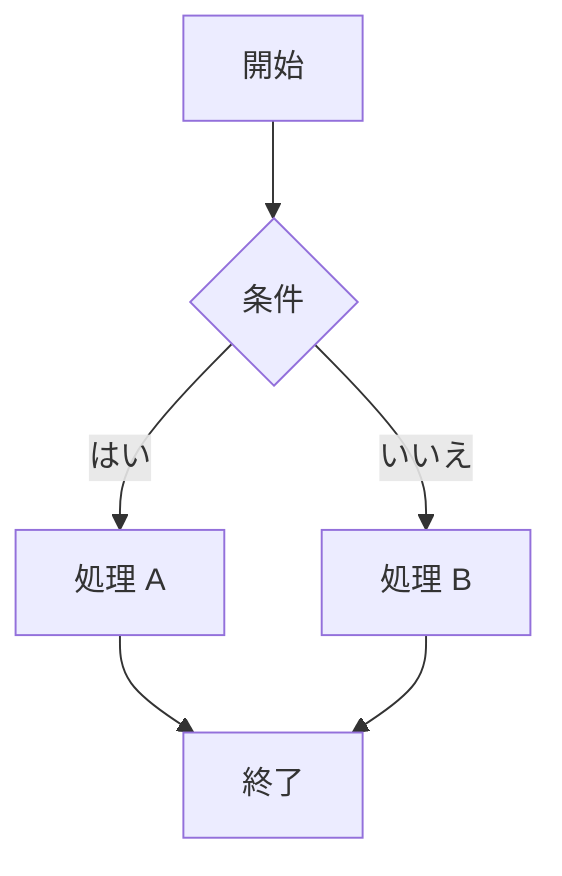
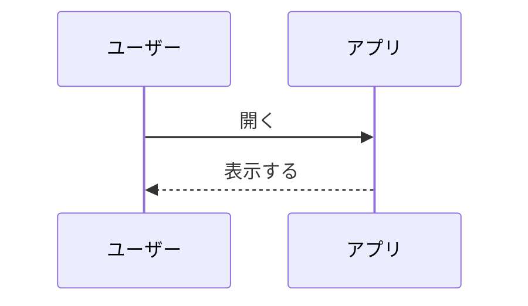

# AntiWebUI Markdown

これは **太字** と *斜体* と ~~取り消し~~ と `inline code` を含む段落です。[見出しへのリンク](#表) と [外へのリンク](https://example.com) もあります。:party: は絵文字です。

## リスト

- 一つ目
- 二つ目の **強調**
  - 入れ子の項目
    - さらに深く
- [x] 終わったタスク
- [ ] まだのタスク

1. 番号付き
2. リスト
3. です

> 引用です。複数行にわたる引用の中に `code` も書けます。
>
> 二つ目の段落。

> [!NOTE]
> GitHub のアラートです。

## 表

| 名前 | 説明 | 数 |
|:-----|:----:|---:|
| `rich_text` | 段落の中でスタイルを変える | 1 |
| `markdown_view` | Markdown を表示する | 2 |
| Mermaid | 図 | 10 |

## コード

```rust
fn main() {
    println!("Hello, AntiWebUI!");
}
```

## 図





---

脚注の例です[^1]。上付き^2^と下付き~x~。

[^1]: これが脚注です。
